# FEMB QC Criteria Report

## FEMB-IO 1826-1L Quality Control Analysis

**Analysis Date:** October 2026
**Board Version:** FEMB-IO 1826-1L
**Number of Boards Analyzed:** 44
**Analysis Method:** Statistical analysis using latest passing test per board

---

## Overview

This report documents the Quality Control (QC) criteria derived from 44 FEMB-IO 1826-1L boards that passed checkout testing at BNL. The criteria are established using statistical analysis with 3σ (99.7% coverage) and 5σ (99.99994% coverage) bounds.

### Statistical Methods

- **Mean:** Arithmetic average of all measurements
- **Std:** Standard deviation
- **Median:** Middle value (robust to outliers)
- **MAD:** Median Absolute Deviation (robust measure of spread)
- **3σ Bounds:** Mean ± 3×Std (99.7% of normal distribution) - shown in green
- **5σ Bounds:** Mean ± 5×Std (recommended pass/fail threshold) - shown in red

---

## 1. 128-Channel Parameters

These parameters are measured for all 128 channels on each FEMB board (5632 total data points = 44 boards × 128 channels).

### 1.1 Pedestal (ped)

**Description:** The baseline ADC value when no signal is present. Represents the DC offset of each channel's readout electronics.

| Statistic | Value |
|-----------|-------|
| Mean | 911.81 |
| Std | 104.80 |
| Median | 903.32 |
| MAD | 67.86 |
| 3σ Lower | 597.41 |
| 3σ Upper | 1226.20 |
| 5σ Lower | 387.81 |
| 5σ Upper | 1435.80 |

**Interpretation:** Pedestal values vary across channels due to manufacturing variations. Values outside 5σ bounds may indicate channel issues.

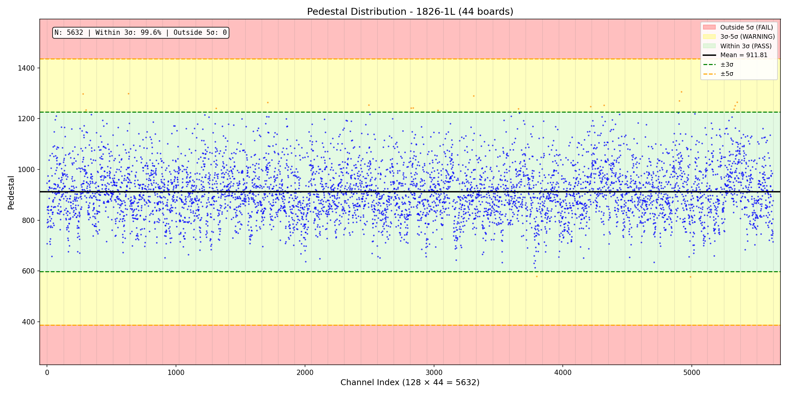

---

### 1.2 RMS Noise (rms)

**Description:** Root Mean Square of the baseline fluctuations. Measures the intrinsic electronic noise of each channel in ADC counts.

| Statistic | Value |
|-----------|-------|
| Mean | 11.20 |
| Std | 0.45 |
| Median | 11.19 |
| MAD | 0.30 |
| 3σ Lower | 9.83 |
| 3σ Upper | 12.56 |
| 5σ Lower | 8.93 |
| 5σ Upper | 13.47 |

**Interpretation:** Lower noise is better. High RMS indicates noisy channels that may affect signal quality. Typical good channels have RMS around 11 ADC counts.

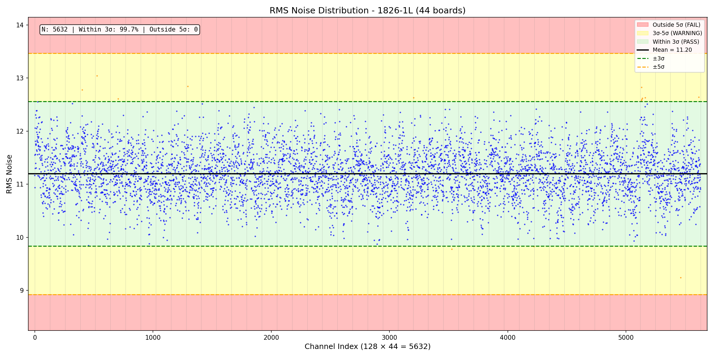

---

### 1.3 Positive Peak (PPK_mean)

**Description:** Mean ADC value of the positive pulse response when injecting a calibration pulse. Measures the channel gain for positive signals.

| Statistic | Value |
|-----------|-------|
| Mean | 12747.66 |
| Std | 94.28 |
| Median | 12749.00 |
| MAD | 64.00 |
| 3σ Lower | 12464.80 |
| 3σ Upper | 13030.51 |
| 5σ Lower | 12276.23 |
| 5σ Upper | 13219.08 |

**Interpretation:** Consistent PPK values across channels indicate uniform gain. Large deviations suggest gain calibration issues.

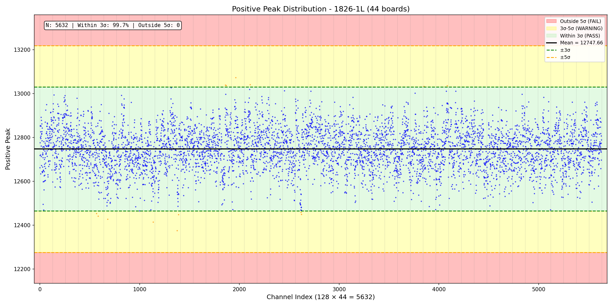

---

### 1.4 Negative Peak (NPK_mean)

**Description:** Mean ADC value of the negative pulse response. Measures the channel response to negative-going signals.

| Statistic | Value |
|-----------|-------|
| Mean | 4411.52 |
| Std | 85.62 |
| Median | 4411.00 |
| MAD | 57.00 |
| 3σ Lower | 4154.66 |
| 3σ Upper | 4668.39 |
| 5σ Lower | 3983.41 |
| 5σ Upper | 4839.64 |

**Interpretation:** NPK should be symmetric with PPK relative to baseline. Asymmetry may indicate amplifier nonlinearity.

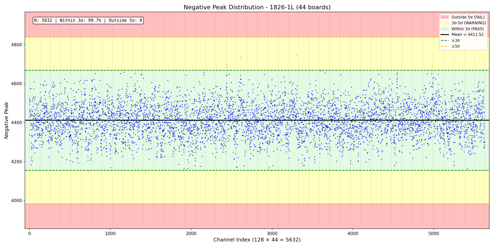

---

### 1.5 Baseline (BL_mean)

**Description:** Mean baseline level during pulse response measurement. Should be centered around mid-range ADC value.

| Statistic | Value |
|-----------|-------|
| Mean | 8579.72 |
| Std | 70.14 |
| Median | 8581.00 |
| MAD | 47.00 |
| 3σ Lower | 8369.29 |
| 3σ Upper | 8790.16 |
| 5σ Lower | 8229.00 |
| 5σ Upper | 8930.45 |

**Interpretation:** Baseline provides reference for pulse amplitude measurements. Stable baseline indicates good DC performance.

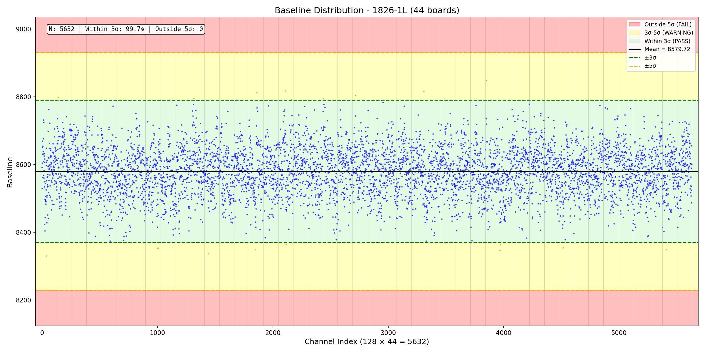

---

### 1.6 Pedestal Max (pedmax)

**Description:** Maximum pedestal value observed during the measurement window. Used to check for pedestal stability.

| Statistic | Value |
|-----------|-------|
| Mean | 949.49 |
| Std | 104.66 |
| Median | 941.00 |
| MAD | 68.00 |
| 3σ Lower | 635.51 |
| 3σ Upper | 1263.46 |
| 5σ Lower | 426.19 |
| 5σ Upper | 1472.78 |

**Interpretation:** Large difference between pedmax and pedmin indicates pedestal instability or excessive noise spikes.

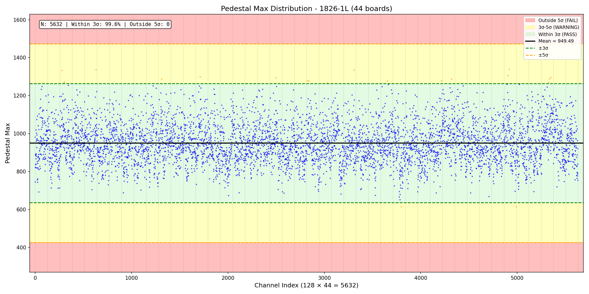

---

### 1.7 Pedestal Min (pedmin)

**Description:** Minimum pedestal value observed during the measurement window.

| Statistic | Value |
|-----------|-------|
| Mean | 874.16 |
| Std | 105.09 |
| Median | 865.00 |
| MAD | 68.00 |
| 3σ Lower | 558.90 |
| 3σ Upper | 1189.42 |
| 5σ Lower | 348.73 |
| 5σ Upper | 1399.60 |

**Interpretation:** Together with pedmax, defines the pedestal variation range. (pedmax - pedmin) should be small for stable channels.

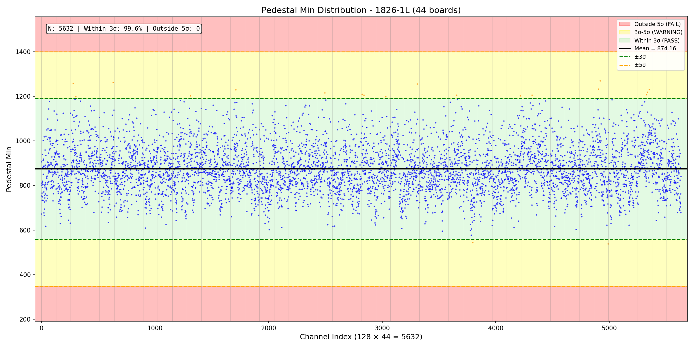

---

## 2. LDO Voltage Parameters (Pedestal Configuration)

Low Dropout (LDO) regulator output voltages measured during pedestal check. These monitor the on-board power regulation.

### 2.1 CDVDDA_ped

**Description:** COLDATA analog supply voltage (VDDA) during pedestal check. Powers the analog sections of the COLDATA ASIC.

| Statistic | Value |
|-----------|-------|
| Mean | 1185.16 |
| Std | 1.97 |
| 3σ Lower | 1179.26 |
| 3σ Upper | 1191.05 |
| 5σ Lower | 1175.33 |
| 5σ Upper | 1194.98 |

---

### 2.2 CDVDDIO_HALF_ped

**Description:** COLDATA I/O supply voltage (divided by 2 for ADC range). Powers the digital I/O of COLDATA.

| Statistic | Value |
|-----------|-------|
| Mean | 2231.48 |
| Std | 5.89 |
| 3σ Lower | 2213.79 |
| 3σ Upper | 2249.16 |
| 5σ Lower | 2202.00 |
| 5σ Upper | 2260.95 |

---

### 2.3 ADCRVDDD1P2_ped

**Description:** Right ColdADC digital 1.2V supply voltage. Powers the digital logic of the right-side ColdADC.

| Statistic | Value |
|-----------|-------|
| Mean | 1097.64 |
| Std | 1.96 |
| 3σ Lower | 1091.77 |
| 3σ Upper | 1103.50 |
| 5σ Lower | 1087.86 |
| 5σ Upper | 1107.41 |

---

### 2.4 ADCLVDDD1P2_ped

**Description:** Left ColdADC digital 1.2V supply voltage. Powers the digital logic of the left-side ColdADC.

| Statistic | Value |
|-----------|-------|
| Mean | 1097.55 |
| Std | 1.86 |
| 3σ Lower | 1091.95 |
| 3σ Upper | 1103.14 |
| 5σ Lower | 1088.22 |
| 5σ Upper | 1106.87 |

---

### 2.5 FERVDDP_ped

**Description:** Right LArASIC (FE) positive supply voltage during pedestal check. Powers the right-side front-end ASIC.

| Statistic | Value |
|-----------|-------|
| Mean | 1793.41 |
| Std | 2.97 |
| 3σ Lower | 1784.49 |
| 3σ Upper | 1802.33 |
| 5σ Lower | 1778.55 |
| 5σ Upper | 1808.27 |

---

### 2.6 FELVDDP_ped

**Description:** Left LArASIC (FE) positive supply voltage during pedestal check.

| Statistic | Value |
|-----------|-------|
| Mean | 1792.77 |
| Std | 3.26 |
| 3σ Lower | 1782.99 |
| 3σ Upper | 1802.55 |
| 5σ Lower | 1776.47 |
| 5σ Upper | 1809.07 |

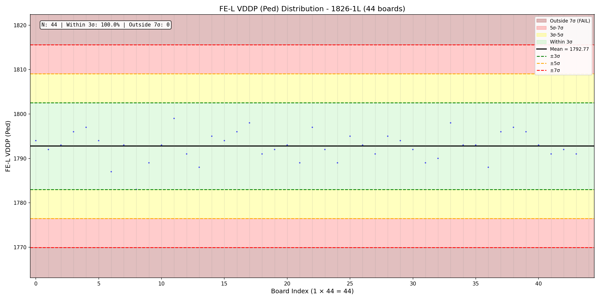

---

### 2.7 ADCRP25V_1_HALF_ped

**Description:** Right ColdADC 2.5V supply #1 (divided by 2). Analog reference voltage for right ADC.

| Statistic | Value |
|-----------|-------|
| Mean | 2252.57 |
| Std | 5.68 |
| 3σ Lower | 2235.52 |
| 3σ Upper | 2269.62 |
| 5σ Lower | 2224.16 |
| 5σ Upper | 2280.98 |

---

### 2.8 ADCLP25V_1_HALF_ped

**Description:** Left ColdADC 2.5V supply #1 (divided by 2).

| Statistic | Value |
|-----------|-------|
| Mean | 2250.52 |
| Std | 5.06 |
| 3σ Lower | 2235.35 |
| 3σ Upper | 2265.69 |
| 5σ Lower | 2225.24 |
| 5σ Upper | 2275.81 |

---

### 2.9 ADCRP25V_HALF_ped

**Description:** Right ColdADC 2.5V supply (divided by 2). Main 2.5V reference for right ADC.

| Statistic | Value |
|-----------|-------|
| Mean | 2251.84 |
| Std | 5.63 |
| 3σ Lower | 2234.96 |
| 3σ Upper | 2268.73 |
| 5σ Lower | 2223.70 |
| 5σ Upper | 2279.98 |

---

### 2.10 ADCLP25V_HALF_ped

**Description:** Left ColdADC 2.5V supply (divided by 2).

| Statistic | Value |
|-----------|-------|
| Mean | 2252.20 |
| Std | 5.28 |
| 3σ Lower | 2236.37 |
| 3σ Upper | 2268.03 |
| 5σ Lower | 2225.82 |
| 5σ Upper | 2278.59 |

---

### 2.11 GND_ped

**Description:** Ground reference measurement during pedestal check. Should be near zero.

| Statistic | Value |
|-----------|-------|
| Mean | 29.43 |
| Std | 2.66 |
| 3σ Lower | 21.46 |
| 3σ Upper | 37.41 |
| 5σ Lower | 16.14 |
| 5σ Upper | 42.72 |

**Interpretation:** Non-zero value represents ADC offset. Should be consistent across boards.

---

## 3. LDO Voltage Parameters (Pulse Configuration)

Same LDO measurements during pulse response check. Different operating conditions may show slight voltage shifts.

### 3.1 CDVDDA_pulse

**Description:** COLDATA analog supply voltage during pulse check.

| Statistic | Value |
|-----------|-------|
| Mean | 1185.16 |
| Std | 1.86 |
| 5σ Lower | 1175.87 |
| 5σ Upper | 1194.45 |

---

### 3.2 CDVDDIO_HALF_pulse

| Statistic | Value |
|-----------|-------|
| Mean | 2232.05 |
| Std | 5.40 |
| 5σ Lower | 2205.04 |
| 5σ Upper | 2259.05 |

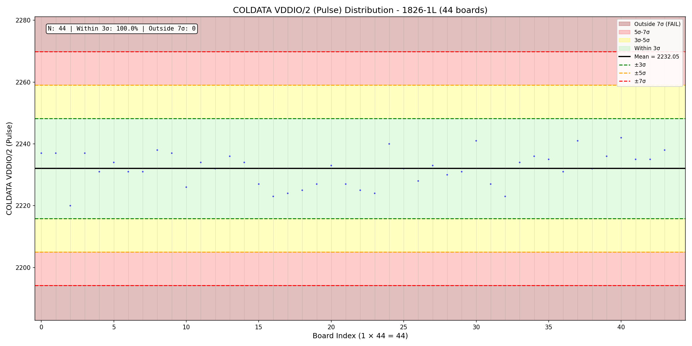

---

### 3.3 ADCRVDDD1P2_pulse

| Statistic | Value |
|-----------|-------|
| Mean | 1097.84 |
| Std | 1.72 |
| 5σ Lower | 1089.25 |
| 5σ Upper | 1106.43 |

---

### 3.4 ADCLVDDD1P2_pulse

| Statistic | Value |
|-----------|-------|
| Mean | 1097.73 |
| Std | 1.76 |
| 5σ Lower | 1088.91 |
| 5σ Upper | 1106.54 |

---

### 3.5 FERVDDP_pulse

| Statistic | Value |
|-----------|-------|
| Mean | 1665.48 |
| Std | 2.42 |
| 5σ Lower | 1653.39 |
| 5σ Upper | 1677.56 |

**Note:** FERVDDP is lower during pulse than pedestal due to increased current draw.

---

### 3.6 FELVDDP_pulse

| Statistic | Value |
|-----------|-------|
| Mean | 1665.11 |
| Std | 2.77 |
| 5σ Lower | 1651.25 |
| 5σ Upper | 1678.98 |

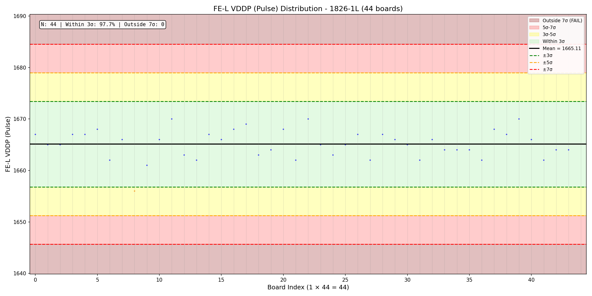

---

### 3.7 ADCRP25V_1_HALF_pulse

| Statistic | Value |
|-----------|-------|
| Mean | 2252.95 |
| Std | 5.61 |
| 5σ Lower | 2224.91 |
| 5σ Upper | 2281.00 |

---

### 3.8 ADCLP25V_1_HALF_pulse

| Statistic | Value |
|-----------|-------|
| Mean | 2250.61 |
| Std | 4.86 |
| 5σ Lower | 2226.32 |
| 5σ Upper | 2274.90 |

---

### 3.9 ADCRP25V_HALF_pulse

| Statistic | Value |
|-----------|-------|
| Mean | 2252.11 |
| Std | 5.28 |
| 5σ Lower | 2225.69 |
| 5σ Upper | 2278.53 |

---

### 3.10 ADCLP25V_HALF_pulse

| Statistic | Value |
|-----------|-------|
| Mean | 2251.91 |
| Std | 4.98 |
| 5σ Lower | 2227.03 |
| 5σ Upper | 2276.79 |

---

### 3.11 GND_pulse

| Statistic | Value |
|-----------|-------|
| Mean | 33.25 |
| Std | 2.88 |
| 5σ Lower | 18.86 |
| 5σ Upper | 47.64 |

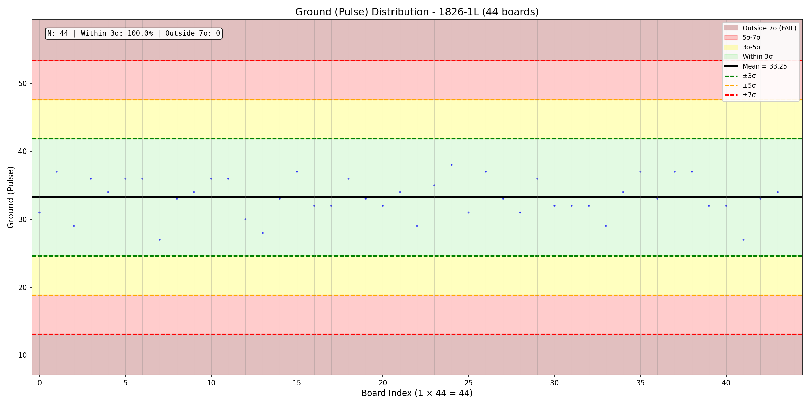

---

## 4. Current Measurements

Board-level current consumption for each power rail, measured at different operating configurations.

### 4.1 I_LArASIC (Pedestal)

**Description:** LArASIC front-end ASIC current during pedestal measurement. Lower power state.

| Statistic | Value (A) |
|-----------|-----------|
| Mean | 0.4226 |
| Std | 0.0030 |
| 5σ Lower | 0.4075 |
| 5σ Upper | 0.4378 |

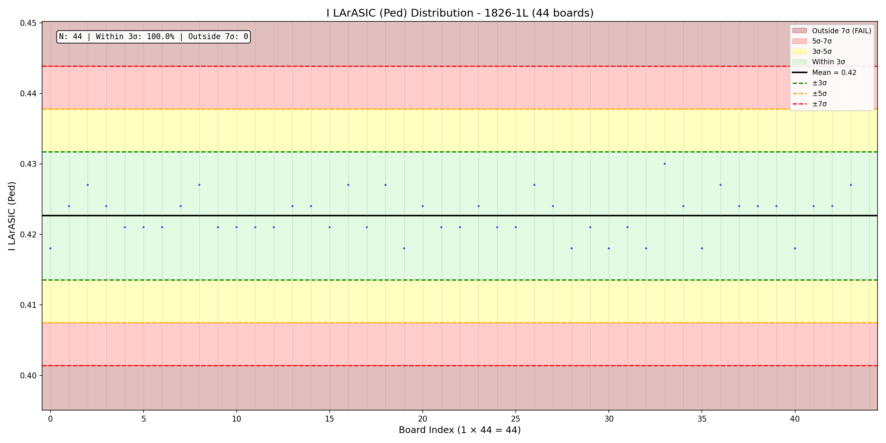

---

### 4.2 I_LArASIC (Pulse)

**Description:** LArASIC current during pulse response. Higher due to active pulsing.

| Statistic | Value (A) |
|-----------|-----------|
| Mean | 0.6739 |
| Std | 0.0051 |
| 5σ Lower | 0.6484 |
| 5σ Upper | 0.6994 |

---

### 4.3 I_ColdDATA (Pedestal)

**Description:** COLDATA serializer ASIC current during pedestal check.

| Statistic | Value (A) |
|-----------|-----------|
| Mean | 0.2319 |
| Std | 0.0071 |
| 5σ Lower | 0.1964 |
| 5σ Upper | 0.2674 |

---

### 4.4 I_ColdDATA (Pulse)

**Description:** COLDATA current during pulse response.

| Statistic | Value (A) |
|-----------|-----------|
| Mean | 0.2339 |
| Std | 0.0069 |
| 5σ Lower | 0.1996 |
| 5σ Upper | 0.2683 |

---

### 4.5 I_ColdADC (Pedestal)

**Description:** ColdADC digitizer current during pedestal check.

| Statistic | Value (A) |
|-----------|-----------|
| Mean | 1.5979 |
| Std | 0.0345 |
| 5σ Lower | 1.4255 |
| 5σ Upper | 1.7703 |

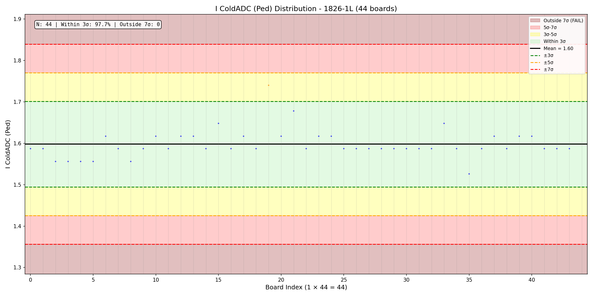

---

### 4.6 I_ColdADC (Pulse)

**Description:** ColdADC current during pulse response.

| Statistic | Value (A) |
|-----------|-----------|
| Mean | 1.6006 |
| Std | 0.0301 |
| 5σ Lower | 1.4502 |
| 5σ Upper | 1.7510 |

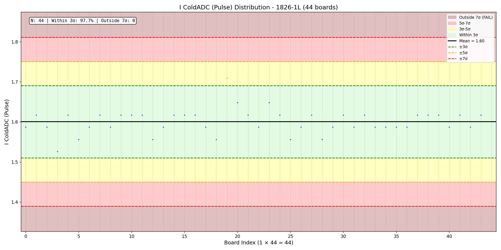

---

## 5. Power Measurements

### 5.1 Total Power (Pedestal)

**Description:** Total board power consumption during pedestal check configuration.

| Statistic | Value (W) |
|-----------|-----------|
| Mean | 7.4095 |
| Std | 0.1233 |
| 5σ Lower | 6.7927 |
| 5σ Upper | 8.0262 |

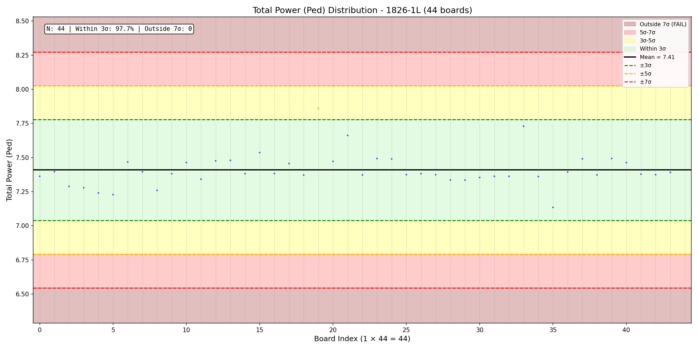

---

### 5.2 Total Power (Pulse)

**Description:** Total board power consumption during pulse response configuration.

| Statistic | Value (W) |
|-----------|-----------|
| Mean | 8.1342 |
| Std | 0.1066 |
| 5σ Lower | 7.6011 |
| 5σ Upper | 8.6674 |

**Interpretation:** Pulse configuration draws ~0.7W more than pedestal due to active signal processing.

---

## 6. ASIC-Level Parameters (8-Chip)

These parameters are measured per ASIC chip (8 chips per board, 352 total data points = 44 boards × 8 chips).

### 6.1 FE Temperature (FE T)

**Description:** LArASIC temperature sensor reading in ADC counts. Higher values indicate higher temperature.

| Statistic | Value |
|-----------|-------|
| Mean | 902.32 |
| Std | 6.40 |
| 5σ Lower | 870.33 |
| 5σ Upper | 934.31 |

**Interpretation:** Temperature should be consistent across chips and boards at room temperature testing.

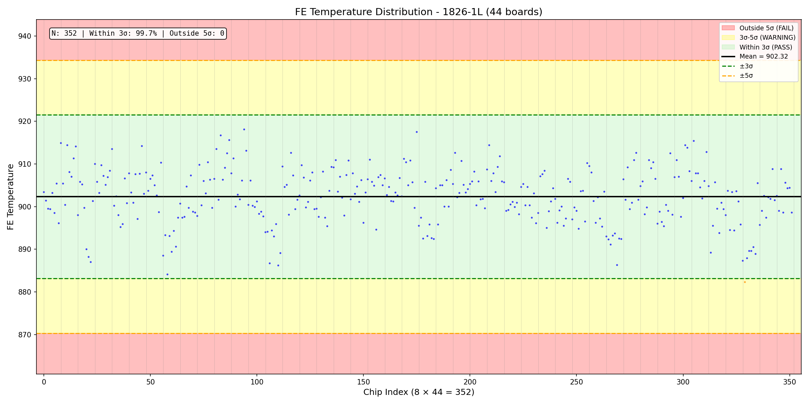

---

### 6.2 FE Bandgap (FE BGP)

**Description:** LArASIC bandgap reference voltage in ADC counts. Critical for stable operation.

| Statistic | Value |
|-----------|-------|
| Mean | 1207.54 |
| Std | 3.41 |
| 5σ Lower | 1190.48 |
| 5σ Upper | 1224.61 |

**Interpretation:** Bandgap provides voltage reference for the ASIC. Should be very stable.

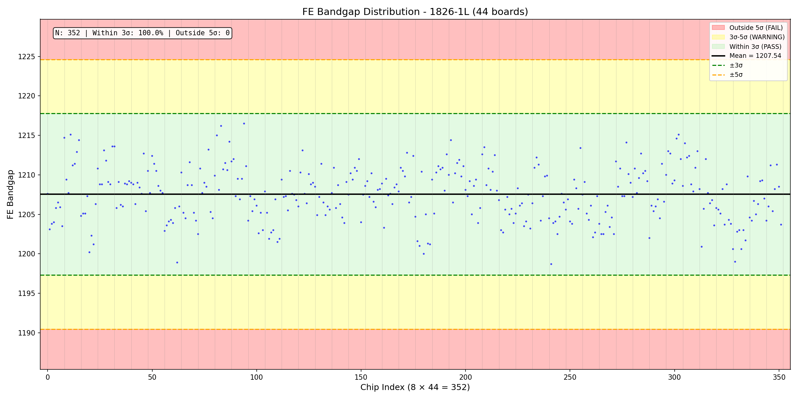

---

### 6.3 ADC VCMI

**Description:** ColdADC common-mode input voltage reference.

| Statistic | Value |
|-----------|-------|
| Mean | 937.28 |
| Std | 3.15 |
| 5σ Lower | 921.54 |
| 5σ Upper | 953.01 |

---

### 6.4 ADC VCMO

**Description:** ColdADC common-mode output voltage reference.

| Statistic | Value |
|-----------|-------|
| Mean | 1224.49 |
| Std | 3.40 |
| 5σ Lower | 1207.50 |
| 5σ Upper | 1241.49 |

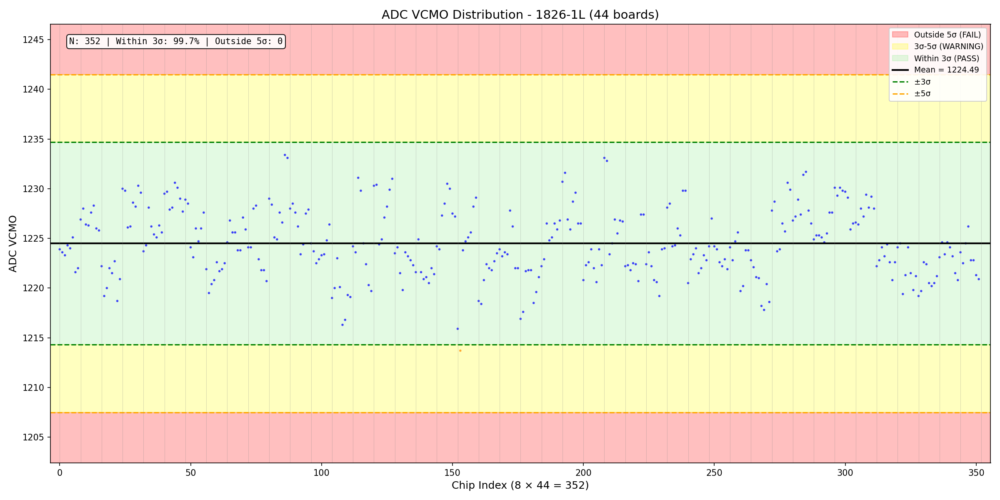

---

### 6.5 ADC VREFP

**Description:** ColdADC positive reference voltage. Sets the upper limit of ADC range.

| Statistic | Value |
|-----------|-------|
| Mean | 1942.31 |
| Std | 4.65 |
| 5σ Lower | 1919.07 |
| 5σ Upper | 1965.55 |

---

### 6.6 ADC VREFN

**Description:** ColdADC negative reference voltage. Sets the lower limit of ADC range.

| Statistic | Value |
|-----------|-------|
| Mean | 501.52 |
| Std | 2.97 |
| 5σ Lower | 486.68 |
| 5σ Upper | 516.36 |

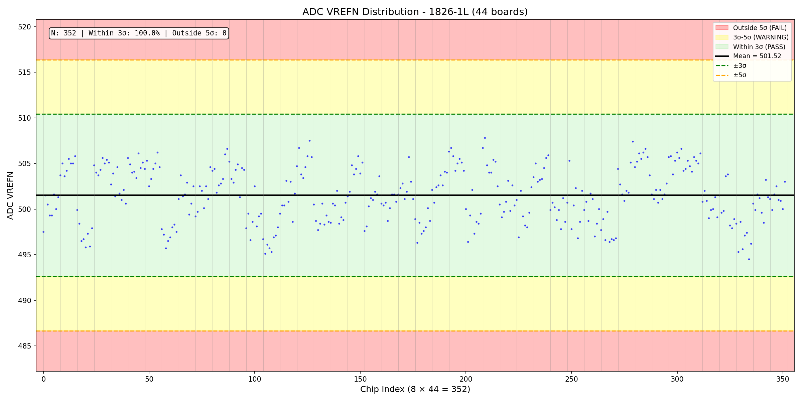

---

### 6.7 VSSA

**Description:** Analog ground reference voltage. Should be near zero.

| Statistic | Value |
|-----------|-------|
| Mean | 67.43 |
| Std | 3.06 |
| 5σ Lower | 52.15 |
| 5σ Upper | 82.72 |

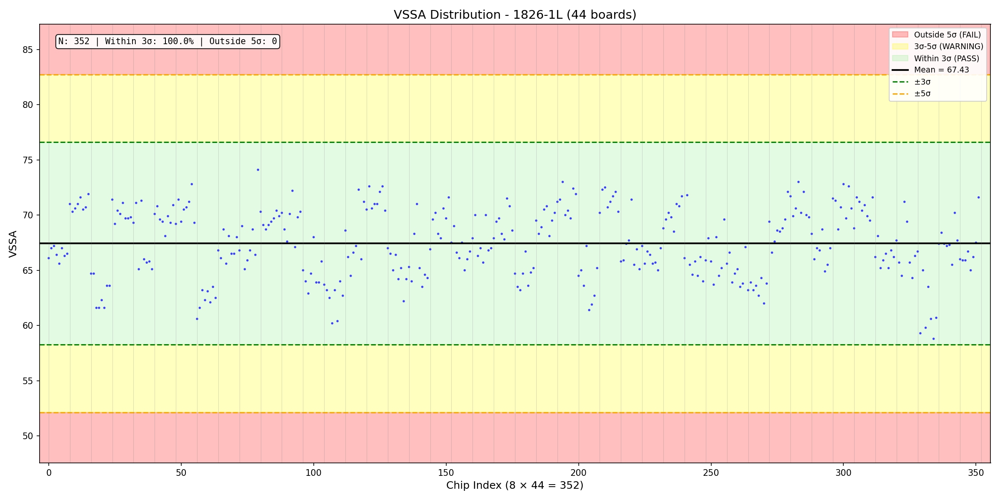

---

## Appendix A: Pass/Fail Criteria Summary

For QC purposes, use the **5σ bounds** as pass/fail thresholds:

| Parameter | 5σ Lower | 5σ Upper | Unit |
|-----------|----------|----------|------|
| ped | 387.81 | 1435.80 | ADC |
| rms | 8.93 | 13.47 | ADC |
| PPK_mean | 12276.23 | 13219.08 | ADC |
| NPK_mean | 3983.41 | 4839.64 | ADC |
| BL_mean | 8229.00 | 8930.45 | ADC |
| Total Power (Pulse) | 7.60 | 8.67 | W |
| I_LArASIC (Pulse) | 0.648 | 0.699 | A |
| I_ColdADC (Pulse) | 1.450 | 1.751 | A |

---

## Appendix B: Board List

44 boards were used in this analysis (latest passing test only):

See `good_boards_list.txt` for the complete list of board serial numbers.

---

## Appendix C: Excluded Boards

- **Board 00046:** Manually excluded (known bad board)
- Boards with only failed tests were automatically excluded

---

*Report generated from QC checkout data analysis*
*BNL Cold Electronics Testing Facility*
