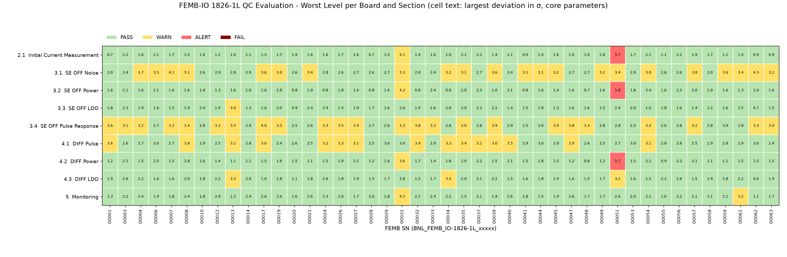

# FEMB QC Parameter Evaluation - Summary

**Board version:** FEMB-IO 1826-1L  
**Boards evaluated:** 44 (latest passing test per board; excluded: 00046)  
**Sections:** 9  
**Generated:** 2026-10-16 16:38  
**Script:** `summary.py` (`--rerun` regenerates every section first)

## 1. Judgement Schemes

| Scheme | Used for | PASS | WARN | ALERT | FAIL |
|---|---|---|---|---|---|
| 7σ | Board-level power, current and LDO readings (2.1, 3.2, 3.3, 4.2, 4.3) | ≤ 3σ | 3σ – 5σ | 5σ – 7σ | > 7σ |
| 5σ | Channel-level noise / pulse (3.1, 3.4, 4.1) and per-ASIC monitoring (5) | ≤ 3σ | 3σ – 5σ | – | > 5σ |

A board's level in a section is the worst level over the section's core parameters (auxiliary parameters such as BIAS are listed but not counted). The overall level is the worst over all sections.

## 2. Overall Result

| Overall level | Boards |
|---|---|
| PASS | 9 |
| WARN | 34 |
| ALERT | 1 |
| FAIL | 0 |

**Boards at ALERT / FAIL:** BNL_FEMB_IO-1826-1L_00051

## 3. Sections

| Section | Title | Scheme | Core params | PASS | WARN | ALERT | FAIL | Report |
|---|---|---|---|---|---|---|---|---|
| 2.1 | Initial Current Measurement | 7σ | 7 | 42 | 1 | 1 | 0 | [Report_2_1_Initial_Power.md](sec2_1_initial_power/Report_2_1_Initial_Power.md) |
| 3.1 | SE OFF Noise | 5σ | 2 | 22 | 22 | – | 0 | [Report_3_1_SE_OFF_Noise.md](sec3_1_se_off_noise/Report_3_1_SE_OFF_Noise.md) |
| 3.2 | SE OFF Power | 7σ | 7 | 42 | 1 | 1 | 0 | [Report_3_2_SE_OFF_Power.md](sec3_2_se_off_power/Report_3_2_SE_OFF_Power.md) |
| 3.3 | SE OFF LDO | 7σ | 11 | 43 | 1 | 0 | 0 | [Report_3_3_SE_OFF_LDO.md](sec3_3_se_off_ldo/Report_3_3_SE_OFF_LDO.md) |
| 3.4 | SE OFF Pulse Response | 5σ | 3 | 20 | 24 | – | 0 | [Report_3_4_SE_OFF_Pulse.md](sec3_4_se_off_pulse/Report_3_4_SE_OFF_Pulse.md) |
| 4.1 | DIFF Pulse | 5σ | 3 | 29 | 15 | – | 0 | [Report_4_1_DIFF_Pulse.md](sec4_1_diff_pulse/Report_4_1_DIFF_Pulse.md) |
| 4.2 | DIFF Power | 7σ | 7 | 42 | 1 | 1 | 0 | [Report_4_2_DIFF_Power.md](sec4_2_diff_power/Report_4_2_DIFF_Power.md) |
| 4.3 | DIFF LDO | 7σ | 11 | 41 | 3 | 0 | 0 | [Report_4_3_DIFF_LDO.md](sec4_3_diff_ldo/Report_4_3_DIFF_LDO.md) |
| 5 | Monitoring | 5σ | 7 | 42 | 2 | – | 0 | [Report_5_Monitoring.md](sec5_monitoring/Report_5_Monitoring.md) |

## 4. Board × Section Overview

## 5. Boards Requiring Attention

Isolated WARN channels are expected by chance (≈ 15 per channel-level parameter over all boards), so a board is listed here only if at least one of these holds:

- **ALERT / FAIL** in any section;
- **repeated**: the same parameter at the same location (board-level reading, channel or chip) is flagged in more than one section (e.g. 2.1 / 3.2 / 4.2, or SE 3.4 and DIFF 4.1);
- **chip cluster**: ≥ 4 flagged items on one ASIC within one section.

### BNL_FEMB_IO-1826-1L_00051 – overall **ALERT**

Reason: ALERT; repeated: `I_ColdDATA` board

| Section | Parameter | Where | Value | Deviation | Level |
|---|---|---|---|---|---|
| 2.1 | `I_ColdDATA` | board | 0.275 A | 5.7σ | **ALERT** |
| 3.1 | `rms` | ch36 (chip 2) | 12.73 | 3.4σ | WARN |
| 3.2 | `I_ColdDATA` | board | 0.275 A | 5.8σ | **ALERT** |
| 4.2 | `I_ColdDATA` | board | 0.275 A | 5.7σ | **ALERT** |
| 4.3 | `CDVDDA` | board | 1179 mV | 3.2σ | WARN |

### BNL_FEMB_IO-1826-1L_00032 – overall **WARN**

Reason: repeated: `NPK_mean` ch56, `PPK_mean` ch58, `PPK_mean` ch63; chip cluster: 3.4 chip 3 (4), 4.1 chip 3 (7)

| Section | Parameter | Where | Value | Deviation | Level |
|---|---|---|---|---|---|
| 3.4 | `NPK_mean` | ch48 (chip 3) | 4739.00 | 3.8σ | WARN |
| 3.4 | `NPK_mean` | ch56 (chip 3) | 4730.00 | 3.7σ | WARN |
| 3.4 | `PPK_mean` | ch63 (chip 3) | 12449.00 | 3.2σ | WARN |
| 3.4 | `PPK_mean` | ch58 (chip 3) | 12458.00 | 3.1σ | WARN |
| 4.1 | `PPK_mean` | ch58 (chip 3) | 12696.50 | 3.9σ | WARN |
| 4.1 | `PPK_mean` | ch55 (chip 3) | 12718.50 | 3.5σ | WARN |
| 4.1 | `NPK_mean` | ch56 (chip 3) | 4637.50 | 3.4σ | WARN |
| 4.1 | `PPK_mean` | ch52 (chip 3) | 12743.75 | 3.2σ | WARN |
| 4.1 | `PPK_mean` | ch48 (chip 3) | 12755.00 | 3.1σ | WARN |
| 4.1 | `PPK_mean` | ch49 (chip 3) | 12755.50 | 3.0σ | WARN |
| 4.1 | `PPK_mean` | ch63 (chip 3) | 12757.50 | 3.0σ | WARN |

### BNL_FEMB_IO-1826-1L_00008 – overall **WARN**

Reason: repeated: `PPK_mean` ch40; chip cluster: 4.1 chip 2 (6)

| Section | Parameter | Where | Value | Deviation | Level |
|---|---|---|---|---|---|
| 3.1 | `rms` | ch66 (chip 4) | 12.61 | 3.1σ | WARN |
| 3.4 | `PPK_mean` | ch40 (chip 2) | 12427.00 | 3.4σ | WARN |
| 3.4 | `NPK_mean` | ch86 (chip 5) | 4145.00 | 3.1σ | WARN |
| 4.1 | `PPK_mean` | ch40 (chip 2) | 12700.75 | 3.8σ | WARN |
| 4.1 | `PPK_mean` | ch33 (chip 2) | 12729.00 | 3.4σ | WARN |
| 4.1 | `BL_mean` | ch49 (chip 3) | 8571.13 | 3.4σ | WARN |
| 4.1 | `PPK_mean` | ch34 (chip 2) | 12737.00 | 3.3σ | WARN |
| 4.1 | `PPK_mean` | ch43 (chip 2) | 12738.00 | 3.3σ | WARN |
| 4.1 | `PPK_mean` | ch39 (chip 2) | 12741.75 | 3.2σ | WARN |
| 4.1 | `PPK_mean` | ch41 (chip 2) | 12756.00 | 3.0σ | WARN |

### BNL_FEMB_IO-1826-1L_00031 – overall **WARN**

Reason: repeated: `I_ColdADC` board, `Total_Power` board

| Section | Parameter | Where | Value | Deviation | Level |
|---|---|---|---|---|---|
| 2.1 | `Total_Power` | board | 7.915 W | 4.1σ | WARN |
| 2.1 | `I_ColdADC` | board | 1.74 A | 4.1σ | WARN |
| 3.1 | `ped` | ch64 (chip 4) | 1253.36 | 3.3σ | WARN |
| 3.2 | `I_ColdADC` | board | 1.74 A | 4.2σ | WARN |
| 3.2 | `Total_Power` | board | 7.862 W | 4.1σ | WARN |
| 3.4 | `NPK_mean` | ch8 (chip 0) | 4697.00 | 3.3σ | WARN |
| 3.4 | `NPK_mean` | ch5 (chip 0) | 4682.00 | 3.2σ | WARN |
| 3.4 | `BL_mean` | ch5 (chip 0) | 8794.00 | 3.1σ | WARN |
| 4.2 | `I_ColdADC` | board | 1.709 A | 3.6σ | WARN |
| 4.2 | `Total_Power` | board | 8.463 W | 3.1σ | WARN |
| 5 | `ADC_VREFP` | chip1 | 1922.80 | 4.2σ | WARN |
| 5 | `ADC_VCMO` | chip1 | 1213.70 | 3.1σ | WARN |

### BNL_FEMB_IO-1826-1L_00017 – overall **WARN**

Reason: repeated: `PPK_mean` ch110

| Section | Parameter | Where | Value | Deviation | Level |
|---|---|---|---|---|---|
| 3.1 | `rms` | ch15 (chip 0) | 12.84 | 3.6σ | WARN |
| 3.1 | `ped` | ch32 (chip 2) | 1240.36 | 3.1σ | WARN |
| 3.4 | `PPK_mean` | ch96 (chip 6) | 12375.00 | 4.0σ | WARN |
| 3.4 | `PPK_mean` | ch110 (chip 6) | 12448.00 | 3.2σ | WARN |
| 3.4 | `BL_mean` | ch36 (chip 2) | 8795.00 | 3.1σ | WARN |
| 3.4 | `NPK_mean` | ch107 (chip 6) | 4672.00 | 3.0σ | WARN |
| 4.1 | `PPK_mean` | ch110 (chip 6) | 12758.50 | 3.0σ | WARN |

### BNL_FEMB_IO-1826-1L_00024 – overall **WARN**

Reason: repeated: `PPK_mean` ch68

| Section | Parameter | Where | Value | Deviation | Level |
|---|---|---|---|---|---|
| 3.4 | `BL_mean` | ch68 (chip 4) | 8812.00 | 3.3σ | WARN |
| 3.4 | `BL_mean` | ch57 (chip 3) | 8349.00 | 3.3σ | WARN |
| 3.4 | `PPK_mean` | ch68 (chip 4) | 13039.00 | 3.1σ | WARN |
| 3.4 | `PPK_mean` | ch76 (chip 4) | 13037.00 | 3.1σ | WARN |
| 4.1 | `NPK_mean` | ch40 (chip 2) | 4624.50 | 3.2σ | WARN |
| 4.1 | `PPK_mean` | ch68 (chip 4) | 13211.75 | 3.1σ | WARN |

### BNL_FEMB_IO-1826-1L_00001 – overall **WARN**

Reason: repeated: `BL_mean` ch38

| Section | Parameter | Where | Value | Deviation | Level |
|---|---|---|---|---|---|
| 3.4 | `BL_mean` | ch38 (chip 2) | 8330.00 | 3.6σ | WARN |
| 4.1 | `BL_mean` | ch38 (chip 2) | 8559.92 | 3.6σ | WARN |
| 4.1 | `BL_mean` | ch49 (chip 3) | 8569.29 | 3.4σ | WARN |
| 4.1 | `PPK_mean` | ch38 (chip 2) | 12742.00 | 3.2σ | WARN |

### BNL_FEMB_IO-1826-1L_00013 – overall **WARN**

Reason: repeated: `FELVDDP` board

| Section | Parameter | Where | Value | Deviation | Level |
|---|---|---|---|---|---|
| 3.3 | `FELVDDP` | board | 1783 mV | 3.0σ | WARN |
| 3.4 | `PPK_mean` | ch112 (chip 7) | 12414.00 | 3.5σ | WARN |
| 4.1 | `PPK_mean` | ch88 (chip 5) | 12752.50 | 3.1σ | WARN |
| 4.3 | `FELVDDP` | board | 1656 mV | 3.3σ | WARN |

### BNL_FEMB_IO-1826-1L_00047 – overall **WARN**

Reason: repeated: `BL_mean` ch11

| Section | Parameter | Where | Value | Deviation | Level |
|---|---|---|---|---|---|
| 3.4 | `BL_mean` | ch11 (chip 0) | 8848.00 | 3.8σ | WARN |
| 3.4 | `PPK_mean` | ch11 (chip 0) | 13033.00 | 3.0σ | WARN |
| 4.1 | `BL_mean` | ch11 (chip 0) | 8977.40 | 3.9σ | WARN |

## 6. Per-Board Matrix

Cell: section level (largest core-parameter deviation).

| FEMB SN | 2.1 | 3.1 | 3.2 | 3.3 | 3.4 | 4.1 | 4.2 | 4.3 | 5 | Overall |
|---|---|---|---|---|---|---|---|---|---|---|
| 00001 | PASS | PASS | PASS | PASS | WARN (3.6σ) | WARN (3.6σ) | PASS | PASS | PASS | WARN |
| 00003 | PASS | PASS | PASS | PASS | WARN (3.1σ) | PASS | PASS | PASS | PASS | WARN |
| 00004 | PASS | WARN (3.7σ) | PASS | PASS | WARN (3.2σ) | PASS | PASS | PASS | PASS | WARN |
| 00006 | PASS | WARN (3.5σ) | PASS | PASS | PASS | PASS | PASS | PASS | PASS | WARN |
| 00007 | PASS | WARN (4.1σ) | PASS | PASS | WARN (3.2σ) | PASS | PASS | PASS | PASS | WARN |
| 00008 | PASS | WARN (3.1σ) | PASS | PASS | WARN (3.4σ) | WARN (3.8σ) | PASS | PASS | PASS | WARN |
| 00010 | PASS | PASS | PASS | PASS | PASS | PASS | PASS | PASS | PASS | PASS |
| 00012 | PASS | PASS | PASS | PASS | WARN (3.2σ) | PASS | PASS | PASS | PASS | WARN |
| 00013 | PASS | PASS | PASS | WARN (3.0σ) | WARN (3.5σ) | WARN (3.1σ) | PASS | WARN (3.3σ) | PASS | WARN |
| 00014 | PASS | PASS | PASS | PASS | PASS | PASS | PASS | PASS | PASS | PASS |
| 00017 | PASS | WARN (3.6σ) | PASS | PASS | WARN (4.0σ) | WARN (3.0σ) | PASS | PASS | PASS | WARN |
| 00019 | PASS | WARN (3.0σ) | PASS | PASS | WARN (3.5σ) | PASS | PASS | PASS | PASS | WARN |
| 00020 | PASS | PASS | PASS | PASS | PASS | PASS | PASS | PASS | PASS | PASS |
| 00021 | PASS | WARN (3.4σ) | PASS | PASS | PASS | PASS | PASS | PASS | PASS | WARN |
| 00024 | PASS | PASS | PASS | PASS | WARN (3.3σ) | WARN (3.2σ) | PASS | PASS | PASS | WARN |
| 00026 | PASS | PASS | PASS | PASS | WARN (3.5σ) | WARN (3.3σ) | PASS | PASS | PASS | WARN |
| 00027 | PASS | PASS | PASS | PASS | WARN (3.4σ) | WARN (3.1σ) | PASS | PASS | PASS | WARN |
| 00028 | PASS | PASS | PASS | PASS | PASS | PASS | PASS | PASS | PASS | PASS |
| 00029 | PASS | PASS | PASS | PASS | PASS | PASS | PASS | PASS | PASS | PASS |
| 00031 | WARN (4.1σ) | WARN (3.3σ) | WARN (4.2σ) | PASS | WARN (3.3σ) | PASS | WARN (3.6σ) | PASS | WARN (4.2σ) | WARN |
| 00032 | PASS | PASS | PASS | PASS | WARN (3.8σ) | WARN (3.9σ) | PASS | PASS | PASS | WARN |
| 00033 | PASS | PASS | PASS | PASS | WARN (3.2σ) | PASS | PASS | PASS | PASS | WARN |
| 00034 | PASS | WARN (3.2σ) | PASS | PASS | PASS | WARN (3.3σ) | PASS | WARN (3.5σ) | PASS | WARN |
| 00035 | PASS | WARN (3.1σ) | PASS | PASS | WARN (3.0σ) | WARN (3.4σ) | PASS | PASS | PASS | WARN |
| 00037 | PASS | PASS | PASS | PASS | PASS | WARN (3.1σ) | PASS | PASS | PASS | WARN |
| 00039 | PASS | WARN (3.6σ) | PASS | PASS | WARN (3.9σ) | WARN (3.0σ) | PASS | PASS | PASS | WARN |
| 00040 | PASS | PASS | PASS | PASS | PASS | WARN (3.5σ) | PASS | PASS | PASS | WARN |
| 00041 | PASS | WARN (3.1σ) | PASS | PASS | PASS | PASS | PASS | PASS | PASS | WARN |
| 00044 | PASS | WARN (3.1σ) | PASS | PASS | PASS | PASS | PASS | PASS | PASS | WARN |
| 00045 | PASS | WARN (3.2σ) | PASS | PASS | WARN (3.0σ) | PASS | PASS | PASS | PASS | WARN |
| 00047 | PASS | PASS | PASS | PASS | WARN (3.8σ) | WARN (3.9σ) | PASS | PASS | PASS | WARN |
| 00048 | PASS | PASS | PASS | PASS | WARN (3.3σ) | PASS | PASS | PASS | PASS | WARN |
| 00049 | PASS | WARN (3.2σ) | PASS | PASS | PASS | PASS | PASS | PASS | PASS | WARN |
| 00051 | **ALERT (5.7σ)** | WARN (3.4σ) | **ALERT (5.8σ)** | PASS | PASS | PASS | **ALERT (5.7σ)** | WARN (3.2σ) | PASS | **ALERT** |
| 00053 | PASS | PASS | PASS | PASS | PASS | PASS | PASS | PASS | PASS | PASS |
| 00054 | PASS | WARN (3.0σ) | PASS | PASS | WARN (3.2σ) | WARN (3.1σ) | PASS | PASS | PASS | WARN |
| 00055 | PASS | PASS | PASS | PASS | PASS | PASS | PASS | PASS | PASS | PASS |
| 00056 | PASS | PASS | PASS | PASS | PASS | PASS | PASS | PASS | PASS | PASS |
| 00057 | PASS | WARN (3.8σ) | PASS | PASS | WARN (3.2σ) | PASS | PASS | PASS | PASS | WARN |
| 00058 | PASS | PASS | PASS | PASS | PASS | PASS | PASS | PASS | PASS | PASS |
| 00059 | PASS | WARN (3.6σ) | PASS | PASS | PASS | PASS | PASS | PASS | PASS | WARN |
| 00061 | PASS | WARN (3.4σ) | PASS | PASS | PASS | PASS | PASS | PASS | WARN (3.2σ) | WARN |
| 00062 | PASS | WARN (4.3σ) | PASS | PASS | WARN (3.3σ) | PASS | PASS | PASS | PASS | WARN |
| 00063 | PASS | WARN (3.2σ) | PASS | PASS | WARN (3.0σ) | PASS | PASS | PASS | PASS | WARN |

## 7. All Flagged Items

136 items beyond 3σ across all sections (`aux` = auxiliary parameter, not counted in the board level).

| FEMB SN | Section | Parameter | Where | Value | Deviation | Level |
|---|---|---|---|---|---|---|
| 00001 | 3.4 | `BL_mean` | ch38 (chip 2) | 8330.00 | 3.6σ | WARN |
| 00001 | 4.1 | `BL_mean` | ch38 (chip 2) | 8559.92 | 3.6σ | WARN |
| 00001 | 4.1 | `BL_mean` | ch49 (chip 3) | 8569.29 | 3.4σ | WARN |
| 00001 | 4.1 | `PPK_mean` | ch38 (chip 2) | 12742.00 | 3.2σ | WARN |
| 00003 | 3.4 | `BL_mean` | ch13 (chip 0) | 8798.00 | 3.1σ | WARN |
| 00004 | 3.1 | `ped` | ch24 (chip 1) | 1297.25 | 3.7σ | WARN |
| 00004 | 3.1 | `ped` | ch47 (chip 2) | 1233.97 | 3.1σ | WARN |
| 00004 | 3.1 | `ped` | ch40 (chip 2) | 1226.81 | 3.0σ | WARN |
| 00004 | 3.4 | `NPK_mean` | ch47 (chip 2) | 4686.00 | 3.2σ | WARN |
| 00006 | 3.1 | `rms` | ch18 (chip 1) | 12.78 | 3.5σ | WARN |
| 00007 | 3.1 | `rms` | ch15 (chip 0) | 13.04 | 4.1σ | WARN |
| 00007 | 3.1 | `ped` | ch120 (chip 7) | 1298.34 | 3.7σ | WARN |
| 00007 | 3.4 | `PPK_mean` | ch72 (chip 4) | 12441.00 | 3.2σ | WARN |
| 00007 | 3.4 | `PPK_mean` | ch56 (chip 3) | 12453.00 | 3.1σ | WARN |
| 00008 | 3.1 | `rms` | ch66 (chip 4) | 12.61 | 3.1σ | WARN |
| 00008 | 3.4 | `PPK_mean` | ch40 (chip 2) | 12427.00 | 3.4σ | WARN |
| 00008 | 3.4 | `NPK_mean` | ch86 (chip 5) | 4145.00 | 3.1σ | WARN |
| 00008 | 4.1 | `PPK_mean` | ch40 (chip 2) | 12700.75 | 3.8σ | WARN |
| 00008 | 4.1 | `PPK_mean` | ch33 (chip 2) | 12729.00 | 3.4σ | WARN |
| 00008 | 4.1 | `BL_mean` | ch49 (chip 3) | 8571.13 | 3.4σ | WARN |
| 00008 | 4.1 | `PPK_mean` | ch34 (chip 2) | 12737.00 | 3.3σ | WARN |
| 00008 | 4.1 | `PPK_mean` | ch43 (chip 2) | 12738.00 | 3.3σ | WARN |
| 00008 | 4.1 | `PPK_mean` | ch39 (chip 2) | 12741.75 | 3.2σ | WARN |
| 00008 | 4.1 | `PPK_mean` | ch41 (chip 2) | 12756.00 | 3.0σ | WARN |
| 00012 | 3.4 | `BL_mean` | ch104 (chip 6) | 8353.00 | 3.2σ | WARN |
| 00012 | 3.4 | `BL_mean` | ch110 (chip 6) | 8353.00 | 3.2σ | WARN |
| 00012 | 3.4 | `NPK_mean` | ch72 (chip 4) | 4681.00 | 3.2σ | WARN |
| 00013 | 3.3 | `FELVDDP` | board | 1783 mV | 3.0σ | WARN |
| 00013 | 3.4 | `PPK_mean` | ch112 (chip 7) | 12414.00 | 3.5σ | WARN |
| 00013 | 4.1 | `PPK_mean` | ch88 (chip 5) | 12752.50 | 3.1σ | WARN |
| 00013 | 4.3 | `FELVDDP` | board | 1656 mV | 3.3σ | WARN |
| 00017 | 3.1 | `rms` | ch15 (chip 0) | 12.84 | 3.6σ | WARN |
| 00017 | 3.1 | `ped` | ch32 (chip 2) | 1240.36 | 3.1σ | WARN |
| 00017 | 3.4 | `PPK_mean` | ch96 (chip 6) | 12375.00 | 4.0σ | WARN |
| 00017 | 3.4 | `PPK_mean` | ch110 (chip 6) | 12448.00 | 3.2σ | WARN |
| 00017 | 3.4 | `BL_mean` | ch36 (chip 2) | 8795.00 | 3.1σ | WARN |
| 00017 | 3.4 | `NPK_mean` | ch107 (chip 6) | 4672.00 | 3.0σ | WARN |
| 00017 | 4.1 | `PPK_mean` | ch110 (chip 6) | 12758.50 | 3.0σ | WARN |
| 00019 | 3.1 | `rms` | ch13 (chip 0) | 12.56 | 3.0σ | WARN |
| 00019 | 3.4 | `BL_mean` | ch33 (chip 2) | 8337.00 | 3.5σ | WARN |
| 00019 | 3.4 | `NPK_mean` | ch33 (chip 2) | 4143.00 | 3.1σ | WARN |
| 00021 | 3.1 | `ped` | ch48 (chip 3) | 1263.46 | 3.4σ | WARN |
| 00024 | 3.4 | `BL_mean` | ch68 (chip 4) | 8812.00 | 3.3σ | WARN |
| 00024 | 3.4 | `BL_mean` | ch57 (chip 3) | 8349.00 | 3.3σ | WARN |
| 00024 | 3.4 | `PPK_mean` | ch68 (chip 4) | 13039.00 | 3.1σ | WARN |
| 00024 | 3.4 | `PPK_mean` | ch76 (chip 4) | 13037.00 | 3.1σ | WARN |
| 00024 | 4.1 | `NPK_mean` | ch40 (chip 2) | 4624.50 | 3.2σ | WARN |
| 00024 | 4.1 | `PPK_mean` | ch68 (chip 4) | 13211.75 | 3.1σ | WARN |
| 00026 | 3.4 | `PPK_mean` | ch44 (chip 2) | 13073.00 | 3.5σ | WARN |
| 00026 | 4.1 | `NPK_mean` | ch39 (chip 2) | 4163.25 | 3.3σ | WARN |
| 00027 | 3.4 | `BL_mean` | ch60 (chip 3) | 8817.00 | 3.4σ | WARN |
| 00027 | 3.4 | `PPK_mean` | ch60 (chip 3) | 13041.00 | 3.1σ | WARN |
| 00027 | 3.4 | `BL_mean` | ch68 (chip 4) | 8364.00 | 3.1σ | WARN |
| 00027 | 3.4 | `BL_mean` | ch111 (chip 6) | 8792.00 | 3.0σ | WARN |
| 00027 | 4.1 | `PPK_mean` | ch7 (chip 0) | 13213.50 | 3.1σ | WARN |
| 00031 | 2.1 | `Total_Power` | board | 7.915 W | 4.1σ | WARN |
| 00031 | 2.1 | `I_ColdADC` | board | 1.74 A | 4.1σ | WARN |
| 00031 | 3.1 | `ped` | ch64 (chip 4) | 1253.36 | 3.3σ | WARN |
| 00031 | 3.2 | `I_ColdADC` | board | 1.74 A | 4.2σ | WARN |
| 00031 | 3.2 | `Total_Power` | board | 7.862 W | 4.1σ | WARN |
| 00031 | 3.4 | `NPK_mean` | ch8 (chip 0) | 4697.00 | 3.3σ | WARN |
| 00031 | 3.4 | `NPK_mean` | ch5 (chip 0) | 4682.00 | 3.2σ | WARN |
| 00031 | 3.4 | `BL_mean` | ch5 (chip 0) | 8794.00 | 3.1σ | WARN |
| 00031 | 4.2 | `I_ColdADC` | board | 1.709 A | 3.6σ | WARN |
| 00031 | 4.2 | `Total_Power` | board | 8.463 W | 3.1σ | WARN |
| 00031 | 5 | `ADC_VREFP` | chip1 | 1922.80 | 4.2σ | WARN |
| 00031 | 5 | `ADC_VCMO` | chip1 | 1213.70 | 3.1σ | WARN |
| 00032 | 3.4 | `NPK_mean` | ch48 (chip 3) | 4739.00 | 3.8σ | WARN |
| 00032 | 3.4 | `NPK_mean` | ch56 (chip 3) | 4730.00 | 3.7σ | WARN |
| 00032 | 3.4 | `PPK_mean` | ch63 (chip 3) | 12449.00 | 3.2σ | WARN |
| 00032 | 3.4 | `PPK_mean` | ch58 (chip 3) | 12458.00 | 3.1σ | WARN |
| 00032 | 4.1 | `PPK_mean` | ch58 (chip 3) | 12696.50 | 3.9σ | WARN |
| 00032 | 4.1 | `PPK_mean` | ch55 (chip 3) | 12718.50 | 3.5σ | WARN |
| 00032 | 4.1 | `NPK_mean` | ch56 (chip 3) | 4637.50 | 3.4σ | WARN |
| 00032 | 4.1 | `PPK_mean` | ch52 (chip 3) | 12743.75 | 3.2σ | WARN |
| 00032 | 4.1 | `PPK_mean` | ch48 (chip 3) | 12755.00 | 3.1σ | WARN |
| 00032 | 4.1 | `PPK_mean` | ch49 (chip 3) | 12755.50 | 3.0σ | WARN |
| 00032 | 4.1 | `PPK_mean` | ch63 (chip 3) | 12757.50 | 3.0σ | WARN |
| 00033 | 3.4 | `BL_mean` | ch29 (chip 1) | 8804.00 | 3.2σ | WARN |
| 00034 | 3.1 | `ped` | ch24 (chip 1) | 1241.94 | 3.2σ | WARN |
| 00034 | 3.1 | `ped` | ch8 (chip 0) | 1241.47 | 3.2σ | WARN |
| 00034 | 4.1 | `BL_mean` | ch90 (chip 5) | 8575.50 | 3.3σ | WARN |
| 00034 | 4.1 | `BL_mean` | ch79 (chip 4) | 8928.45 | 3.0σ | WARN |
| 00034 | 4.3 | `FERVDDP` | board | 1657 mV | 3.5σ | WARN |
| 00035 | 3.1 | `ped` | ch88 (chip 5) | 1232.32 | 3.1σ | WARN |
| 00035 | 3.4 | `NPK_mean` | ch88 (chip 5) | 4669.00 | 3.0σ | WARN |
| 00035 | 4.1 | `PPK_mean` | ch68 (chip 4) | 13231.50 | 3.4σ | WARN |
| 00037 | 4.1 | `PPK_mean` | ch94 (chip 5) | 12753.50 | 3.1σ | WARN |
| 00039 | 3.1 | `ped` | ch109 (chip 6) | 1289.33 | 3.6σ | WARN |
| 00039 | 3.1 | `rms` | ch5 (chip 0) | 12.63 | 3.1σ | WARN |
| 00039 | 3.4 | `NPK_mean` | ch109 (chip 6) | 4745.00 | 3.9σ | WARN |
| 00039 | 3.4 | `BL_mean` | ch109 (chip 6) | 8816.00 | 3.4σ | WARN |
| 00039 | 4.1 | `NPK_mean` | ch112 (chip 7) | 4607.75 | 3.0σ | WARN |
| 00040 | 4.1 | `PPK_mean` | ch118 (chip 7) | 12726.00 | 3.5σ | WARN |
| 00040 | 4.1 | `NPK_mean` | ch49 (chip 3) | 4158.25 | 3.4σ | WARN |
| 00040 | 4.1 | `BL_mean` | ch118 (chip 7) | 8577.80 | 3.3σ | WARN |
| 00040 | 4.1 | `BL_mean` | ch21 (chip 1) | 8933.56 | 3.1σ | WARN |
| 00041 | 3.1 | `rms` | ch72 (chip 4) | 9.78 | 3.1σ | WARN |
| 00044 | 3.1 | `ped` | ch72 (chip 4) | 1238.61 | 3.1σ | WARN |
| 00045 | 3.1 | `ped` | ch86 (chip 5) | 578.45 | 3.2σ | WARN |
| 00045 | 3.4 | `NPK_mean` | ch40 (chip 2) | 4669.00 | 3.0σ | WARN |
| 00047 | 3.4 | `BL_mean` | ch11 (chip 0) | 8848.00 | 3.8σ | WARN |
| 00047 | 3.4 | `PPK_mean` | ch11 (chip 0) | 13033.00 | 3.0σ | WARN |
| 00047 | 4.1 | `BL_mean` | ch11 (chip 0) | 8977.40 | 3.9σ | WARN |
| 00048 | 3.4 | `BL_mean` | ch1 (chip 0) | 8347.00 | 3.3σ | WARN |
| 00048 | 3.4 | `BL_mean` | ch6 (chip 0) | 8363.00 | 3.1σ | WARN |
| 00048 | 3.4 | `PPK_mean` | ch116 (chip 7) | 13036.00 | 3.1σ | WARN |
| 00049 | 3.1 | `ped` | ch120 (chip 7) | 1247.25 | 3.2σ | WARN |
| 00049 | 3.1 | `rms` | ch127 (chip 7) | 9.83 | 3.0σ | WARN |
| 00051 | 2.1 | `I_ColdDATA` | board | 0.275 A | 5.7σ | **ALERT** |
| 00051 | 3.1 | `rms` | ch36 (chip 2) | 12.73 | 3.4σ | WARN |
| 00051 | 3.2 | `I_ColdDATA` | board | 0.275 A | 5.8σ | **ALERT** |
| 00051 | 4.2 | `I_ColdDATA` | board | 0.275 A | 5.7σ | **ALERT** |
| 00051 | 4.3 | `CDVDDA` | board | 1179 mV | 3.2σ | WARN |
| 00054 | 3.1 | `rms` | ch20 (chip 1) | 12.57 | 3.0σ | WARN |
| 00054 | 3.4 | `BL_mean` | ch38 (chip 2) | 8354.00 | 3.2σ | WARN |
| 00054 | 4.1 | `BL_mean` | ch54 (chip 3) | 8586.76 | 3.1σ | WARN |
| 00054 | 4.1 | `NPK_mean` | ch66 (chip 4) | 4609.75 | 3.0σ | WARN |
| 00057 | 3.1 | `ped` | ch56 (chip 3) | 1305.49 | 3.8σ | WARN |
| 00057 | 3.1 | `ped` | ch40 (chip 2) | 1269.79 | 3.4σ | WARN |
| 00057 | 3.1 | `ped` | ch126 (chip 7) | 576.84 | 3.2σ | WARN |
| 00057 | 3.4 | `NPK_mean` | ch120 (chip 7) | 4689.00 | 3.2σ | WARN |
| 00059 | 3.1 | `rms` | ch13 (chip 0) | 12.82 | 3.6σ | WARN |
| 00059 | 3.1 | `rms` | ch44 (chip 2) | 12.63 | 3.1σ | WARN |
| 00059 | 3.1 | `rms` | ch20 (chip 1) | 12.62 | 3.1σ | WARN |
| 00059 | 3.1 | `rms` | ch15 (chip 0) | 12.60 | 3.1σ | WARN |
| 00059 | 3.1 | `rms` | ch12 (chip 0) | 12.57 | 3.0σ | WARN |
| 00061 | 3.1 | `ped` | ch104 (chip 6) | 1264.56 | 3.4σ | WARN |
| 00061 | 3.1 | `ped` | ch88 (chip 5) | 1250.73 | 3.2σ | WARN |
| 00061 | 3.1 | `ped` | ch80 (chip 5) | 1237.22 | 3.1σ | WARN |
| 00061 | 5 | `FE T` | chip1 | 882.30 | 3.2σ | WARN |
| 00062 | 3.1 | `rms` | ch88 (chip 5) | 9.24 | 4.3σ | WARN |
| 00062 | 3.4 | `BL_mean` | ch38 (chip 2) | 8349.00 | 3.3σ | WARN |
| 00063 | 3.1 | `rms` | ch113 (chip 7) | 12.64 | 3.2σ | WARN |
| 00063 | 3.4 | `NPK_mean` | ch104 (chip 6) | 4671.00 | 3.0σ | WARN |
| 00063 | 3.4 | `PPK_mean` | ch24 (chip 1) | 12464.00 | 3.0σ | WARN |

## Appendix: Output Files

- `output_summary/summary_heatmap.png` – board × section worst level
- `output_summary/summary_boards.csv` – per-board level in each section and overall
- `secX_Y_*/Report_*.md` – detailed section reports with distribution plots
