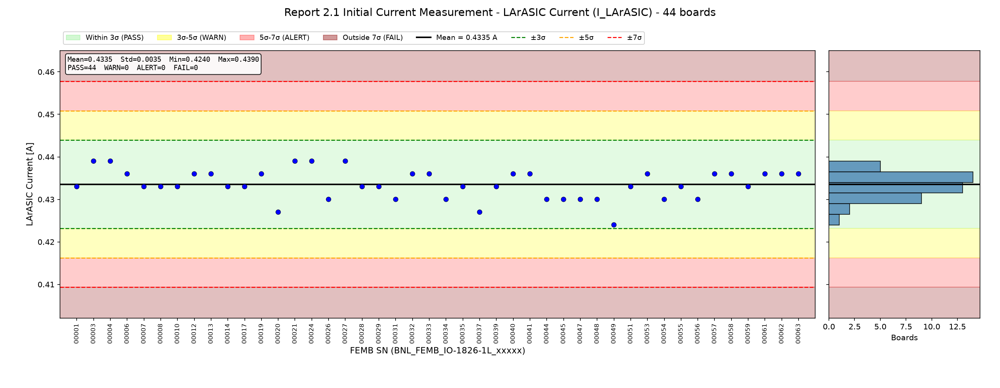
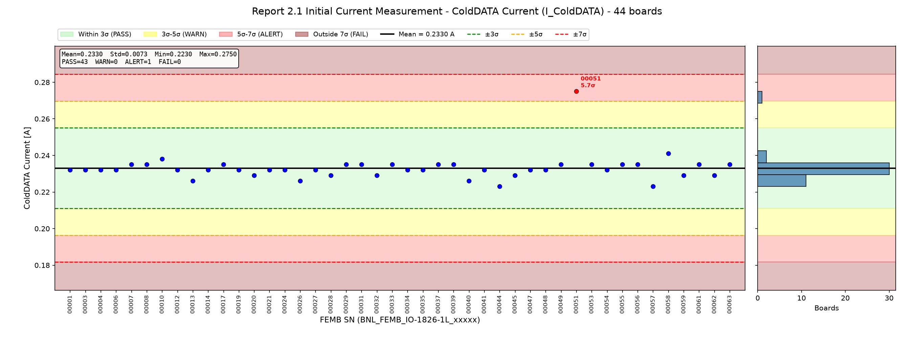
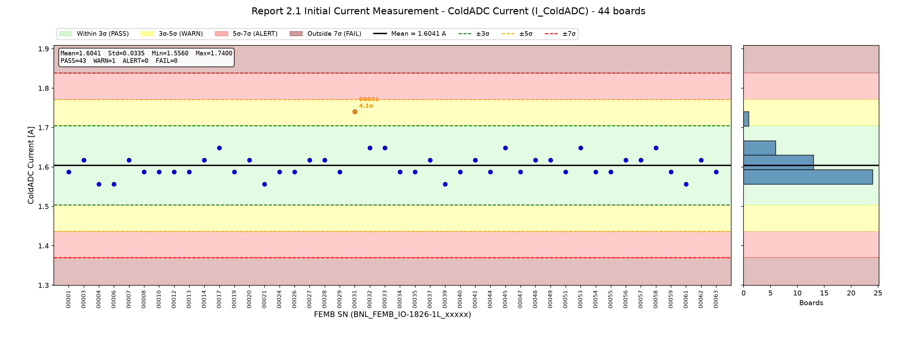
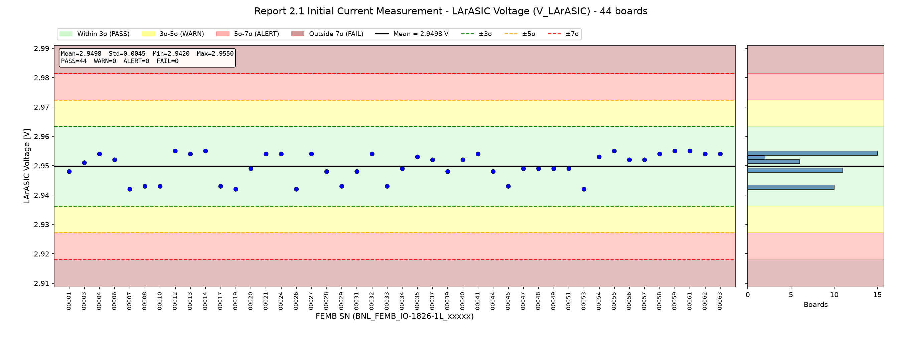
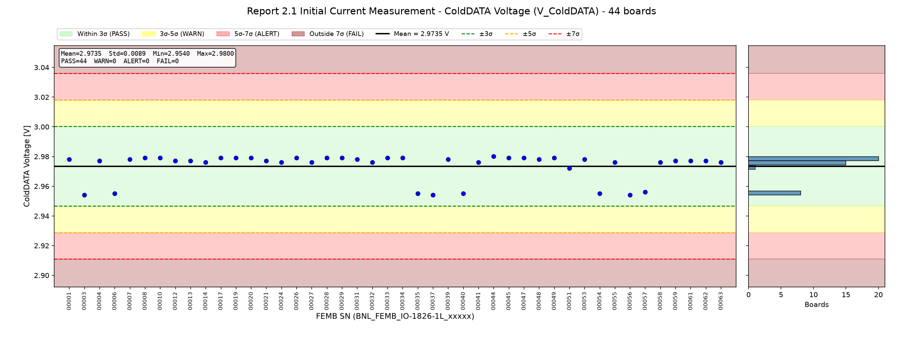
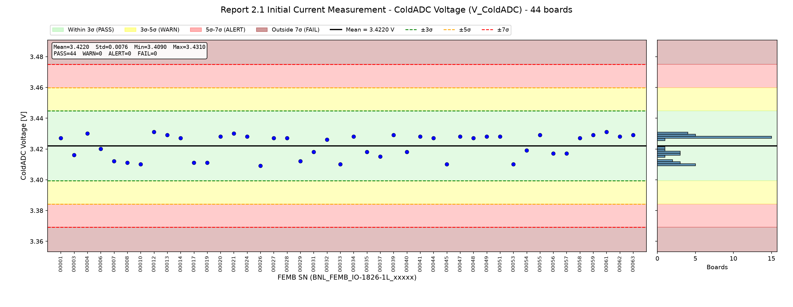
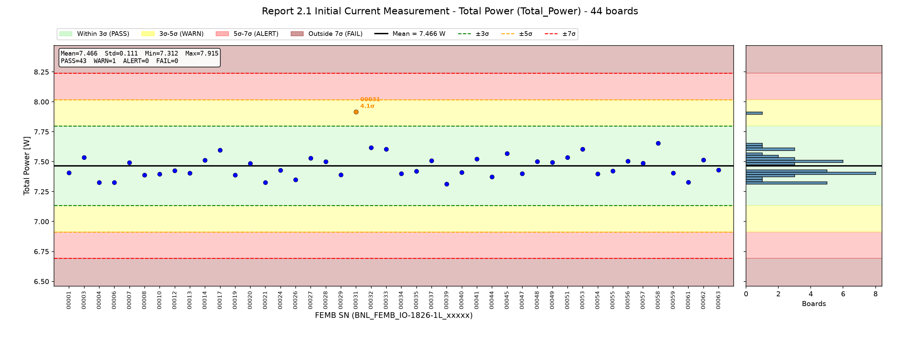
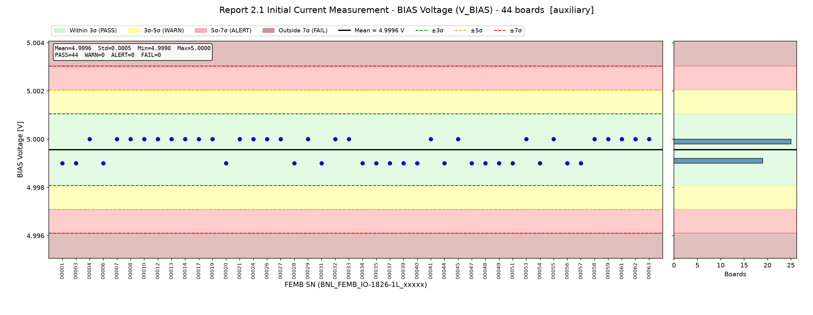
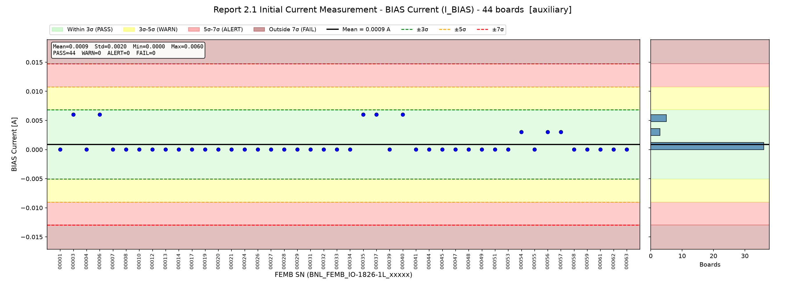

# FEMB QC Parameter Evaluation - Report Section 2.1: Initial Current Measurement

**Board version:** FEMB-IO 1826-1L  
**Boards used:** 44 (latest passing test per board; excluded: 00046)  
**Test period:** 2026-07-27 23:48 - 2026-10-15 17:19  
**Generated:** 2026-10-16 16:37  
**Script:** `eval_2_1_initial_power.py`

## 1. Scope

Section 2.1 of the per-board checkout report is the power-on reading of the four power-supply channels (BIAS, LArASIC, ColdDATA, ColdADC), taken before any configuration. It contains 17 numbers: V_set / V_meas / I_meas / P_meas for 4 rails, plus Total Power.

| Category | Parameters | Treatment |
|---|---|---|
| Core | I_meas & V_meas of LArASIC / ColdDATA / ColdADC, Total Power (7) | Statistical judgement |
| Auxiliary | V_meas & I_meas of BIAS (2) | Shown for reference; I_BIAS ≈ 0 is better served by a fixed limit |
| Not evaluated | V_set (4) | Configuration setpoints, constant |
| Not evaluated | P_meas (4) | Redundant (P = V × I) |

## 2. Judgement Method

For each parameter, mean and standard deviation (σ) are computed over all boards; each board is graded by its deviation |x − mean| / σ.

| Level | Deviation | Plot background |
|---|---|---|
| PASS | ≤ 3σ | green |
| WARN | 3σ – 5σ | yellow |
| ALERT | 5σ – 7σ | red |
| FAIL | > 7σ | dark red |

## 3. Summary

| Parameter | Role | Mean | Std | Min | Max | N unique | PASS | WARN | ALERT | FAIL | Flagged boards |
|---|---|---|---|---|---|---|---|---|---|---|---|
| I_LArASIC | core | 0.4335 A | 0.0035 | 0.4240 | 0.4390 | 6 | 44 | 0 | 0 | 0 | – |
| I_ColdDATA | core | 0.2330 A | 0.0073 | 0.2230 | 0.2750 | 8 | 43 | 0 | 1 | 0 | 00051 (ALERT 5.7σ) |
| I_ColdADC | core | 1.6041 A | 0.0335 | 1.5560 | 1.7400 | 5 | 43 | 1 | 0 | 0 | 00031 (WARN 4.1σ) |
| V_LArASIC | core | 2.9498 V | 0.0045 | 2.9420 | 2.9550 | 9 | 44 | 0 | 0 | 0 | – |
| V_ColdDATA | core | 2.9735 V | 0.0089 | 2.9540 | 2.9800 | 9 | 44 | 0 | 0 | 0 | – |
| V_ColdADC | core | 3.4220 V | 0.0076 | 3.4090 | 3.4310 | 16 | 44 | 0 | 0 | 0 | – |
| Total_Power | core | 7.466 W | 0.111 | 7.312 | 7.915 | 38 | 43 | 1 | 0 | 0 | 00031 (WARN 4.1σ) |
| V_BIAS | aux | 4.9996 V | 0.0005 | 4.9990 | 5.0000 | 2 | 44 | 0 | 0 | 0 | – |
| I_BIAS | aux | 0.0009 A | 0.0020 | 0.0000 | 0.0060 | 3 | 44 | 0 | 0 | 0 | – |

### Criteria (limits)

| Parameter | Unit | −7σ | −5σ | −3σ | Mean | +3σ | +5σ | +7σ |
|---|---|---|---|---|---|---|---|---|
| I_LArASIC | A | 0.4093 | 0.4162 | 0.4232 | 0.4335 | 0.4439 | 0.4508 | 0.4578 |
| I_ColdDATA | A | 0.1817 | 0.1964 | 0.2110 | 0.2330 | 0.2551 | 0.2697 | 0.2844 |
| I_ColdADC | A | 1.3698 | 1.4367 | 1.5037 | 1.6041 | 1.7046 | 1.7715 | 1.8385 |
| V_LArASIC | V | 2.9182 | 2.9272 | 2.9363 | 2.9498 | 2.9634 | 2.9724 | 2.9815 |
| V_ColdDATA | V | 2.9109 | 2.9288 | 2.9467 | 2.9735 | 3.0003 | 3.0181 | 3.0360 |
| V_ColdADC | V | 3.3691 | 3.3842 | 3.3994 | 3.4220 | 3.4447 | 3.4599 | 3.4750 |
| Total_Power | W | 6.692 | 6.913 | 7.134 | 7.466 | 7.797 | 8.018 | 8.239 |
| V_BIAS | V | 4.9961 | 4.9971 | 4.9981 | 4.9996 | 5.0011 | 5.0020 | 5.0030 |
| I_BIAS | A | -0.0130 | -0.0090 | -0.0051 | 0.0009 | 0.0068 | 0.0108 | 0.0147 |

## 4. Core Parameters

### 4.1 LArASIC Current (`I_LArASIC`)

LArASIC rail current.  
Mean = 0.4335 A, σ = 0.0035 A, range [0.4240, 0.4390], 6 distinct values over 44 boards.

All boards within 3σ.

### 4.2 ColdDATA Current (`I_ColdDATA`)

ColdDATA rail current.  
Mean = 0.2330 A, σ = 0.0073 A, range [0.2230, 0.2750], 8 distinct values over 44 boards.

| FEMB SN | Value | Deviation | Level |
|---|---|---|---|
| BNL_FEMB_IO-1826-1L_00051 | 0.2750 A | 5.7σ | **ALERT** |

### 4.3 ColdADC Current (`I_ColdADC`)

ColdADC rail current.  
Mean = 1.6041 A, σ = 0.0335 A, range [1.5560, 1.7400], 5 distinct values over 44 boards.

| FEMB SN | Value | Deviation | Level |
|---|---|---|---|
| BNL_FEMB_IO-1826-1L_00031 | 1.7400 A | 4.1σ | **WARN** |

### 4.4 LArASIC Voltage (`V_LArASIC`)

LArASIC rail voltage at the supply.  
Mean = 2.9498 V, σ = 0.0045 V, range [2.9420, 2.9550], 9 distinct values over 44 boards.

All boards within 3σ.

### 4.5 ColdDATA Voltage (`V_ColdDATA`)

ColdDATA rail voltage at the supply.  
Mean = 2.9735 V, σ = 0.0089 V, range [2.9540, 2.9800], 9 distinct values over 44 boards.

All boards within 3σ.

### 4.6 ColdADC Voltage (`V_ColdADC`)

ColdADC rail voltage at the supply.  
Mean = 3.4220 V, σ = 0.0076 V, range [3.4090, 3.4310], 16 distinct values over 44 boards.

All boards within 3σ.

### 4.7 Total Power (`Total_Power`)

Sum of rail powers.  
Mean = 7.466 W, σ = 0.111 W, range [7.312, 7.915], 38 distinct values over 44 boards.

| FEMB SN | Value | Deviation | Level |
|---|---|---|---|
| BNL_FEMB_IO-1826-1L_00031 | 7.915 W | 4.1σ | **WARN** |

## 5. Auxiliary Parameters

### 5.1 BIAS Voltage (`V_BIAS`)

BIAS rail voltage.  
Mean = 4.9996 V, σ = 0.0005 V, range [4.9990, 5.0000], 2 distinct values over 44 boards.

All boards within 3σ.

### 5.2 BIAS Current (`I_BIAS`)

BIAS rail current (≈ 0).  
Mean = 0.0009 A, σ = 0.0020 A, range [0.0000, 0.0060], 3 distinct values over 44 boards.

All boards within 3σ.

## 6. Observations

- **BNL_FEMB_IO-1826-1L_00031**: I_ColdADC 4.1σ (WARN); Total_Power 4.1σ (WARN)
- **BNL_FEMB_IO-1826-1L_00051**: I_ColdDATA 5.7σ (ALERT)
- Readout resolution is coarse (≤ 10 distinct values) for: I_LArASIC, I_ColdDATA, I_ColdADC, V_LArASIC, V_ColdDATA. σ is therefore small and quantized; a minimum tolerance tied to instrument resolution should be considered before using these limits.
- Flagged boards are still included in the statistics and inflate σ; re-deriving limits without them would tighten the criteria.

## Appendix A: Per-Board Judgement (core parameters)

| FEMB SN | Test time | I_LArASIC | I_ColdDATA | I_ColdADC | V_LArASIC | V_ColdDATA | V_ColdADC | Total_Power | Worst |
|---|---|---|---|---|---|---|---|---|---|
| BNL_FEMB_IO-1826-1L_00001 | 2026-07-28 15:21 | 0.2σ | 0.1σ | 0.5σ | 0.4σ | 0.5σ | 0.7σ | 0.5σ | PASS |
| BNL_FEMB_IO-1826-1L_00003 | 2026-07-28 15:21 | 1.6σ | 0.1σ | 0.4σ | 0.3σ | 2.2σ | 0.8σ | 0.6σ | PASS |
| BNL_FEMB_IO-1826-1L_00004 | 2026-08-03 22:20 | 1.6σ | 0.1σ | 1.4σ | 0.9σ | 0.4σ | 1.1σ | 1.3σ | PASS |
| BNL_FEMB_IO-1826-1L_00006 | 2026-07-28 20:07 | 0.7σ | 0.1σ | 1.4σ | 0.5σ | 2.1σ | 0.3σ | 1.3σ | PASS |
| BNL_FEMB_IO-1826-1L_00007 | 2026-09-11 18:46 | 0.2σ | 0.3σ | 0.4σ | 1.7σ | 0.5σ | 1.3σ | 0.2σ | PASS |
| BNL_FEMB_IO-1826-1L_00008 | 2026-07-28 20:24 | 0.2σ | 0.3σ | 0.5σ | 1.5σ | 0.6σ | 1.5σ | 0.7σ | PASS |
| BNL_FEMB_IO-1826-1L_00010 | 2026-07-28 00:58 | 0.2σ | 0.7σ | 0.5σ | 1.5σ | 0.6σ | 1.6σ | 0.6σ | PASS |
| BNL_FEMB_IO-1826-1L_00012 | 2026-07-29 22:28 | 0.7σ | 0.1σ | 0.5σ | 1.1σ | 0.4σ | 1.2σ | 0.4σ | PASS |
| BNL_FEMB_IO-1826-1L_00013 | 2026-07-28 14:53 | 0.7σ | 1.0σ | 0.5σ | 0.9σ | 0.4σ | 0.9σ | 0.6σ | PASS |
| BNL_FEMB_IO-1826-1L_00014 | 2026-07-28 20:07 | 0.2σ | 0.1σ | 0.4σ | 1.1σ | 0.3σ | 0.7σ | 0.4σ | PASS |
| BNL_FEMB_IO-1826-1L_00017 | 2026-09-11 19:03 | 0.2σ | 0.3σ | 1.3σ | 1.5σ | 0.6σ | 1.5σ | 1.2σ | PASS |
| BNL_FEMB_IO-1826-1L_00019 | 2026-07-28 15:07 | 0.7σ | 0.1σ | 0.5σ | 1.7σ | 0.6σ | 1.5σ | 0.7σ | PASS |
| BNL_FEMB_IO-1826-1L_00020 | 2026-09-11 19:03 | 1.9σ | 0.6σ | 0.4σ | 0.2σ | 0.6σ | 0.8σ | 0.2σ | PASS |
| BNL_FEMB_IO-1826-1L_00021 | 2026-07-29 22:36 | 1.6σ | 0.1σ | 1.4σ | 0.9σ | 0.4σ | 1.1σ | 1.3σ | PASS |
| BNL_FEMB_IO-1826-1L_00024 | 2026-09-11 19:03 | 1.6σ | 0.1σ | 0.5σ | 0.9σ | 0.3σ | 0.8σ | 0.3σ | PASS |
| BNL_FEMB_IO-1826-1L_00026 | 2026-07-28 15:21 | 1.0σ | 1.0σ | 0.5σ | 1.7σ | 0.6σ | 1.7σ | 1.1σ | PASS |
| BNL_FEMB_IO-1826-1L_00027 | 2026-09-11 18:46 | 1.6σ | 0.1σ | 0.4σ | 0.9σ | 0.3σ | 0.7σ | 0.6σ | PASS |
| BNL_FEMB_IO-1826-1L_00028 | 2026-07-28 00:03 | 0.2σ | 0.6σ | 0.4σ | 0.4σ | 0.6σ | 0.7σ | 0.3σ | PASS |
| BNL_FEMB_IO-1826-1L_00029 | 2026-07-28 19:55 | 0.2σ | 0.3σ | 0.5σ | 1.5σ | 0.6σ | 1.3σ | 0.7σ | PASS |
| BNL_FEMB_IO-1826-1L_00031 | 2026-07-28 00:58 | 1.0σ | 0.3σ | **4.1σ WARN** | 0.4σ | 0.5σ | 0.5σ | **4.1σ WARN** | WARN |
| BNL_FEMB_IO-1826-1L_00032 | 2026-07-28 15:36 | 0.7σ | 0.6σ | 1.3σ | 0.9σ | 0.3σ | 0.5σ | 1.4σ | PASS |
| BNL_FEMB_IO-1826-1L_00033 | 2026-09-17 22:09 | 0.7σ | 0.3σ | 1.3σ | 1.5σ | 0.6σ | 1.6σ | 1.2σ | PASS |
| BNL_FEMB_IO-1826-1L_00034 | 2026-09-17 22:09 | 1.0σ | 0.1σ | 0.5σ | 0.2σ | 0.6σ | 0.8σ | 0.6σ | PASS |
| BNL_FEMB_IO-1826-1L_00035 | 2026-09-11 18:46 | 0.2σ | 0.1σ | 0.5σ | 0.7σ | 2.1σ | 0.5σ | 0.4σ | PASS |
| BNL_FEMB_IO-1826-1L_00037 | 2026-07-28 00:03 | 1.9σ | 0.3σ | 0.4σ | 0.5σ | 2.2σ | 0.9σ | 0.4σ | PASS |
| BNL_FEMB_IO-1826-1L_00039 | 2026-07-28 20:41 | 0.2σ | 0.3σ | 1.4σ | 0.4σ | 0.5σ | 0.9σ | 1.4σ | PASS |
| BNL_FEMB_IO-1826-1L_00040 | 2026-07-28 20:41 | 0.7σ | 1.0σ | 0.5σ | 0.5σ | 2.1σ | 0.5σ | 0.5σ | PASS |
| BNL_FEMB_IO-1826-1L_00041 | 2026-07-28 20:24 | 0.7σ | 0.1σ | 0.4σ | 0.9σ | 0.3σ | 0.8σ | 0.5σ | PASS |
| BNL_FEMB_IO-1826-1L_00044 | 2026-07-28 15:07 | 1.0σ | 1.4σ | 0.5σ | 0.4σ | 0.7σ | 0.7σ | 0.8σ | PASS |
| BNL_FEMB_IO-1826-1L_00045 | 2026-07-28 14:53 | 1.0σ | 0.6σ | 1.3σ | 1.5σ | 0.6σ | 1.6σ | 0.9σ | PASS |
| BNL_FEMB_IO-1826-1L_00047 | 2026-07-27 23:48 | 1.0σ | 0.1σ | 0.5σ | 0.2σ | 0.6σ | 0.8σ | 0.6σ | PASS |
| BNL_FEMB_IO-1826-1L_00048 | 2026-07-28 14:53 | 1.0σ | 0.1σ | 0.4σ | 0.2σ | 0.5σ | 0.7σ | 0.3σ | PASS |
| BNL_FEMB_IO-1826-1L_00049 | 2026-07-28 19:55 | 2.8σ | 0.3σ | 0.4σ | 0.2σ | 0.6σ | 0.8σ | 0.2σ | PASS |
| BNL_FEMB_IO-1826-1L_00051 | 2026-10-15 17:19 | 0.2σ | **5.7σ ALERT** | 0.5σ | 0.2σ | 0.2σ | 0.8σ | 0.6σ | ALERT |
| BNL_FEMB_IO-1826-1L_00053 | 2026-07-28 15:36 | 0.7σ | 0.3σ | 1.3σ | 1.7σ | 0.5σ | 1.6σ | 1.2σ | PASS |
| BNL_FEMB_IO-1826-1L_00054 | 2026-07-28 00:58 | 1.0σ | 0.1σ | 0.5σ | 0.7σ | 2.1σ | 0.4σ | 0.6σ | PASS |
| BNL_FEMB_IO-1826-1L_00055 | 2026-07-28 00:58 | 0.2σ | 0.3σ | 0.5σ | 1.1σ | 0.3σ | 0.9σ | 0.4σ | PASS |
| BNL_FEMB_IO-1826-1L_00056 | 2026-07-28 20:24 | 1.0σ | 0.3σ | 0.4σ | 0.5σ | 2.2σ | 0.7σ | 0.3σ | PASS |
| BNL_FEMB_IO-1826-1L_00057 | 2026-07-28 15:07 | 0.7σ | 1.4σ | 0.4σ | 0.5σ | 2.0σ | 0.7σ | 0.2σ | PASS |
| BNL_FEMB_IO-1826-1L_00058 | 2026-09-17 22:09 | 0.7σ | 1.1σ | 1.3σ | 0.9σ | 0.3σ | 0.7σ | 1.7σ | PASS |
| BNL_FEMB_IO-1826-1L_00059 | 2026-08-03 18:53 | 0.2σ | 0.6σ | 0.5σ | 1.1σ | 0.4σ | 0.9σ | 0.6σ | PASS |
| BNL_FEMB_IO-1826-1L_00061 | 2026-10-09 17:53 | 0.7σ | 0.3σ | 1.4σ | 1.1σ | 0.4σ | 1.2σ | 1.3σ | PASS |
| BNL_FEMB_IO-1826-1L_00062 | 2026-07-27 23:48 | 0.7σ | 0.6σ | 0.4σ | 0.9σ | 0.4σ | 0.8σ | 0.4σ | PASS |
| BNL_FEMB_IO-1826-1L_00063 | 2026-07-28 19:55 | 0.7σ | 0.3σ | 0.5σ | 0.9σ | 0.3σ | 0.9σ | 0.3σ | PASS |

## Appendix B: Output Files

- `output/criteria_2_1.csv` – mean, σ and 3σ/5σ/7σ limits per parameter
- `output/judgement_2_1.csv` – value, deviation and level per board per parameter
- `output/plot_2_1_*.png` – distribution plots
