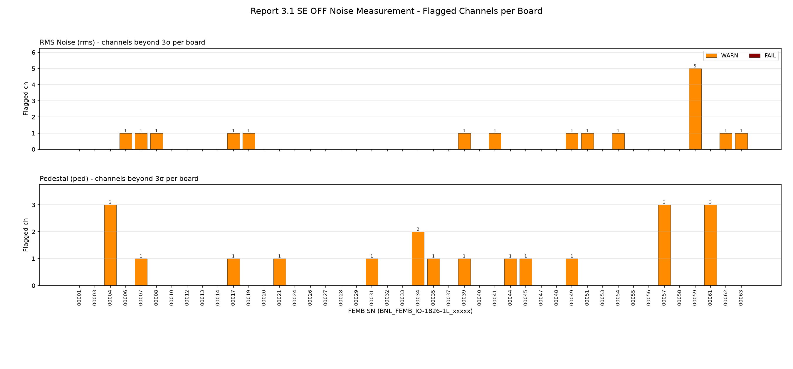
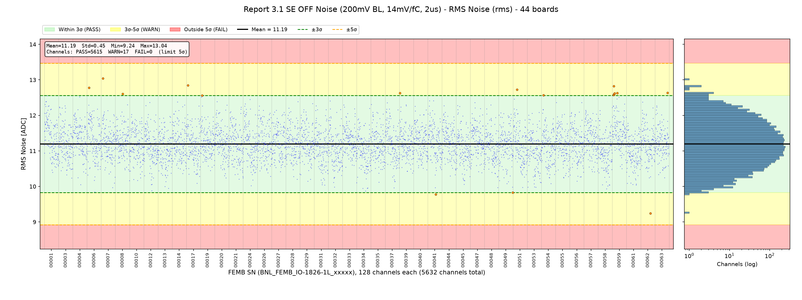
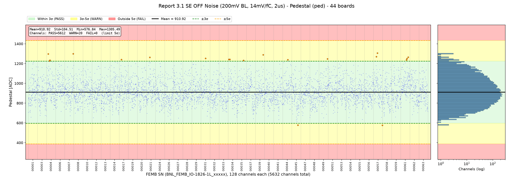

# FEMB QC Parameter Evaluation - Report Section 3.1: SE OFF Noise Measurement

**Board version:** FEMB-IO 1826-1L  
**Boards used:** 44 (latest passing test per board; excluded: 00046)  
**Channels:** 44 × 128 = 5632  
**Test period:** 2026-07-27 23:48 - 2026-10-15 17:19  
**Configuration:** single-ended, SE buffer OFF, 200 mV baseline, 14 mV/fC, 2 µs, no pulse  
**Generated:** 2026-10-16 16:37  
**Script:** `eval_3_1_noise.py`

## 1. Scope

Section 3.1 of the checkout report is the noise test: no calibration pulse is injected, and for each of the 128 channels the pedestal and RMS noise are evaluated. Pulse-response quantities (PPK / NPK / baseline) belong to section 3.4 and are not part of this section.

| Parameter | Description |
|---|---|
| `rms` – RMS Noise | RMS of the baseline, ADC counts |
| `ped` – Pedestal | Mean baseline (DC offset), ADC counts |

## 2. Judgement Method

For each parameter the mean and σ are computed over all 5632 channels pooled together; each channel is graded by |x − mean| / σ. A board takes the worst level among its channels.

Channel-level (noise / pulse) parameters use **5σ as the limit**: a channel beyond 5σ fails. (Board-level power and LDO parameters keep the wider 7σ limit.)

| Level | Deviation | Plot background |
|---|---|---|
| PASS | ≤ 3σ | green |
| WARN | 3σ – 5σ | yellow |
| FAIL | > 5σ | red |

For a Gaussian distribution, about 0.27 % of channels (≈ 15 of 5632) are expected beyond 3σ by chance, so isolated WARN channels are normal.

## 3. Summary

| Parameter | Mean | Std | Min | Max | PASS | WARN | FAIL | Boards with ≥1 FAIL |
|---|---|---|---|---|---|---|---|---|
| `rms` | 11.19 | 0.45 | 9.24 | 13.04 | 5615 | 17 | 0 | – |
| `ped` | 910.92 | 104.51 | 576.84 | 1305.49 | 5612 | 20 | 0 | – |

### Criteria (limits, ADC counts)

| Parameter | −5σ (FAIL) | −3σ | Mean | +3σ | +5σ (FAIL) |
|---|---|---|---|---|---|
| `rms` | 8.92 | 9.83 | 11.19 | 12.56 | 13.47 |
| `ped` | 388.37 | 597.39 | 910.92 | 1224.45 | 1433.47 |

### Flagged channels per board

## 4. Parameters

### 4.1 RMS Noise (`rms`)

Mean = 11.19, σ = 0.45, range [9.24, 13.04] ADC. Spread of per-board means: σ = 0.11; spread of per-channel means across boards: σ = 0.26.

17 channel(s) beyond 3σ:

| FEMB SN | Channel | Chip | Value | Deviation | Level |
|---|---|---|---|---|---|
| BNL_FEMB_IO-1826-1L_00062 | 88 | 5 | 9.24 | 4.3σ | WARN |
| BNL_FEMB_IO-1826-1L_00007 | 15 | 0 | 13.04 | 4.1σ | WARN |
| BNL_FEMB_IO-1826-1L_00017 | 15 | 0 | 12.84 | 3.6σ | WARN |
| BNL_FEMB_IO-1826-1L_00059 | 13 | 0 | 12.82 | 3.6σ | WARN |
| BNL_FEMB_IO-1826-1L_00006 | 18 | 1 | 12.78 | 3.5σ | WARN |
| BNL_FEMB_IO-1826-1L_00051 | 36 | 2 | 12.73 | 3.4σ | WARN |
| BNL_FEMB_IO-1826-1L_00063 | 113 | 7 | 12.64 | 3.2σ | WARN |
| BNL_FEMB_IO-1826-1L_00059 | 44 | 2 | 12.63 | 3.2σ | WARN |
| BNL_FEMB_IO-1826-1L_00039 | 5 | 0 | 12.63 | 3.2σ | WARN |
| BNL_FEMB_IO-1826-1L_00059 | 20 | 1 | 12.62 | 3.1σ | WARN |
| BNL_FEMB_IO-1826-1L_00041 | 72 | 4 | 9.78 | 3.1σ | WARN |
| BNL_FEMB_IO-1826-1L_00008 | 66 | 4 | 12.61 | 3.1σ | WARN |
| BNL_FEMB_IO-1826-1L_00059 | 15 | 0 | 12.60 | 3.1σ | WARN |
| BNL_FEMB_IO-1826-1L_00059 | 12 | 0 | 12.57 | 3.0σ | WARN |
| BNL_FEMB_IO-1826-1L_00054 | 20 | 1 | 12.57 | 3.0σ | WARN |
| BNL_FEMB_IO-1826-1L_00049 | 127 | 7 | 9.83 | 3.0σ | WARN |
| BNL_FEMB_IO-1826-1L_00019 | 13 | 0 | 12.56 | 3.0σ | WARN |

### 4.2 Pedestal (`ped`)

Mean = 910.92, σ = 104.51, range [576.84, 1305.49] ADC. Spread of per-board means: σ = 23.59; spread of per-channel means across boards: σ = 65.47.

20 channel(s) beyond 3σ:

| FEMB SN | Channel | Chip | Value | Deviation | Level |
|---|---|---|---|---|---|
| BNL_FEMB_IO-1826-1L_00057 | 56 | 3 | 1305.49 | 3.8σ | WARN |
| BNL_FEMB_IO-1826-1L_00007 | 120 | 7 | 1298.34 | 3.7σ | WARN |
| BNL_FEMB_IO-1826-1L_00004 | 24 | 1 | 1297.25 | 3.7σ | WARN |
| BNL_FEMB_IO-1826-1L_00039 | 109 | 6 | 1289.33 | 3.6σ | WARN |
| BNL_FEMB_IO-1826-1L_00057 | 40 | 2 | 1269.79 | 3.4σ | WARN |
| BNL_FEMB_IO-1826-1L_00061 | 104 | 6 | 1264.56 | 3.4σ | WARN |
| BNL_FEMB_IO-1826-1L_00021 | 48 | 3 | 1263.46 | 3.4σ | WARN |
| BNL_FEMB_IO-1826-1L_00031 | 64 | 4 | 1253.36 | 3.3σ | WARN |
| BNL_FEMB_IO-1826-1L_00061 | 88 | 5 | 1250.73 | 3.3σ | WARN |
| BNL_FEMB_IO-1826-1L_00049 | 120 | 7 | 1247.25 | 3.2σ | WARN |
| BNL_FEMB_IO-1826-1L_00057 | 126 | 7 | 576.84 | 3.2σ | WARN |
| BNL_FEMB_IO-1826-1L_00045 | 86 | 5 | 578.45 | 3.2σ | WARN |
| BNL_FEMB_IO-1826-1L_00034 | 24 | 1 | 1241.94 | 3.2σ | WARN |
| BNL_FEMB_IO-1826-1L_00034 | 8 | 0 | 1241.47 | 3.2σ | WARN |
| BNL_FEMB_IO-1826-1L_00017 | 32 | 2 | 1240.36 | 3.2σ | WARN |
| BNL_FEMB_IO-1826-1L_00044 | 72 | 4 | 1238.61 | 3.1σ | WARN |
| BNL_FEMB_IO-1826-1L_00061 | 80 | 5 | 1237.22 | 3.1σ | WARN |
| BNL_FEMB_IO-1826-1L_00004 | 47 | 2 | 1233.97 | 3.1σ | WARN |
| BNL_FEMB_IO-1826-1L_00035 | 88 | 5 | 1232.32 | 3.1σ | WARN |
| BNL_FEMB_IO-1826-1L_00004 | 40 | 2 | 1226.81 | 3.0σ | WARN |

## 5. Observations

- **rms**: no channel beyond 5σ.
- **ped**: no channel beyond 5σ.
- Thresholds are pooled over channels; `ped` varies channel-to-channel by design (σ ≈ 105 ADC), so its limits are wide and mainly catch dead / stuck channels.

## Appendix A: Per-Board Judgement

Each cell: number of channels WARN / FAIL, and worst deviation.

| FEMB SN | Test time | `rms` | `ped` | Worst |
|---|---|---|---|---|
| BNL_FEMB_IO-1826-1L_00001 | 2026-07-28 15:21 | 0/0 (3.0σ) | 0/0 (2.9σ) | PASS |
| BNL_FEMB_IO-1826-1L_00003 | 2026-07-28 15:21 | 0/0 (2.4σ) | 0/0 (2.4σ) | PASS |
| BNL_FEMB_IO-1826-1L_00004 | 2026-08-03 22:20 | 0/0 (2.9σ) | 3/0 (3.7σ) | WARN |
| BNL_FEMB_IO-1826-1L_00006 | 2026-07-28 20:07 | 1/0 (3.5σ) | 0/0 (2.7σ) | WARN |
| BNL_FEMB_IO-1826-1L_00007 | 2026-09-11 18:46 | 1/0 (4.1σ) | 1/0 (3.7σ) | WARN |
| BNL_FEMB_IO-1826-1L_00008 | 2026-07-28 20:24 | 1/0 (3.1σ) | 0/0 (2.2σ) | WARN |
| BNL_FEMB_IO-1826-1L_00010 | 2026-07-28 00:58 | 0/0 (2.3σ) | 0/0 (2.6σ) | PASS |
| BNL_FEMB_IO-1826-1L_00012 | 2026-07-29 22:28 | 0/0 (2.9σ) | 0/0 (2.5σ) | PASS |
| BNL_FEMB_IO-1826-1L_00013 | 2026-07-28 14:53 | 0/0 (2.8σ) | 0/0 (2.4σ) | PASS |
| BNL_FEMB_IO-1826-1L_00014 | 2026-07-28 20:07 | 0/0 (2.6σ) | 0/0 (2.9σ) | PASS |
| BNL_FEMB_IO-1826-1L_00017 | 2026-09-11 19:03 | 1/0 (3.6σ) | 1/0 (3.2σ) | WARN |
| BNL_FEMB_IO-1826-1L_00019 | 2026-07-28 15:07 | 1/0 (3.0σ) | 0/0 (2.8σ) | WARN |
| BNL_FEMB_IO-1826-1L_00020 | 2026-09-11 19:03 | 0/0 (2.6σ) | 0/0 (2.5σ) | PASS |
| BNL_FEMB_IO-1826-1L_00021 | 2026-07-29 22:36 | 0/0 (2.3σ) | 1/0 (3.4σ) | WARN |
| BNL_FEMB_IO-1826-1L_00024 | 2026-09-11 19:03 | 0/0 (2.8σ) | 0/0 (2.8σ) | PASS |
| BNL_FEMB_IO-1826-1L_00026 | 2026-07-28 15:21 | 0/0 (2.3σ) | 0/0 (2.6σ) | PASS |
| BNL_FEMB_IO-1826-1L_00027 | 2026-09-11 18:46 | 0/0 (2.1σ) | 0/0 (2.7σ) | PASS |
| BNL_FEMB_IO-1826-1L_00028 | 2026-07-28 00:03 | 0/0 (2.6σ) | 0/0 (2.3σ) | PASS |
| BNL_FEMB_IO-1826-1L_00029 | 2026-07-28 19:55 | 0/0 (2.5σ) | 0/0 (2.7σ) | PASS |
| BNL_FEMB_IO-1826-1L_00031 | 2026-07-28 00:58 | 0/0 (2.5σ) | 1/0 (3.3σ) | WARN |
| BNL_FEMB_IO-1826-1L_00032 | 2026-07-28 15:36 | 0/0 (2.7σ) | 0/0 (2.8σ) | PASS |
| BNL_FEMB_IO-1826-1L_00033 | 2026-09-17 22:09 | 0/0 (2.4σ) | 0/0 (2.3σ) | PASS |
| BNL_FEMB_IO-1826-1L_00034 | 2026-09-17 22:09 | 0/0 (2.9σ) | 2/0 (3.2σ) | WARN |
| BNL_FEMB_IO-1826-1L_00035 | 2026-09-11 18:46 | 0/0 (2.4σ) | 1/0 (3.1σ) | WARN |
| BNL_FEMB_IO-1826-1L_00037 | 2026-07-28 00:03 | 0/0 (2.7σ) | 0/0 (2.6σ) | PASS |
| BNL_FEMB_IO-1826-1L_00039 | 2026-07-28 20:41 | 1/0 (3.2σ) | 1/0 (3.6σ) | WARN |
| BNL_FEMB_IO-1826-1L_00040 | 2026-07-28 20:41 | 0/0 (2.3σ) | 0/0 (2.3σ) | PASS |
| BNL_FEMB_IO-1826-1L_00041 | 2026-07-28 20:24 | 1/0 (3.1σ) | 0/0 (2.7σ) | WARN |
| BNL_FEMB_IO-1826-1L_00044 | 2026-07-28 15:07 | 0/0 (2.4σ) | 1/0 (3.1σ) | WARN |
| BNL_FEMB_IO-1826-1L_00045 | 2026-07-28 14:53 | 0/0 (3.0σ) | 1/0 (3.2σ) | WARN |
| BNL_FEMB_IO-1826-1L_00047 | 2026-07-27 23:48 | 0/0 (2.6σ) | 0/0 (2.7σ) | PASS |
| BNL_FEMB_IO-1826-1L_00048 | 2026-07-28 14:53 | 0/0 (2.7σ) | 0/0 (2.4σ) | PASS |
| BNL_FEMB_IO-1826-1L_00049 | 2026-07-28 19:55 | 1/0 (3.0σ) | 1/0 (3.2σ) | WARN |
| BNL_FEMB_IO-1826-1L_00051 | 2026-10-15 17:19 | 1/0 (3.4σ) | 0/0 (3.0σ) | WARN |
| BNL_FEMB_IO-1826-1L_00053 | 2026-07-28 15:36 | 0/0 (2.7σ) | 0/0 (2.9σ) | PASS |
| BNL_FEMB_IO-1826-1L_00054 | 2026-07-28 00:58 | 1/0 (3.0σ) | 0/0 (2.6σ) | WARN |
| BNL_FEMB_IO-1826-1L_00055 | 2026-07-28 00:58 | 0/0 (2.6σ) | 0/0 (2.6σ) | PASS |
| BNL_FEMB_IO-1826-1L_00056 | 2026-07-28 20:24 | 0/0 (2.6σ) | 0/0 (2.0σ) | PASS |
| BNL_FEMB_IO-1826-1L_00057 | 2026-07-28 15:07 | 0/0 (2.1σ) | 3/0 (3.8σ) | WARN |
| BNL_FEMB_IO-1826-1L_00058 | 2026-09-17 22:09 | 0/0 (2.8σ) | 0/0 (2.9σ) | PASS |
| BNL_FEMB_IO-1826-1L_00059 | 2026-08-03 18:53 | 5/0 (3.6σ) | 0/0 (2.6σ) | WARN |
| BNL_FEMB_IO-1826-1L_00061 | 2026-10-09 17:53 | 0/0 (2.5σ) | 3/0 (3.4σ) | WARN |
| BNL_FEMB_IO-1826-1L_00062 | 2026-07-27 23:48 | 1/0 (4.3σ) | 0/0 (2.2σ) | WARN |
| BNL_FEMB_IO-1826-1L_00063 | 2026-07-28 19:55 | 1/0 (3.2σ) | 0/0 (2.4σ) | WARN |

## Appendix B: Output Files

- `output/criteria_3_1.csv` – mean, σ and 3σ/5σ limits per parameter
- `output/judgement_3_1_channels.csv` – every channel beyond 3σ (board, channel, value, deviation, level)
- `output/judgement_3_1_boards.csv` – per-board counts and worst level
- `output/plot_3_1_*.png` – distribution plots and per-board summary
