# FEMB QC Parameter Evaluation - Report Section 3.3: SE OFF LDO Measurement

**Board version:** FEMB-IO 1826-1L  
**Boards used:** 44 (latest passing test per board; excluded: 00046)  
**Test period:** 2026-07-27 23:48 - 2026-10-15 17:19  
**Generated:** 2026-10-16 16:37  
**Script:** `eval_3_3_se_off_ldo.py`

## 1. Scope

Section 3.3 of the per-board checkout report lists the outputs of the 11 on-board LDO / monitor points, read in mV by the board monitor ADC while the FEMB is in the SE OFF configuration (same configuration as 3.1 / 3.2). One value per board per point; all 11 are evaluated, using the values as reported in the CSV.

| Parameter | Description |
|---|---|
| `CDVDDA` – COLDATA VDDA | COLDATA analog supply |
| `CDVDDIO_HALF` – COLDATA VDDIO | COLDATA I/O supply |
| `ADCRVDDD1P2` – ADC-R VDDD 1.2V | Right-side ColdADC digital 1.2 V supply |
| `ADCLVDDD1P2` – ADC-L VDDD 1.2V | Left-side ColdADC digital 1.2 V supply |
| `FERVDDP` – FE-R VDDP | Right-side LArASIC supply |
| `FELVDDP` – FE-L VDDP | Left-side LArASIC supply |
| `ADCRP25V_1_HALF` – ADC-R 2.5V #1 | Right-side ColdADC 2.5 V supply #1 |
| `ADCLP25V_1_HALF` – ADC-L 2.5V #1 | Left-side ColdADC 2.5 V supply #1 |
| `ADCRP25V_HALF` – ADC-R 2.5V | Right-side ColdADC 2.5 V main supply |
| `ADCLP25V_HALF` – ADC-L 2.5V | Left-side ColdADC 2.5 V main supply |
| `GND` – Ground | Ground reference reading of the monitor ADC |

## 2. Judgement Method

For each parameter, mean and standard deviation (σ) are computed over all boards; each board is graded by its deviation |x − mean| / σ.

| Level | Deviation | Plot background |
|---|---|---|
| PASS | ≤ 3σ | green |
| WARN | 3σ – 5σ | yellow |
| ALERT | 5σ – 7σ | red |
| FAIL | > 7σ | dark red |

## 3. Summary

| Parameter | Role | Mean | Std | Min | Max | N unique | PASS | WARN | ALERT | FAIL | Flagged boards |
|---|---|---|---|---|---|---|---|---|---|---|---|
| CDVDDA | core | 1185.1 mV | 2.1 | 1180.0 | 1189.0 | 9 | 44 | 0 | 0 | 0 | – |
| CDVDDIO_HALF | core | 2231.4 mV | 5.8 | 2221.0 | 2241.0 | 20 | 44 | 0 | 0 | 0 | – |
| ADCRVDDD1P2 | core | 1097.6 mV | 1.9 | 1094.0 | 1101.0 | 8 | 44 | 0 | 0 | 0 | – |
| ADCLVDDD1P2 | core | 1097.5 mV | 1.9 | 1094.0 | 1102.0 | 9 | 44 | 0 | 0 | 0 | – |
| FERVDDP | core | 1793.4 mV | 3.0 | 1785.0 | 1799.0 | 12 | 44 | 0 | 0 | 0 | – |
| FELVDDP | core | 1792.7 mV | 3.2 | 1783.0 | 1799.0 | 14 | 43 | 1 | 0 | 0 | 00013 (WARN 3.1σ) |
| ADCRP25V_1_HALF | core | 2252.5 mV | 5.8 | 2243.0 | 2265.0 | 19 | 44 | 0 | 0 | 0 | – |
| ADCLP25V_1_HALF | core | 2250.4 mV | 5.3 | 2240.0 | 2259.0 | 15 | 44 | 0 | 0 | 0 | – |
| ADCRP25V_HALF | core | 2251.7 mV | 5.7 | 2237.0 | 2264.0 | 22 | 44 | 0 | 0 | 0 | – |
| ADCLP25V_HALF | core | 2252.1 mV | 5.3 | 2240.0 | 2265.0 | 20 | 44 | 0 | 0 | 0 | – |
| GND | core | 29.5 mV | 2.6 | 23.0 | 33.0 | 8 | 44 | 0 | 0 | 0 | – |

### Criteria (limits)

| Parameter | Unit | −7σ | −5σ | −3σ | Mean | +3σ | +5σ | +7σ |
|---|---|---|---|---|---|---|---|---|
| CDVDDA | mV | 1170.5 | 1174.7 | 1178.8 | 1185.1 | 1191.4 | 1195.5 | 1199.7 |
| CDVDDIO_HALF | mV | 2190.5 | 2202.2 | 2213.9 | 2231.4 | 2249.0 | 2260.6 | 2272.3 |
| ADCRVDDD1P2 | mV | 1084.1 | 1088.0 | 1091.8 | 1097.6 | 1103.4 | 1107.2 | 1111.0 |
| ADCLVDDD1P2 | mV | 1084.5 | 1088.2 | 1092.0 | 1097.5 | 1103.1 | 1106.9 | 1110.6 |
| FERVDDP | mV | 1772.4 | 1778.4 | 1784.4 | 1793.4 | 1802.3 | 1808.3 | 1814.3 |
| FELVDDP | mV | 1770.4 | 1776.8 | 1783.2 | 1792.7 | 1802.2 | 1808.6 | 1815.0 |
| ADCRP25V_1_HALF | mV | 2212.1 | 2223.6 | 2235.2 | 2252.5 | 2269.8 | 2281.3 | 2292.9 |
| ADCLP25V_1_HALF | mV | 2213.5 | 2224.0 | 2234.6 | 2250.4 | 2266.2 | 2276.7 | 2287.3 |
| ADCRP25V_HALF | mV | 2212.1 | 2223.4 | 2234.7 | 2251.7 | 2268.6 | 2279.9 | 2291.2 |
| ADCLP25V_HALF | mV | 2214.9 | 2225.5 | 2236.1 | 2252.1 | 2268.0 | 2278.6 | 2289.2 |
| GND | mV | 11.4 | 16.6 | 21.7 | 29.5 | 37.2 | 42.4 | 47.5 |

## 4. Parameters

### 4.1 COLDATA VDDA (`CDVDDA`)

COLDATA analog supply.  
Mean = 1185.1 mV, σ = 2.1 mV, range [1180.0, 1189.0], 9 distinct values over 44 boards.

All boards within 3σ.

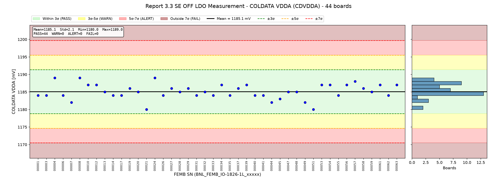

### 4.2 COLDATA VDDIO (`CDVDDIO_HALF`)

COLDATA I/O supply.  
Mean = 2231.4 mV, σ = 5.8 mV, range [2221.0, 2241.0], 20 distinct values over 44 boards.

All boards within 3σ.

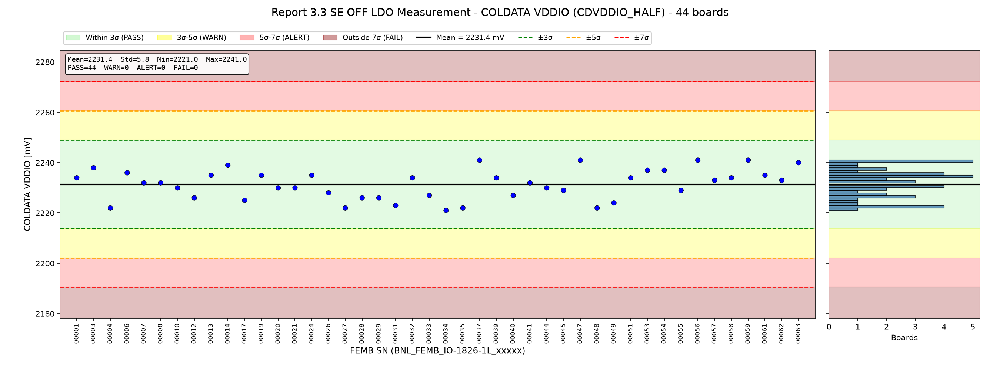

### 4.3 ADC-R VDDD 1.2V (`ADCRVDDD1P2`)

Right-side ColdADC digital 1.2 V supply.  
Mean = 1097.6 mV, σ = 1.9 mV, range [1094.0, 1101.0], 8 distinct values over 44 boards.

All boards within 3σ.

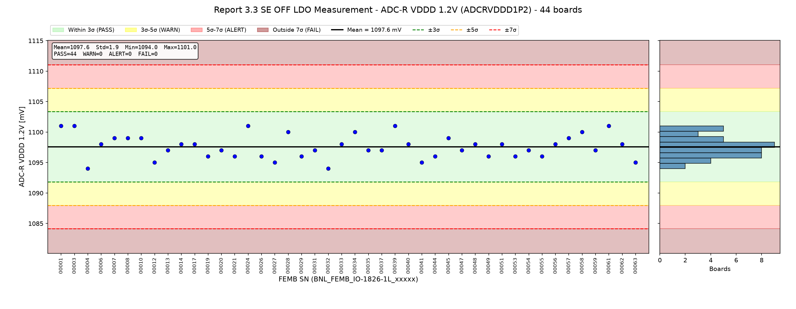

### 4.4 ADC-L VDDD 1.2V (`ADCLVDDD1P2`)

Left-side ColdADC digital 1.2 V supply.  
Mean = 1097.5 mV, σ = 1.9 mV, range [1094.0, 1102.0], 9 distinct values over 44 boards.

All boards within 3σ.

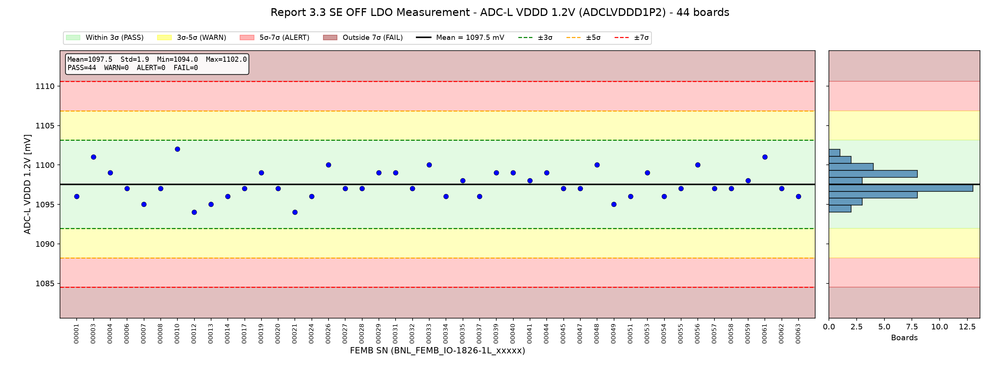

### 4.5 FE-R VDDP (`FERVDDP`)

Right-side LArASIC supply.  
Mean = 1793.4 mV, σ = 3.0 mV, range [1785.0, 1799.0], 12 distinct values over 44 boards.

All boards within 3σ.

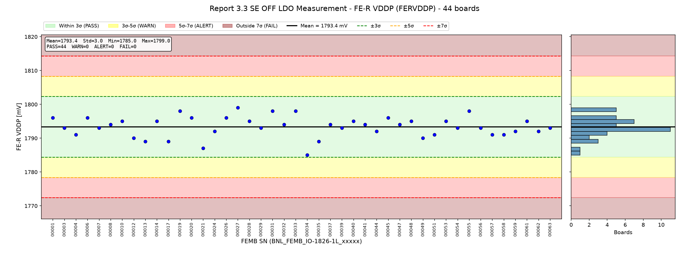

### 4.6 FE-L VDDP (`FELVDDP`)

Left-side LArASIC supply.  
Mean = 1792.7 mV, σ = 3.2 mV, range [1783.0, 1799.0], 14 distinct values over 44 boards.

| FEMB SN | Value | Deviation | Level |
|---|---|---|---|
| BNL_FEMB_IO-1826-1L_00013 | 1783.0 mV | 3.1σ | **WARN** |

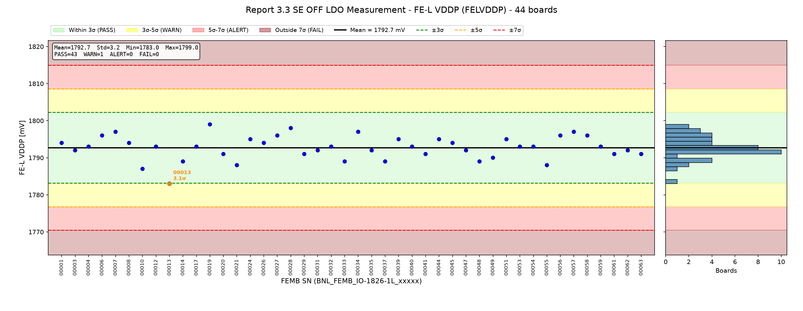

### 4.7 ADC-R 2.5V #1 (`ADCRP25V_1_HALF`)

Right-side ColdADC 2.5 V supply #1.  
Mean = 2252.5 mV, σ = 5.8 mV, range [2243.0, 2265.0], 19 distinct values over 44 boards.

All boards within 3σ.

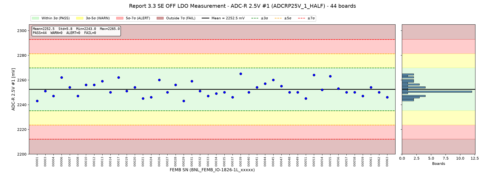

### 4.8 ADC-L 2.5V #1 (`ADCLP25V_1_HALF`)

Left-side ColdADC 2.5 V supply #1.  
Mean = 2250.4 mV, σ = 5.3 mV, range [2240.0, 2259.0], 15 distinct values over 44 boards.

All boards within 3σ.

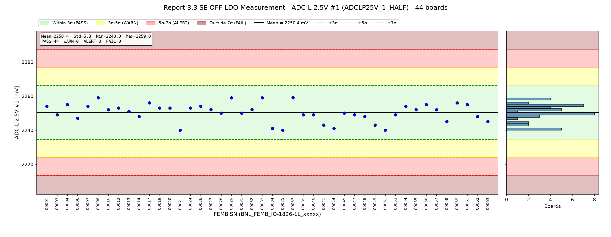

### 4.9 ADC-R 2.5V (`ADCRP25V_HALF`)

Right-side ColdADC 2.5 V main supply.  
Mean = 2251.7 mV, σ = 5.7 mV, range [2237.0, 2264.0], 22 distinct values over 44 boards.

All boards within 3σ.

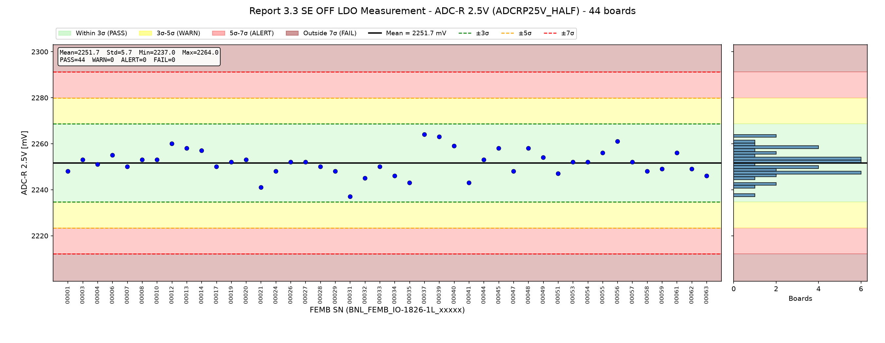

### 4.10 ADC-L 2.5V (`ADCLP25V_HALF`)

Left-side ColdADC 2.5 V main supply.  
Mean = 2252.1 mV, σ = 5.3 mV, range [2240.0, 2265.0], 20 distinct values over 44 boards.

All boards within 3σ.

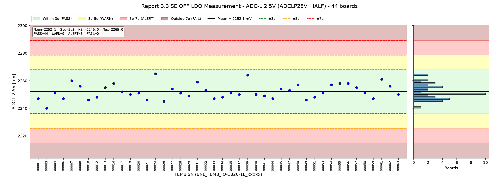

### 4.11 Ground (`GND`)

Ground reference reading of the monitor ADC.  
Mean = 29.5 mV, σ = 2.6 mV, range [23.0, 33.0], 8 distinct values over 44 boards.

All boards within 3σ.

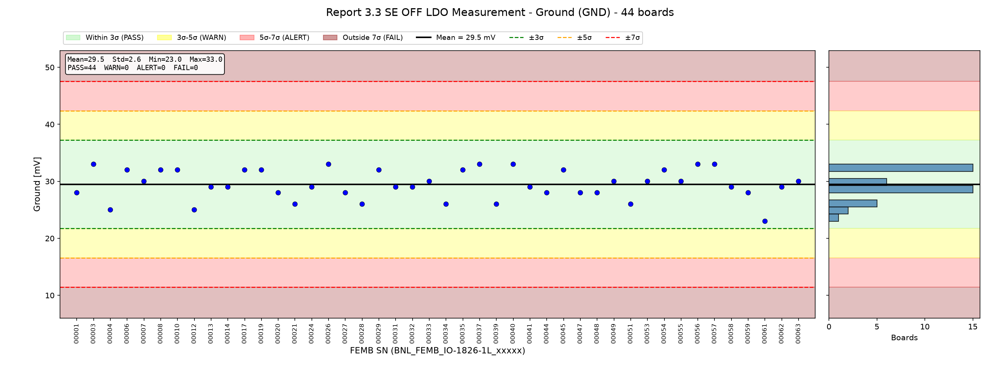

## 5. Observations

- **BNL_FEMB_IO-1826-1L_00013**: FELVDDP 3.1σ (WARN)
- Readout resolution is coarse (≤ 10 distinct values) for: CDVDDA, ADCRVDDD1P2, ADCLVDDD1P2, GND. σ is therefore small and quantized; a minimum tolerance tied to instrument resolution should be considered before using these limits.
- Flagged boards are still included in the statistics and inflate σ; re-deriving limits without them would tighten the criteria.

## Appendix A: Per-Board Judgement

| FEMB SN | Test time | CDVDDA | CDVDDIO_HALF | ADCRVDDD1P2 | ADCLVDDD1P2 | FERVDDP | FELVDDP | ADCRP25V_1_HALF | ADCLP25V_1_HALF | ADCRP25V_HALF | ADCLP25V_HALF | GND | Worst |
|---|---|---|---|---|---|---|---|---|---|---|---|---|---|
| BNL_FEMB_IO-1826-1L_00001 | 2026-07-28 15:21 | 0.5σ | 0.4σ | 1.8σ | 0.8σ | 0.9σ | 0.4σ | 1.6σ | 0.7σ | 0.6σ | 1.0σ | 0.6σ | PASS |
| BNL_FEMB_IO-1826-1L_00003 | 2026-07-28 15:21 | 0.5σ | 1.1σ | 1.8σ | 1.9σ | 0.1σ | 0.2σ | 0.3σ | 0.3σ | 0.2σ | 2.3σ | 1.4σ | PASS |
| BNL_FEMB_IO-1826-1L_00004 | 2026-08-03 22:20 | 1.9σ | 1.6σ | 1.9σ | 0.8σ | 0.8σ | 0.1σ | 0.9σ | 0.9σ | 0.1σ | 0.2σ | 1.7σ | PASS |
| BNL_FEMB_IO-1826-1L_00006 | 2026-07-28 20:07 | 0.5σ | 0.8σ | 0.2σ | 0.3σ | 0.9σ | 1.0σ | 1.7σ | 0.6σ | 0.6σ | 1.0σ | 1.0σ | PASS |
| BNL_FEMB_IO-1826-1L_00007 | 2026-09-11 18:46 | 1.5σ | 0.1σ | 0.7σ | 1.4σ | 0.1σ | 1.4σ | 0.3σ | 0.7σ | 0.3σ | 1.5σ | 0.2σ | PASS |
| BNL_FEMB_IO-1826-1L_00008 | 2026-07-28 20:24 | 1.9σ | 0.1σ | 0.7σ | 0.3σ | 0.2σ | 0.4σ | 0.9σ | 1.6σ | 0.2σ | 0.7σ | 1.0σ | PASS |
| BNL_FEMB_IO-1826-1L_00010 | 2026-07-28 00:58 | 0.9σ | 0.2σ | 0.7σ | 2.4σ | 0.5σ | 1.8σ | 0.6σ | 0.3σ | 0.2σ | 1.1σ | 1.0σ | PASS |
| BNL_FEMB_IO-1826-1L_00012 | 2026-07-29 22:28 | 0.9σ | 0.9σ | 1.3σ | 1.9σ | 1.1σ | 0.1σ | 0.6σ | 0.5σ | 1.5σ | 0.8σ | 1.7σ | PASS |
| BNL_FEMB_IO-1826-1L_00013 | 2026-07-28 14:53 | 0.0σ | 0.6σ | 0.3σ | 1.4σ | 1.5σ | **3.1σ WARN** | 1.1σ | 0.1σ | 1.1σ | 0.6σ | 0.2σ | WARN |
| BNL_FEMB_IO-1826-1L_00014 | 2026-07-28 20:07 | 0.5σ | 1.3σ | 0.2σ | 0.8σ | 0.5σ | 1.2σ | 0.4σ | 0.4σ | 0.9σ | 1.1σ | 0.2σ | PASS |
| BNL_FEMB_IO-1826-1L_00017 | 2026-09-11 19:03 | 0.5σ | 1.1σ | 0.2σ | 0.3σ | 1.5σ | 0.1σ | 1.7σ | 1.1σ | 0.3σ | 0.0σ | 1.0σ | PASS |
| BNL_FEMB_IO-1826-1L_00019 | 2026-07-28 15:07 | 0.4σ | 0.6σ | 0.8σ | 0.8σ | 1.5σ | 2.0σ | 0.3σ | 0.5σ | 0.1σ | 0.4σ | 1.0σ | PASS |
| BNL_FEMB_IO-1826-1L_00020 | 2026-09-11 19:03 | 0.0σ | 0.2σ | 0.3σ | 0.3σ | 0.9σ | 0.5σ | 0.3σ | 0.5σ | 0.2σ | 0.2σ | 0.6σ | PASS |
| BNL_FEMB_IO-1826-1L_00021 | 2026-07-29 22:36 | 2.4σ | 0.2σ | 0.8σ | 1.9σ | 2.1σ | 1.5σ | 1.3σ | 2.0σ | 1.9σ | 1.1σ | 1.3σ | PASS |
| BNL_FEMB_IO-1826-1L_00024 | 2026-09-11 19:03 | 1.9σ | 0.6σ | 1.8σ | 0.8σ | 0.5σ | 0.7σ | 1.1σ | 0.5σ | 0.6σ | 2.4σ | 0.2σ | PASS |
| BNL_FEMB_IO-1826-1L_00026 | 2026-07-28 15:21 | 0.5σ | 0.6σ | 0.8σ | 1.3σ | 0.9σ | 0.4σ | 1.3σ | 0.7σ | 0.1σ | 1.3σ | 1.4σ | PASS |
| BNL_FEMB_IO-1826-1L_00027 | 2026-09-11 18:46 | 0.4σ | 1.6σ | 1.3σ | 0.3σ | 1.9σ | 1.0σ | 0.4σ | 0.3σ | 0.1σ | 0.4σ | 0.6σ | PASS |
| BNL_FEMB_IO-1826-1L_00028 | 2026-07-28 00:03 | 0.0σ | 0.9σ | 1.3σ | 0.3σ | 0.5σ | 1.7σ | 0.6σ | 0.1σ | 0.3σ | 0.2σ | 1.3σ | PASS |
| BNL_FEMB_IO-1826-1L_00029 | 2026-07-28 19:55 | 0.4σ | 0.9σ | 0.8σ | 0.8σ | 0.1σ | 0.5σ | 1.6σ | 1.6σ | 0.6σ | 0.6σ | 1.0σ | PASS |
| BNL_FEMB_IO-1826-1L_00031 | 2026-07-28 00:58 | 0.5σ | 1.4σ | 0.3σ | 0.8σ | 1.5σ | 0.2σ | 1.1σ | 0.1σ | 2.6σ | 1.3σ | 0.2σ | PASS |
| BNL_FEMB_IO-1826-1L_00032 | 2026-07-28 15:36 | 0.0σ | 0.4σ | 1.9σ | 0.3σ | 0.2σ | 0.1σ | 0.3σ | 0.3σ | 1.2σ | 0.2σ | 0.2σ | PASS |
| BNL_FEMB_IO-1826-1L_00033 | 2026-09-17 22:09 | 0.5σ | 0.8σ | 0.2σ | 1.3σ | 1.5σ | 1.2σ | 0.9σ | 1.6σ | 0.3σ | 1.0σ | 0.2σ | PASS |
| BNL_FEMB_IO-1826-1L_00034 | 2026-09-17 22:09 | 0.9σ | 1.8σ | 1.3σ | 0.8σ | 2.8σ | 1.4σ | 0.6σ | 1.8σ | 1.0σ | 0.8σ | 1.3σ | PASS |
| BNL_FEMB_IO-1826-1L_00035 | 2026-09-11 18:46 | 0.5σ | 1.6σ | 0.3σ | 0.2σ | 1.5σ | 0.2σ | 0.4σ | 2.0σ | 1.5σ | 0.2σ | 1.0σ | PASS |
| BNL_FEMB_IO-1826-1L_00037 | 2026-07-28 00:03 | 0.4σ | 1.6σ | 0.3σ | 0.8σ | 0.2σ | 1.2σ | 1.1σ | 1.6σ | 2.2σ | 0.4σ | 1.4σ | PASS |
| BNL_FEMB_IO-1826-1L_00039 | 2026-07-28 20:41 | 0.9σ | 0.4σ | 1.8σ | 0.8σ | 0.1σ | 0.7σ | 2.2σ | 0.3σ | 2.0σ | 2.2σ | 1.3σ | PASS |
| BNL_FEMB_IO-1826-1L_00040 | 2026-07-28 20:41 | 0.5σ | 0.8σ | 0.2σ | 0.8σ | 0.5σ | 0.1σ | 0.4σ | 0.3σ | 1.3σ | 0.4σ | 1.4σ | PASS |
| BNL_FEMB_IO-1826-1L_00041 | 2026-07-28 20:24 | 0.5σ | 0.1σ | 1.3σ | 0.2σ | 0.2σ | 0.5σ | 0.3σ | 1.4σ | 1.5σ | 0.6σ | 0.2σ | PASS |
| BNL_FEMB_IO-1826-1L_00044 | 2026-07-28 15:07 | 1.5σ | 0.2σ | 0.8σ | 0.8σ | 0.5σ | 0.7σ | 0.8σ | 1.8σ | 0.2σ | 1.0σ | 0.6σ | PASS |
| BNL_FEMB_IO-1826-1L_00045 | 2026-07-28 14:53 | 1.0σ | 0.4σ | 0.7σ | 0.3σ | 0.9σ | 0.4σ | 1.3σ | 0.1σ | 1.1σ | 0.4σ | 1.0σ | PASS |
| BNL_FEMB_IO-1826-1L_00047 | 2026-07-27 23:48 | 0.0σ | 1.6σ | 0.3σ | 0.3σ | 0.2σ | 0.2σ | 0.4σ | 0.3σ | 0.6σ | 0.2σ | 0.6σ | PASS |
| BNL_FEMB_IO-1826-1L_00048 | 2026-07-28 14:53 | 0.0σ | 1.6σ | 0.2σ | 1.3σ | 0.5σ | 1.2σ | 0.4σ | 0.4σ | 1.1σ | 0.9σ | 0.6σ | PASS |
| BNL_FEMB_IO-1826-1L_00049 | 2026-07-28 19:55 | 1.5σ | 1.3σ | 0.8σ | 1.4σ | 1.1σ | 0.9σ | 0.4σ | 1.4σ | 0.4σ | 1.1σ | 0.2σ | PASS |
| BNL_FEMB_IO-1826-1L_00051 | 2026-10-15 17:19 | 2.4σ | 0.4σ | 0.2σ | 0.8σ | 0.8σ | 0.7σ | 1.3σ | 2.0σ | 0.8σ | 0.8σ | 1.3σ | PASS |
| BNL_FEMB_IO-1826-1L_00053 | 2026-07-28 15:36 | 0.9σ | 1.0σ | 0.8σ | 0.8σ | 0.5σ | 0.1σ | 2.0σ | 0.3σ | 0.1σ | 0.2σ | 0.2σ | PASS |
| BNL_FEMB_IO-1826-1L_00054 | 2026-07-28 00:58 | 0.9σ | 1.0σ | 0.3σ | 0.8σ | 0.1σ | 0.1σ | 0.1σ | 0.7σ | 0.1σ | 0.9σ | 1.0σ | PASS |
| BNL_FEMB_IO-1826-1L_00055 | 2026-07-28 00:58 | 0.5σ | 0.4σ | 0.8σ | 0.3σ | 1.5σ | 1.5σ | 1.8σ | 0.3σ | 0.8σ | 1.1σ | 0.2σ | PASS |
| BNL_FEMB_IO-1826-1L_00056 | 2026-07-28 20:24 | 0.9σ | 1.6σ | 0.2σ | 1.3σ | 0.1σ | 1.0σ | 0.1σ | 0.9σ | 1.7σ | 1.1σ | 1.4σ | PASS |
| BNL_FEMB_IO-1826-1L_00057 | 2026-07-28 15:07 | 1.4σ | 0.3σ | 0.7σ | 0.3σ | 0.8σ | 1.4σ | 0.4σ | 0.3σ | 0.1σ | 0.6σ | 1.4σ | PASS |
| BNL_FEMB_IO-1826-1L_00058 | 2026-09-17 22:09 | 0.4σ | 0.4σ | 1.3σ | 0.3σ | 0.8σ | 1.0σ | 0.4σ | 1.0σ | 0.6σ | 0.2σ | 0.2σ | PASS |
| BNL_FEMB_IO-1826-1L_00059 | 2026-08-03 18:53 | 0.0σ | 1.6σ | 0.3σ | 0.2σ | 0.5σ | 0.1σ | 0.9σ | 1.1σ | 0.5σ | 1.0σ | 0.6σ | PASS |
| BNL_FEMB_IO-1826-1L_00061 | 2026-10-09 17:53 | 0.9σ | 0.6σ | 1.8σ | 1.9σ | 0.5σ | 0.5σ | 0.3σ | 0.9σ | 0.8σ | 1.7σ | 2.5σ | PASS |
| BNL_FEMB_IO-1826-1L_00062 | 2026-07-27 23:48 | 0.5σ | 0.3σ | 0.2σ | 0.3σ | 0.5σ | 0.2σ | 0.4σ | 0.4σ | 0.5σ | 0.7σ | 0.2σ | PASS |
| BNL_FEMB_IO-1826-1L_00063 | 2026-07-28 19:55 | 0.9σ | 1.5σ | 1.3σ | 0.8σ | 0.1σ | 0.5σ | 1.1σ | 1.0σ | 1.0σ | 0.4σ | 0.2σ | PASS |

## Appendix B: Output Files

- `output/criteria_3_3.csv` – mean, σ and 3σ/5σ/7σ limits per parameter
- `output/judgement_3_3.csv` – value, deviation and level per board per parameter
- `output/plot_3_3_*.png` – distribution plots
