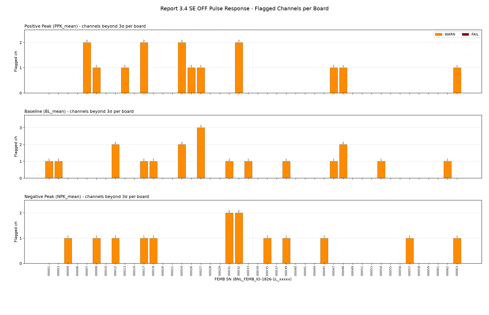
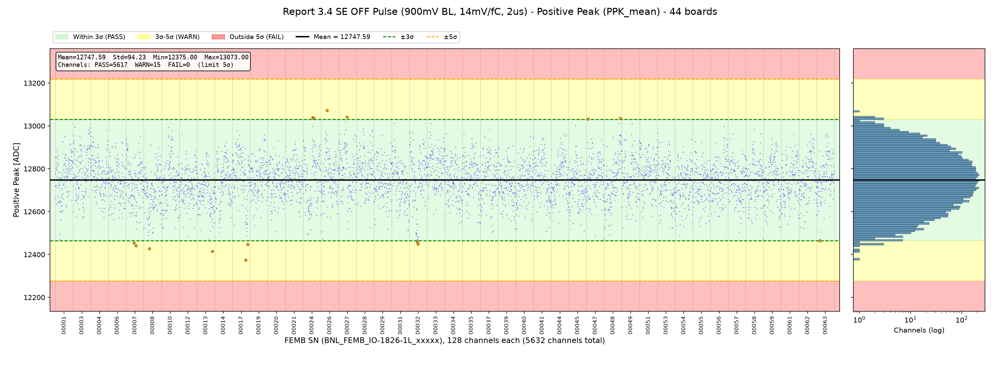
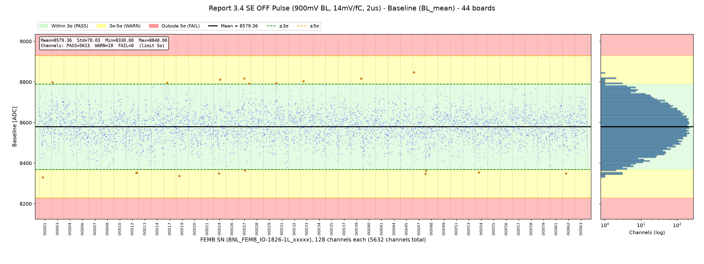
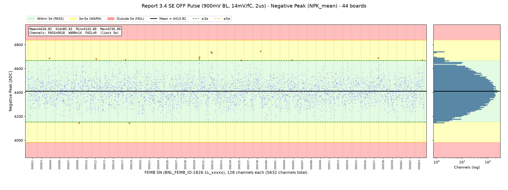

# FEMB QC Parameter Evaluation - Report Section 3.4: SE OFF Pulse Response

**Board version:** FEMB-IO 1826-1L  
**Boards used:** 44 (latest passing test per board; excluded: 00046)  
**Channels:** 44 × 128 = 5632  
**Test period:** 2026-07-27 23:48 - 2026-10-15 17:19  
**Configuration:** single-ended, SE buffer OFF, 900 mV baseline, 14 mV/fC, 2 µs, calibration pulse DAC 0x10  
**Generated:** 2026-10-16 16:37  
**Script:** `eval_3_4_se_off_pulse.py`

## 1. Scope

Section 3.4 of the checkout report is the pulse-response test in the SE OFF configuration: the on-chip calibration pulse (DAC 0x10) is injected into every channel and, for each of the 128 channels, the positive peak, the baseline and the negative peak of the pulse are recorded (`se_pulse_ana()`, `report_log07csv`).

The CSV also stores `PPK_max/min`, `NPK_max/min` and `BL_max/min`; for every board they are identical to the corresponding `_mean` array (one value per channel), so only the `_mean` arrays are evaluated.

| Parameter | Description |
|---|---|
| `PPK_mean` – Positive Peak | Positive peak of the averaged calibration pulse, ADC counts |
| `BL_mean` – Baseline | Baseline level of the pulse waveform, ADC counts |
| `NPK_mean` – Negative Peak | Negative peak (undershoot minimum) of the pulse waveform, ADC counts |

## 2. Judgement Method

For each parameter the mean and σ are computed over all 5632 channels pooled together; each channel is graded by |x − mean| / σ. A board takes the worst level among its channels.

Channel-level (noise / pulse) parameters use **5σ as the limit**: a channel beyond 5σ fails. (Board-level power and LDO parameters keep the wider 7σ limit.)

| Level | Deviation | Plot background |
|---|---|---|
| PASS | ≤ 3σ | green |
| WARN | 3σ – 5σ | yellow |
| FAIL | > 5σ | red |

For a Gaussian distribution, about 0.27 % of channels (≈ 15 of 5632) are expected beyond 3σ by chance, so isolated WARN channels are normal.

## 3. Summary

| Parameter | Mean | Std | Min | Max | PASS | WARN | FAIL | Boards with ≥1 FAIL |
|---|---|---|---|---|---|---|---|---|
| `PPK_mean` | 12747.59 | 94.23 | 12375.00 | 13073.00 | 5617 | 15 | 0 | – |
| `BL_mean` | 8579.36 | 70.03 | 8330.00 | 8848.00 | 5613 | 19 | 0 | – |
| `NPK_mean` | 4410.82 | 85.63 | 4143.00 | 4745.00 | 5618 | 14 | 0 | – |

### Criteria (limits, ADC counts)

| Parameter | −5σ (FAIL) | −3σ | Mean | +3σ | +5σ (FAIL) |
|---|---|---|---|---|---|
| `PPK_mean` | 12276.44 | 12464.90 | 12747.59 | 13030.28 | 13218.73 |
| `BL_mean` | 8229.19 | 8369.26 | 8579.36 | 8789.46 | 8929.53 |
| `NPK_mean` | 3982.66 | 4153.93 | 4410.82 | 4667.71 | 4838.97 |

### Flagged channels per board

## 4. Parameters

### 4.1 Positive Peak (`PPK_mean`)

Mean = 12747.59, σ = 94.23, range [12375.00, 13073.00] ADC. Spread of per-board means: σ = 22.56; spread of per-channel means across boards: σ = 45.81.

15 channel(s) beyond 3σ:

| FEMB SN | Channel | Chip | Value | Deviation | Level |
|---|---|---|---|---|---|
| BNL_FEMB_IO-1826-1L_00017 | 96 | 6 | 12375.00 | 4.0σ | WARN |
| BNL_FEMB_IO-1826-1L_00013 | 112 | 7 | 12414.00 | 3.5σ | WARN |
| BNL_FEMB_IO-1826-1L_00026 | 44 | 2 | 13073.00 | 3.5σ | WARN |
| BNL_FEMB_IO-1826-1L_00008 | 40 | 2 | 12427.00 | 3.4σ | WARN |
| BNL_FEMB_IO-1826-1L_00007 | 72 | 4 | 12441.00 | 3.3σ | WARN |
| BNL_FEMB_IO-1826-1L_00017 | 110 | 6 | 12448.00 | 3.2σ | WARN |
| BNL_FEMB_IO-1826-1L_00032 | 63 | 3 | 12449.00 | 3.2σ | WARN |
| BNL_FEMB_IO-1826-1L_00007 | 56 | 3 | 12453.00 | 3.1σ | WARN |
| BNL_FEMB_IO-1826-1L_00027 | 60 | 3 | 13041.00 | 3.1σ | WARN |
| BNL_FEMB_IO-1826-1L_00024 | 68 | 4 | 13039.00 | 3.1σ | WARN |
| BNL_FEMB_IO-1826-1L_00032 | 58 | 3 | 12458.00 | 3.1σ | WARN |
| BNL_FEMB_IO-1826-1L_00024 | 76 | 4 | 13037.00 | 3.1σ | WARN |
| BNL_FEMB_IO-1826-1L_00048 | 116 | 7 | 13036.00 | 3.1σ | WARN |
| BNL_FEMB_IO-1826-1L_00047 | 11 | 0 | 13033.00 | 3.0σ | WARN |
| BNL_FEMB_IO-1826-1L_00063 | 24 | 1 | 12464.00 | 3.0σ | WARN |

### 4.2 Baseline (`BL_mean`)

Mean = 8579.36, σ = 70.03, range [8330.00, 8848.00] ADC. Spread of per-board means: σ = 13.60; spread of per-channel means across boards: σ = 28.11.

19 channel(s) beyond 3σ:

| FEMB SN | Channel | Chip | Value | Deviation | Level |
|---|---|---|---|---|---|
| BNL_FEMB_IO-1826-1L_00047 | 11 | 0 | 8848.00 | 3.8σ | WARN |
| BNL_FEMB_IO-1826-1L_00001 | 38 | 2 | 8330.00 | 3.6σ | WARN |
| BNL_FEMB_IO-1826-1L_00019 | 33 | 2 | 8337.00 | 3.5σ | WARN |
| BNL_FEMB_IO-1826-1L_00027 | 60 | 3 | 8817.00 | 3.4σ | WARN |
| BNL_FEMB_IO-1826-1L_00039 | 109 | 6 | 8816.00 | 3.4σ | WARN |
| BNL_FEMB_IO-1826-1L_00024 | 68 | 4 | 8812.00 | 3.3σ | WARN |
| BNL_FEMB_IO-1826-1L_00048 | 1 | 0 | 8347.00 | 3.3σ | WARN |
| BNL_FEMB_IO-1826-1L_00024 | 57 | 3 | 8349.00 | 3.3σ | WARN |
| BNL_FEMB_IO-1826-1L_00062 | 38 | 2 | 8349.00 | 3.3σ | WARN |
| BNL_FEMB_IO-1826-1L_00012 | 104 | 6 | 8353.00 | 3.2σ | WARN |
| BNL_FEMB_IO-1826-1L_00012 | 110 | 6 | 8353.00 | 3.2σ | WARN |
| BNL_FEMB_IO-1826-1L_00054 | 38 | 2 | 8354.00 | 3.2σ | WARN |
| BNL_FEMB_IO-1826-1L_00033 | 29 | 1 | 8804.00 | 3.2σ | WARN |
| BNL_FEMB_IO-1826-1L_00003 | 13 | 0 | 8798.00 | 3.1σ | WARN |
| BNL_FEMB_IO-1826-1L_00048 | 6 | 0 | 8363.00 | 3.1σ | WARN |
| BNL_FEMB_IO-1826-1L_00017 | 36 | 2 | 8795.00 | 3.1σ | WARN |
| BNL_FEMB_IO-1826-1L_00027 | 68 | 4 | 8364.00 | 3.1σ | WARN |
| BNL_FEMB_IO-1826-1L_00031 | 5 | 0 | 8794.00 | 3.1σ | WARN |
| BNL_FEMB_IO-1826-1L_00027 | 111 | 6 | 8792.00 | 3.0σ | WARN |

### 4.3 Negative Peak (`NPK_mean`)

Mean = 4410.82, σ = 85.63, range [4143.00, 4745.00] ADC. Spread of per-board means: σ = 16.70; spread of per-channel means across boards: σ = 44.88.

14 channel(s) beyond 3σ:

| FEMB SN | Channel | Chip | Value | Deviation | Level |
|---|---|---|---|---|---|
| BNL_FEMB_IO-1826-1L_00039 | 109 | 6 | 4745.00 | 3.9σ | WARN |
| BNL_FEMB_IO-1826-1L_00032 | 48 | 3 | 4739.00 | 3.8σ | WARN |
| BNL_FEMB_IO-1826-1L_00032 | 56 | 3 | 4730.00 | 3.7σ | WARN |
| BNL_FEMB_IO-1826-1L_00031 | 8 | 0 | 4697.00 | 3.3σ | WARN |
| BNL_FEMB_IO-1826-1L_00057 | 120 | 7 | 4689.00 | 3.2σ | WARN |
| BNL_FEMB_IO-1826-1L_00004 | 47 | 2 | 4686.00 | 3.2σ | WARN |
| BNL_FEMB_IO-1826-1L_00031 | 5 | 0 | 4682.00 | 3.2σ | WARN |
| BNL_FEMB_IO-1826-1L_00012 | 72 | 4 | 4681.00 | 3.2σ | WARN |
| BNL_FEMB_IO-1826-1L_00019 | 33 | 2 | 4143.00 | 3.1σ | WARN |
| BNL_FEMB_IO-1826-1L_00008 | 86 | 5 | 4145.00 | 3.1σ | WARN |
| BNL_FEMB_IO-1826-1L_00017 | 107 | 6 | 4672.00 | 3.1σ | WARN |
| BNL_FEMB_IO-1826-1L_00063 | 104 | 6 | 4671.00 | 3.0σ | WARN |
| BNL_FEMB_IO-1826-1L_00035 | 88 | 5 | 4669.00 | 3.0σ | WARN |
| BNL_FEMB_IO-1826-1L_00045 | 40 | 2 | 4669.00 | 3.0σ | WARN |

## 5. Observations

- **PPK_mean**: no channel beyond 5σ.
- **BL_mean**: no channel beyond 5σ.
- **NPK_mean**: no channel beyond 5σ.

## Appendix A: Per-Board Judgement

Each cell: number of channels WARN / FAIL, and worst deviation.

| FEMB SN | Test time | `PPK_mean` | `BL_mean` | `NPK_mean` | Worst |
|---|---|---|---|---|---|
| BNL_FEMB_IO-1826-1L_00001 | 2026-07-28 15:21 | 0/0 (3.0σ) | 1/0 (3.6σ) | 0/0 (2.7σ) | WARN |
| BNL_FEMB_IO-1826-1L_00003 | 2026-07-28 15:21 | 0/0 (2.6σ) | 1/0 (3.1σ) | 0/0 (2.3σ) | WARN |
| BNL_FEMB_IO-1826-1L_00004 | 2026-08-03 22:20 | 0/0 (2.5σ) | 0/0 (3.0σ) | 1/0 (3.2σ) | WARN |
| BNL_FEMB_IO-1826-1L_00006 | 2026-07-28 20:07 | 0/0 (1.9σ) | 0/0 (2.7σ) | 0/0 (2.5σ) | PASS |
| BNL_FEMB_IO-1826-1L_00007 | 2026-09-11 18:46 | 2/0 (3.3σ) | 0/0 (2.9σ) | 0/0 (2.6σ) | WARN |
| BNL_FEMB_IO-1826-1L_00008 | 2026-07-28 20:24 | 1/0 (3.4σ) | 0/0 (2.9σ) | 1/0 (3.1σ) | WARN |
| BNL_FEMB_IO-1826-1L_00010 | 2026-07-28 00:58 | 0/0 (2.6σ) | 0/0 (2.5σ) | 0/0 (2.8σ) | PASS |
| BNL_FEMB_IO-1826-1L_00012 | 2026-07-29 22:28 | 0/0 (3.0σ) | 2/0 (3.2σ) | 1/0 (3.2σ) | WARN |
| BNL_FEMB_IO-1826-1L_00013 | 2026-07-28 14:53 | 1/0 (3.5σ) | 0/0 (2.7σ) | 0/0 (2.8σ) | WARN |
| BNL_FEMB_IO-1826-1L_00014 | 2026-07-28 20:07 | 0/0 (2.6σ) | 0/0 (2.8σ) | 0/0 (2.9σ) | PASS |
| BNL_FEMB_IO-1826-1L_00017 | 2026-09-11 19:03 | 2/0 (4.0σ) | 1/0 (3.1σ) | 1/0 (3.1σ) | WARN |
| BNL_FEMB_IO-1826-1L_00019 | 2026-07-28 15:07 | 0/0 (2.3σ) | 1/0 (3.5σ) | 1/0 (3.1σ) | WARN |
| BNL_FEMB_IO-1826-1L_00020 | 2026-09-11 19:03 | 0/0 (2.6σ) | 0/0 (2.5σ) | 0/0 (2.2σ) | PASS |
| BNL_FEMB_IO-1826-1L_00021 | 2026-07-29 22:36 | 0/0 (1.9σ) | 0/0 (2.6σ) | 0/0 (2.4σ) | PASS |
| BNL_FEMB_IO-1826-1L_00024 | 2026-09-11 19:03 | 2/0 (3.1σ) | 2/0 (3.3σ) | 0/0 (2.9σ) | WARN |
| BNL_FEMB_IO-1826-1L_00026 | 2026-07-28 15:21 | 1/0 (3.5σ) | 0/0 (2.8σ) | 0/0 (2.9σ) | WARN |
| BNL_FEMB_IO-1826-1L_00027 | 2026-09-11 18:46 | 1/0 (3.1σ) | 3/0 (3.4σ) | 0/0 (2.9σ) | WARN |
| BNL_FEMB_IO-1826-1L_00028 | 2026-07-28 00:03 | 0/0 (2.5σ) | 0/0 (2.7σ) | 0/0 (2.2σ) | PASS |
| BNL_FEMB_IO-1826-1L_00029 | 2026-07-28 19:55 | 0/0 (2.4σ) | 0/0 (2.6σ) | 0/0 (2.0σ) | PASS |
| BNL_FEMB_IO-1826-1L_00031 | 2026-07-28 00:58 | 0/0 (2.8σ) | 1/0 (3.1σ) | 2/0 (3.3σ) | WARN |
| BNL_FEMB_IO-1826-1L_00032 | 2026-07-28 15:36 | 2/0 (3.2σ) | 0/0 (2.6σ) | 2/0 (3.8σ) | WARN |
| BNL_FEMB_IO-1826-1L_00033 | 2026-09-17 22:09 | 0/0 (2.8σ) | 1/0 (3.2σ) | 0/0 (2.4σ) | WARN |
| BNL_FEMB_IO-1826-1L_00034 | 2026-09-17 22:09 | 0/0 (2.3σ) | 0/0 (2.6σ) | 0/0 (2.8σ) | PASS |
| BNL_FEMB_IO-1826-1L_00035 | 2026-09-11 18:46 | 0/0 (2.3σ) | 0/0 (2.9σ) | 1/0 (3.0σ) | WARN |
| BNL_FEMB_IO-1826-1L_00037 | 2026-07-28 00:03 | 0/0 (2.6σ) | 0/0 (2.8σ) | 0/0 (2.6σ) | PASS |
| BNL_FEMB_IO-1826-1L_00039 | 2026-07-28 20:41 | 0/0 (2.0σ) | 1/0 (3.4σ) | 1/0 (3.9σ) | WARN |
| BNL_FEMB_IO-1826-1L_00040 | 2026-07-28 20:41 | 0/0 (2.4σ) | 0/0 (2.9σ) | 0/0 (2.7σ) | PASS |
| BNL_FEMB_IO-1826-1L_00041 | 2026-07-28 20:24 | 0/0 (2.5σ) | 0/0 (2.5σ) | 0/0 (2.5σ) | PASS |
| BNL_FEMB_IO-1826-1L_00044 | 2026-07-28 15:07 | 0/0 (2.3σ) | 0/0 (2.5σ) | 0/0 (3.0σ) | PASS |
| BNL_FEMB_IO-1826-1L_00045 | 2026-07-28 14:53 | 0/0 (2.7σ) | 0/0 (3.0σ) | 1/0 (3.0σ) | WARN |
| BNL_FEMB_IO-1826-1L_00047 | 2026-07-27 23:48 | 1/0 (3.0σ) | 1/0 (3.8σ) | 0/0 (2.7σ) | WARN |
| BNL_FEMB_IO-1826-1L_00048 | 2026-07-28 14:53 | 1/0 (3.1σ) | 2/0 (3.3σ) | 0/0 (2.6σ) | WARN |
| BNL_FEMB_IO-1826-1L_00049 | 2026-07-28 19:55 | 0/0 (2.8σ) | 0/0 (2.8σ) | 0/0 (2.5σ) | PASS |
| BNL_FEMB_IO-1826-1L_00051 | 2026-10-15 17:19 | 0/0 (1.9σ) | 0/0 (2.8σ) | 0/0 (2.7σ) | PASS |
| BNL_FEMB_IO-1826-1L_00053 | 2026-07-28 15:36 | 0/0 (2.4σ) | 0/0 (2.3σ) | 0/0 (2.5σ) | PASS |
| BNL_FEMB_IO-1826-1L_00054 | 2026-07-28 00:58 | 0/0 (2.8σ) | 1/0 (3.2σ) | 0/0 (2.8σ) | WARN |
| BNL_FEMB_IO-1826-1L_00055 | 2026-07-28 00:58 | 0/0 (2.3σ) | 0/0 (2.6σ) | 0/0 (2.0σ) | PASS |
| BNL_FEMB_IO-1826-1L_00056 | 2026-07-28 20:24 | 0/0 (2.6σ) | 0/0 (2.8σ) | 0/0 (2.3σ) | PASS |
| BNL_FEMB_IO-1826-1L_00057 | 2026-07-28 15:07 | 0/0 (2.6σ) | 0/0 (2.7σ) | 1/0 (3.2σ) | WARN |
| BNL_FEMB_IO-1826-1L_00058 | 2026-09-17 22:09 | 0/0 (2.5σ) | 0/0 (2.7σ) | 0/0 (2.8σ) | PASS |
| BNL_FEMB_IO-1826-1L_00059 | 2026-08-03 18:53 | 0/0 (2.9σ) | 0/0 (2.5σ) | 0/0 (2.3σ) | PASS |
| BNL_FEMB_IO-1826-1L_00061 | 2026-10-09 17:53 | 0/0 (2.3σ) | 0/0 (2.7σ) | 0/0 (2.7σ) | PASS |
| BNL_FEMB_IO-1826-1L_00062 | 2026-07-27 23:48 | 0/0 (2.4σ) | 1/0 (3.3σ) | 0/0 (2.9σ) | WARN |
| BNL_FEMB_IO-1826-1L_00063 | 2026-07-28 19:55 | 1/0 (3.0σ) | 0/0 (2.3σ) | 1/0 (3.0σ) | WARN |

## Appendix B: Output Files

- `output/criteria_3_4.csv` – mean, σ and 3σ/5σ limits per parameter
- `output/judgement_3_4_channels.csv` – every channel beyond 3σ (board, channel, value, deviation, level)
- `output/judgement_3_4_boards.csv` – per-board counts and worst level
- `output/plot_3_4_*.png` – distribution plots and per-board summary
