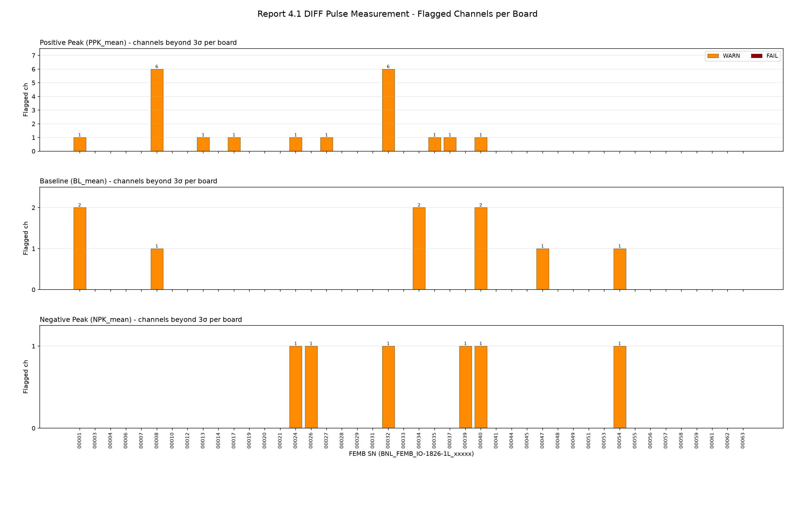
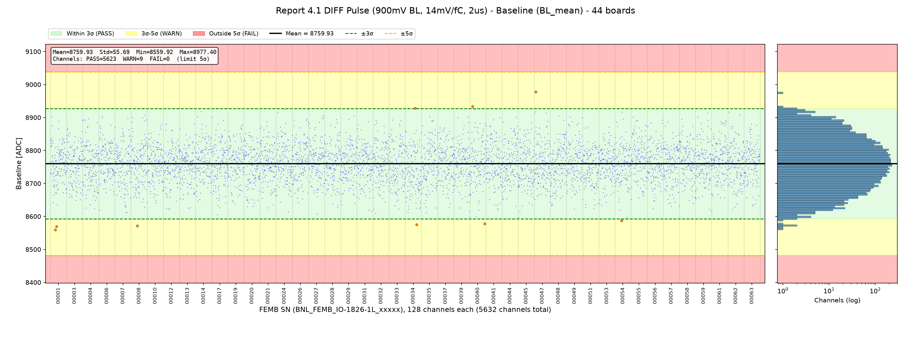
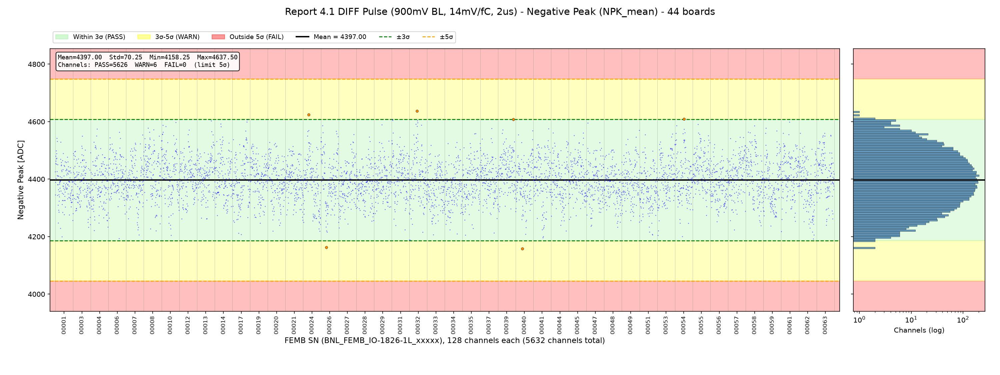

# FEMB QC Parameter Evaluation - Report Section 4.1: DIFF Pulse Measurement

**Board version:** FEMB-IO 1826-1L  
**Boards used:** 44 (latest passing test per board; excluded: 00046)  
**Channels:** 44 × 128 = 5632  
**Test period:** 2026-07-27 23:48 - 2026-10-15 17:19  
**Configuration:** differential ColdADC input (SDD on), 900 mV baseline, 14 mV/fC, 2 µs, calibration pulse DAC 0x10  
**Generated:** 2026-10-16 16:37  
**Script:** `eval_4_1_diff_pulse.py`

## 1. Scope

Section 4.1 of the checkout report repeats the pulse-response test of section 3.4 with the ColdADC in differential mode (FE differential driver SDD on): the calibration pulse (DAC 0x10) is injected into every channel and the positive peak, baseline and negative peak are measured.

**Data source.** The checkout CSV stores only the 4.1 True/False result. The per-channel values are read from `Pulse_Raw_DIFF_900mVBL_14_0mVfC_2_0us_0x10.bin` in each board's report folder, the pickle `[PPK, NPK, BL]` written by `QC_tools.GetPeaks()` during the checkout. (Cross-check: the same file type for section 3.4 agrees with the 3.4 CSV values to < 1 ADC; the CSV values are rounded.)

| Parameter | Description |
|---|---|
| `PPK_mean` – Positive Peak | Positive peak of the averaged calibration pulse, ADC counts |
| `BL_mean` – Baseline | Baseline level of the pulse waveform, ADC counts |
| `NPK_mean` – Negative Peak | Negative peak (undershoot minimum) of the pulse waveform, ADC counts |

## 2. Judgement Method

For each parameter the mean and σ are computed over all 5632 channels pooled together; each channel is graded by |x − mean| / σ. A board takes the worst level among its channels.

Channel-level (noise / pulse) parameters use **5σ as the limit**: a channel beyond 5σ fails. (Board-level power and LDO parameters keep the wider 7σ limit.)

| Level | Deviation | Plot background |
|---|---|---|
| PASS | ≤ 3σ | green |
| WARN | 3σ – 5σ | yellow |
| FAIL | > 5σ | red |

For a Gaussian distribution, about 0.27 % of channels (≈ 15 of 5632) are expected beyond 3σ by chance, so isolated WARN channels are normal.

## 3. Summary

| Parameter | Mean | Std | Min | Max | PASS | WARN | FAIL | Boards with ≥1 FAIL |
|---|---|---|---|---|---|---|---|---|
| `PPK_mean` | 12981.12 | 73.96 | 12696.50 | 13231.50 | 5612 | 20 | 0 | – |
| `BL_mean` | 8759.93 | 55.69 | 8559.92 | 8977.40 | 5623 | 9 | 0 | – |
| `NPK_mean` | 4397.00 | 70.25 | 4158.25 | 4637.50 | 5626 | 6 | 0 | – |

### Criteria (limits, ADC counts)

| Parameter | −5σ (FAIL) | −3σ | Mean | +3σ | +5σ (FAIL) |
|---|---|---|---|---|---|
| `PPK_mean` | 12611.30 | 12759.23 | 12981.12 | 13203.01 | 13350.94 |
| `BL_mean` | 8481.49 | 8592.86 | 8759.93 | 8926.99 | 9038.37 |
| `NPK_mean` | 4045.76 | 4186.25 | 4397.00 | 4607.75 | 4748.24 |

### Flagged channels per board

## 4. Parameters

### 4.1 Positive Peak (`PPK_mean`)

Mean = 12981.12, σ = 73.96, range [12696.50, 13231.50] ADC. Spread of per-board means: σ = 15.44; spread of per-channel means across boards: σ = 22.16.

20 channel(s) beyond 3σ:

| FEMB SN | Channel | Chip | Value | Deviation | Level |
|---|---|---|---|---|---|
| BNL_FEMB_IO-1826-1L_00032 | 58 | 3 | 12696.50 | 3.8σ | WARN |
| BNL_FEMB_IO-1826-1L_00008 | 40 | 2 | 12700.75 | 3.8σ | WARN |
| BNL_FEMB_IO-1826-1L_00032 | 55 | 3 | 12718.50 | 3.6σ | WARN |
| BNL_FEMB_IO-1826-1L_00040 | 118 | 7 | 12726.00 | 3.4σ | WARN |
| BNL_FEMB_IO-1826-1L_00008 | 33 | 2 | 12729.00 | 3.4σ | WARN |
| BNL_FEMB_IO-1826-1L_00035 | 68 | 4 | 13231.50 | 3.4σ | WARN |
| BNL_FEMB_IO-1826-1L_00008 | 34 | 2 | 12737.00 | 3.3σ | WARN |
| BNL_FEMB_IO-1826-1L_00008 | 43 | 2 | 12738.00 | 3.3σ | WARN |
| BNL_FEMB_IO-1826-1L_00008 | 39 | 2 | 12741.75 | 3.2σ | WARN |
| BNL_FEMB_IO-1826-1L_00001 | 38 | 2 | 12742.00 | 3.2σ | WARN |
| BNL_FEMB_IO-1826-1L_00032 | 52 | 3 | 12743.75 | 3.2σ | WARN |
| BNL_FEMB_IO-1826-1L_00027 | 7 | 0 | 13213.50 | 3.1σ | WARN |
| BNL_FEMB_IO-1826-1L_00024 | 68 | 4 | 13211.75 | 3.1σ | WARN |
| BNL_FEMB_IO-1826-1L_00013 | 88 | 5 | 12752.50 | 3.1σ | WARN |
| BNL_FEMB_IO-1826-1L_00037 | 94 | 5 | 12753.50 | 3.1σ | WARN |
| BNL_FEMB_IO-1826-1L_00032 | 48 | 3 | 12755.00 | 3.1σ | WARN |
| BNL_FEMB_IO-1826-1L_00032 | 49 | 3 | 12755.50 | 3.1σ | WARN |
| BNL_FEMB_IO-1826-1L_00008 | 41 | 2 | 12756.00 | 3.0σ | WARN |
| BNL_FEMB_IO-1826-1L_00032 | 63 | 3 | 12757.50 | 3.0σ | WARN |
| BNL_FEMB_IO-1826-1L_00017 | 110 | 6 | 12758.50 | 3.0σ | WARN |

### 4.2 Baseline (`BL_mean`)

Mean = 8759.93, σ = 55.69, range [8559.92, 8977.40] ADC. Spread of per-board means: σ = 7.36; spread of per-channel means across boards: σ = 17.82.

9 channel(s) beyond 3σ:

| FEMB SN | Channel | Chip | Value | Deviation | Level |
|---|---|---|---|---|---|
| BNL_FEMB_IO-1826-1L_00047 | 11 | 0 | 8977.40 | 3.9σ | WARN |
| BNL_FEMB_IO-1826-1L_00001 | 38 | 2 | 8559.92 | 3.6σ | WARN |
| BNL_FEMB_IO-1826-1L_00001 | 49 | 3 | 8569.29 | 3.4σ | WARN |
| BNL_FEMB_IO-1826-1L_00008 | 49 | 3 | 8571.13 | 3.4σ | WARN |
| BNL_FEMB_IO-1826-1L_00034 | 90 | 5 | 8575.50 | 3.3σ | WARN |
| BNL_FEMB_IO-1826-1L_00040 | 118 | 7 | 8577.80 | 3.3σ | WARN |
| BNL_FEMB_IO-1826-1L_00040 | 21 | 1 | 8933.56 | 3.1σ | WARN |
| BNL_FEMB_IO-1826-1L_00054 | 54 | 3 | 8586.76 | 3.1σ | WARN |
| BNL_FEMB_IO-1826-1L_00034 | 79 | 4 | 8928.45 | 3.0σ | WARN |

### 4.3 Negative Peak (`NPK_mean`)

Mean = 4397.00, σ = 70.25, range [4158.25, 4637.50] ADC. Spread of per-board means: σ = 16.47; spread of per-channel means across boards: σ = 23.71.

6 channel(s) beyond 3σ:

| FEMB SN | Channel | Chip | Value | Deviation | Level |
|---|---|---|---|---|---|
| BNL_FEMB_IO-1826-1L_00032 | 56 | 3 | 4637.50 | 3.4σ | WARN |
| BNL_FEMB_IO-1826-1L_00040 | 49 | 3 | 4158.25 | 3.4σ | WARN |
| BNL_FEMB_IO-1826-1L_00026 | 39 | 2 | 4163.25 | 3.3σ | WARN |
| BNL_FEMB_IO-1826-1L_00024 | 40 | 2 | 4624.50 | 3.2σ | WARN |
| BNL_FEMB_IO-1826-1L_00054 | 66 | 4 | 4609.75 | 3.0σ | WARN |
| BNL_FEMB_IO-1826-1L_00039 | 112 | 7 | 4607.75 | 3.0σ | WARN |

## 5. Observations

- **PPK_mean**: no channel beyond 5σ.
- **BL_mean**: no channel beyond 5σ.
- **NPK_mean**: no channel beyond 5σ.
- **PPK_mean**: BNL_FEMB_IO-1826-1L_00008 chip 2 has 6 flagged channels (ch33, ch34, ch39, ch40, ch41, ch43) – clustered on one chip, suggests a chip-level offset rather than random channels.
- **PPK_mean**: BNL_FEMB_IO-1826-1L_00032 chip 3 has 6 flagged channels (ch48, ch49, ch52, ch55, ch58, ch63) – clustered on one chip, suggests a chip-level offset rather than random channels.

## Appendix A: Per-Board Judgement

Each cell: number of channels WARN / FAIL, and worst deviation.

| FEMB SN | Test time | `PPK_mean` | `BL_mean` | `NPK_mean` | Worst |
|---|---|---|---|---|---|
| BNL_FEMB_IO-1826-1L_00001 | 2026-07-28 15:21 | 1/0 (3.2σ) | 2/0 (3.6σ) | 0/0 (2.8σ) | WARN |
| BNL_FEMB_IO-1826-1L_00003 | 2026-07-28 15:21 | 0/0 (2.6σ) | 0/0 (2.0σ) | 0/0 (2.3σ) | PASS |
| BNL_FEMB_IO-1826-1L_00004 | 2026-08-03 22:20 | 0/0 (2.7σ) | 0/0 (2.5σ) | 0/0 (2.5σ) | PASS |
| BNL_FEMB_IO-1826-1L_00006 | 2026-07-28 20:07 | 0/0 (2.5σ) | 0/0 (3.0σ) | 0/0 (2.9σ) | PASS |
| BNL_FEMB_IO-1826-1L_00007 | 2026-09-11 18:46 | 0/0 (2.2σ) | 0/0 (2.7σ) | 0/0 (2.7σ) | PASS |
| BNL_FEMB_IO-1826-1L_00008 | 2026-07-28 20:24 | 6/0 (3.8σ) | 1/0 (3.4σ) | 0/0 (2.6σ) | WARN |
| BNL_FEMB_IO-1826-1L_00010 | 2026-07-28 00:58 | 0/0 (2.2σ) | 0/0 (2.1σ) | 0/0 (2.8σ) | PASS |
| BNL_FEMB_IO-1826-1L_00012 | 2026-07-29 22:28 | 0/0 (2.2σ) | 0/0 (2.5σ) | 0/0 (2.5σ) | PASS |
| BNL_FEMB_IO-1826-1L_00013 | 2026-07-28 14:53 | 1/0 (3.1σ) | 0/0 (2.4σ) | 0/0 (2.9σ) | WARN |
| BNL_FEMB_IO-1826-1L_00014 | 2026-07-28 20:07 | 0/0 (2.7σ) | 0/0 (2.8σ) | 0/0 (2.8σ) | PASS |
| BNL_FEMB_IO-1826-1L_00017 | 2026-09-11 19:03 | 1/0 (3.0σ) | 0/0 (2.8σ) | 0/0 (3.0σ) | WARN |
| BNL_FEMB_IO-1826-1L_00019 | 2026-07-28 15:07 | 0/0 (2.4σ) | 0/0 (2.2σ) | 0/0 (2.1σ) | PASS |
| BNL_FEMB_IO-1826-1L_00020 | 2026-09-11 19:03 | 0/0 (2.6σ) | 0/0 (2.3σ) | 0/0 (2.5σ) | PASS |
| BNL_FEMB_IO-1826-1L_00021 | 2026-07-29 22:36 | 0/0 (2.5σ) | 0/0 (2.4σ) | 0/0 (2.0σ) | PASS |
| BNL_FEMB_IO-1826-1L_00024 | 2026-09-11 19:03 | 1/0 (3.1σ) | 0/0 (3.0σ) | 1/0 (3.2σ) | WARN |
| BNL_FEMB_IO-1826-1L_00026 | 2026-07-28 15:21 | 0/0 (2.5σ) | 0/0 (3.0σ) | 1/0 (3.3σ) | WARN |
| BNL_FEMB_IO-1826-1L_00027 | 2026-09-11 18:46 | 1/0 (3.1σ) | 0/0 (2.8σ) | 0/0 (2.4σ) | WARN |
| BNL_FEMB_IO-1826-1L_00028 | 2026-07-28 00:03 | 0/0 (2.5σ) | 0/0 (2.4σ) | 0/0 (2.1σ) | PASS |
| BNL_FEMB_IO-1826-1L_00029 | 2026-07-28 19:55 | 0/0 (2.4σ) | 0/0 (3.0σ) | 0/0 (2.7σ) | PASS |
| BNL_FEMB_IO-1826-1L_00031 | 2026-07-28 00:58 | 0/0 (2.6σ) | 0/0 (2.6σ) | 0/0 (3.0σ) | PASS |
| BNL_FEMB_IO-1826-1L_00032 | 2026-07-28 15:36 | 6/0 (3.8σ) | 0/0 (2.7σ) | 1/0 (3.4σ) | WARN |
| BNL_FEMB_IO-1826-1L_00033 | 2026-09-17 22:09 | 0/0 (2.9σ) | 0/0 (2.5σ) | 0/0 (2.7σ) | PASS |
| BNL_FEMB_IO-1826-1L_00034 | 2026-09-17 22:09 | 0/0 (2.9σ) | 2/0 (3.3σ) | 0/0 (2.7σ) | WARN |
| BNL_FEMB_IO-1826-1L_00035 | 2026-09-11 18:46 | 1/0 (3.4σ) | 0/0 (2.7σ) | 0/0 (2.7σ) | WARN |
| BNL_FEMB_IO-1826-1L_00037 | 2026-07-28 00:03 | 1/0 (3.1σ) | 0/0 (2.4σ) | 0/0 (2.6σ) | WARN |
| BNL_FEMB_IO-1826-1L_00039 | 2026-07-28 20:41 | 0/0 (2.5σ) | 0/0 (2.5σ) | 1/0 (3.0σ) | WARN |
| BNL_FEMB_IO-1826-1L_00040 | 2026-07-28 20:41 | 1/0 (3.4σ) | 2/0 (3.3σ) | 1/0 (3.4σ) | WARN |
| BNL_FEMB_IO-1826-1L_00041 | 2026-07-28 20:24 | 0/0 (2.9σ) | 0/0 (2.5σ) | 0/0 (2.9σ) | PASS |
| BNL_FEMB_IO-1826-1L_00044 | 2026-07-28 15:07 | 0/0 (3.0σ) | 0/0 (2.5σ) | 0/0 (2.5σ) | PASS |
| BNL_FEMB_IO-1826-1L_00045 | 2026-07-28 14:53 | 0/0 (2.6σ) | 0/0 (2.9σ) | 0/0 (2.3σ) | PASS |
| BNL_FEMB_IO-1826-1L_00047 | 2026-07-27 23:48 | 0/0 (3.0σ) | 1/0 (3.9σ) | 0/0 (2.8σ) | WARN |
| BNL_FEMB_IO-1826-1L_00048 | 2026-07-28 14:53 | 0/0 (2.6σ) | 0/0 (2.6σ) | 0/0 (2.3σ) | PASS |
| BNL_FEMB_IO-1826-1L_00049 | 2026-07-28 19:55 | 0/0 (2.5σ) | 0/0 (2.5σ) | 0/0 (2.5σ) | PASS |
| BNL_FEMB_IO-1826-1L_00051 | 2026-10-15 17:19 | 0/0 (1.7σ) | 0/0 (2.5σ) | 0/0 (2.7σ) | PASS |
| BNL_FEMB_IO-1826-1L_00053 | 2026-07-28 15:36 | 0/0 (3.0σ) | 0/0 (2.3σ) | 0/0 (2.7σ) | PASS |
| BNL_FEMB_IO-1826-1L_00054 | 2026-07-28 00:58 | 0/0 (2.2σ) | 1/0 (3.1σ) | 1/0 (3.0σ) | WARN |
| BNL_FEMB_IO-1826-1L_00055 | 2026-07-28 00:58 | 0/0 (2.5σ) | 0/0 (2.5σ) | 0/0 (2.7σ) | PASS |
| BNL_FEMB_IO-1826-1L_00056 | 2026-07-28 20:24 | 0/0 (2.8σ) | 0/0 (2.4σ) | 0/0 (2.1σ) | PASS |
| BNL_FEMB_IO-1826-1L_00057 | 2026-07-28 15:07 | 0/0 (2.4σ) | 0/0 (2.3σ) | 0/0 (2.5σ) | PASS |
| BNL_FEMB_IO-1826-1L_00058 | 2026-09-17 22:09 | 0/0 (2.9σ) | 0/0 (2.4σ) | 0/0 (2.7σ) | PASS |
| BNL_FEMB_IO-1826-1L_00059 | 2026-08-03 18:53 | 0/0 (2.7σ) | 0/0 (2.8σ) | 0/0 (2.6σ) | PASS |
| BNL_FEMB_IO-1826-1L_00061 | 2026-10-09 17:53 | 0/0 (2.2σ) | 0/0 (2.6σ) | 0/0 (2.9σ) | PASS |
| BNL_FEMB_IO-1826-1L_00062 | 2026-07-27 23:48 | 0/0 (2.4σ) | 0/0 (2.9σ) | 0/0 (2.9σ) | PASS |
| BNL_FEMB_IO-1826-1L_00063 | 2026-07-28 19:55 | 0/0 (2.4σ) | 0/0 (2.3σ) | 0/0 (2.3σ) | PASS |

## Appendix B: Output Files

- `output/criteria_4_1.csv` – mean, σ and 3σ/5σ limits per parameter
- `output/judgement_4_1_channels.csv` – every channel beyond 3σ (board, channel, value, deviation, level)
- `output/judgement_4_1_boards.csv` – per-board counts and worst level
- `output/plot_4_1_*.png` – distribution plots and per-board summary
