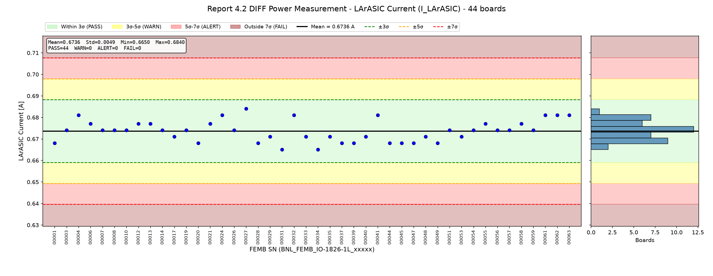
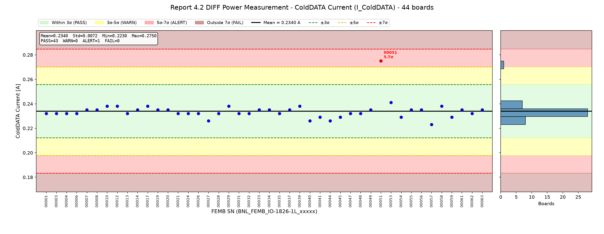
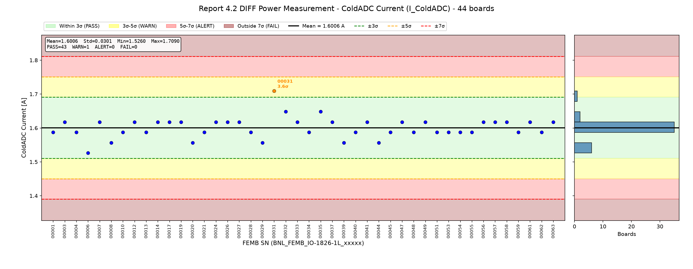
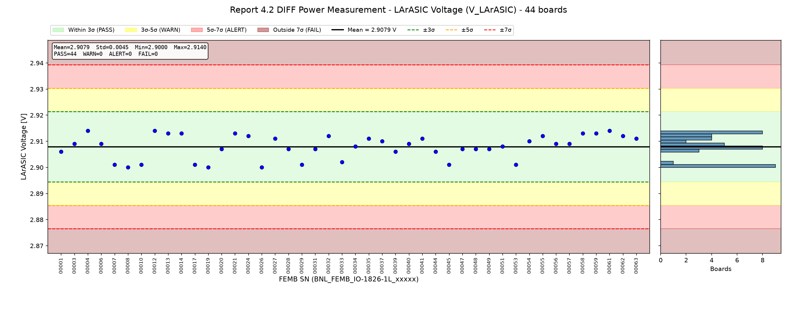
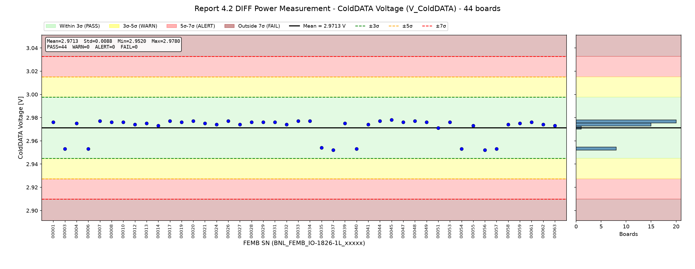
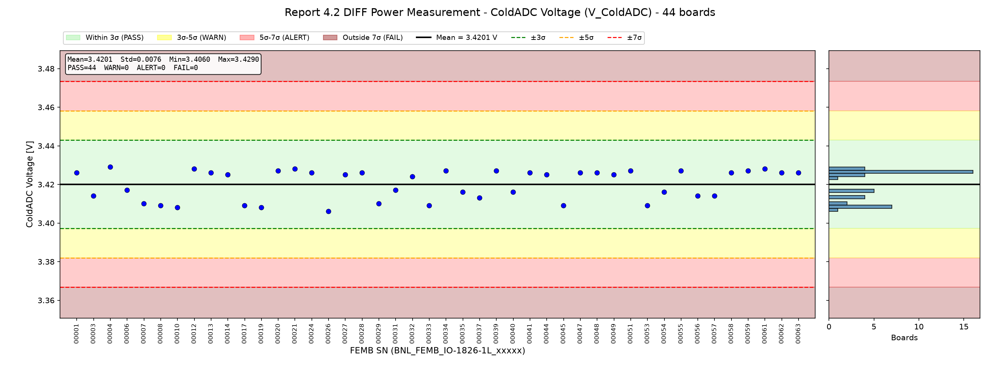
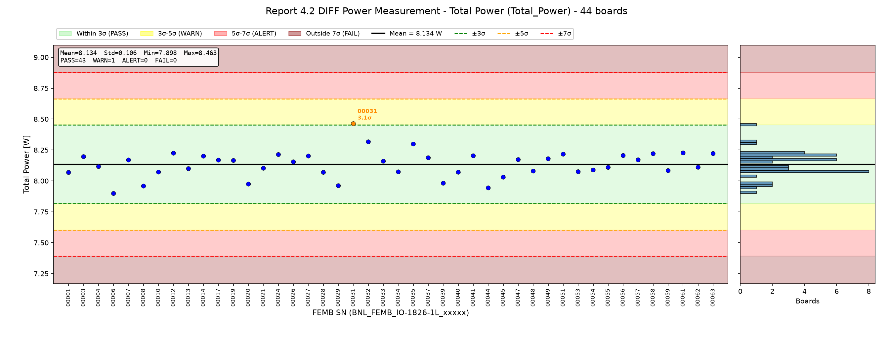
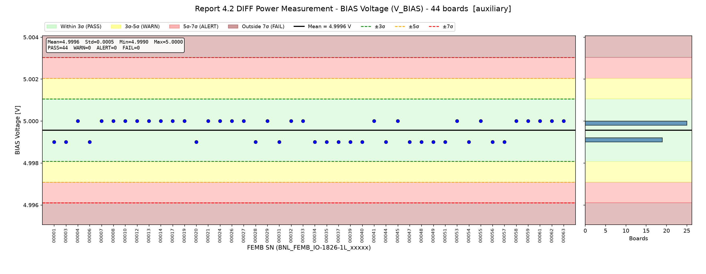
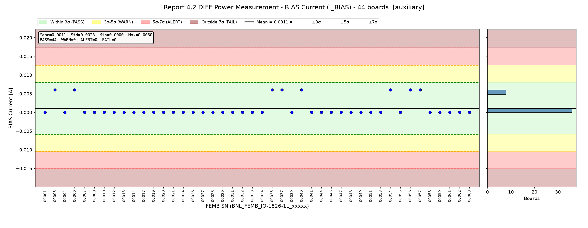

# FEMB QC Parameter Evaluation - Report Section 4.2: DIFF Power Measurement

**Board version:** FEMB-IO 1826-1L  
**Boards used:** 44 (latest passing test per board; excluded: 00046)  
**Test period:** 2026-07-27 23:48 - 2026-10-15 17:19  
**Generated:** 2026-10-16 16:37  
**Script:** `eval_4_2_diff_power.py`

## 1. Scope

Section 4.2 of the per-board checkout report is the power-supply reading taken while the FEMB is in the DIFF configuration of section 4.1 (ColdADC differential input, FE differential driver on, 900 mV baseline, 14 mV/fC, 2 µs, calibration pulse on). It has the same 17 numbers as sections 2.1 and 3.2: V_set / V_meas / I_meas / P_meas for the 4 rails (BIAS, LArASIC, ColdDATA, ColdADC), plus Total Power. In the CSV it is the third power block.

| Category | Parameters | Treatment |
|---|---|---|
| Core | I_meas & V_meas of LArASIC / ColdDATA / ColdADC, Total Power (7) | Statistical judgement |
| Auxiliary | V_meas & I_meas of BIAS (2) | Shown for reference; I_BIAS ≈ 0 is better served by a fixed limit |
| Not evaluated | V_set (4) | Configuration setpoints, constant |
| Not evaluated | P_meas (4) | Redundant (P = V × I) |

## 2. Judgement Method

For each parameter, mean and standard deviation (σ) are computed over all boards; each board is graded by its deviation |x − mean| / σ.

| Level | Deviation | Plot background |
|---|---|---|
| PASS | ≤ 3σ | green |
| WARN | 3σ – 5σ | yellow |
| ALERT | 5σ – 7σ | red |
| FAIL | > 7σ | dark red |

## 3. Summary

| Parameter | Role | Mean | Std | Min | Max | N unique | PASS | WARN | ALERT | FAIL | Flagged boards |
|---|---|---|---|---|---|---|---|---|---|---|---|
| I_LArASIC | core | 0.6736 A | 0.0049 | 0.6650 | 0.6840 | 7 | 44 | 0 | 0 | 0 | – |
| I_ColdDATA | core | 0.2340 A | 0.0072 | 0.2230 | 0.2750 | 8 | 43 | 0 | 1 | 0 | 00051 (ALERT 5.7σ) |
| I_ColdADC | core | 1.6006 A | 0.0301 | 1.5260 | 1.7090 | 6 | 43 | 1 | 0 | 0 | 00031 (WARN 3.6σ) |
| V_LArASIC | core | 2.9079 V | 0.0045 | 2.9000 | 2.9140 | 12 | 44 | 0 | 0 | 0 | – |
| V_ColdDATA | core | 2.9713 V | 0.0088 | 2.9520 | 2.9780 | 10 | 44 | 0 | 0 | 0 | – |
| V_ColdADC | core | 3.4201 V | 0.0076 | 3.4060 | 3.4290 | 14 | 44 | 0 | 0 | 0 | – |
| Total_Power | core | 8.134 W | 0.106 | 7.898 | 8.463 | 44 | 43 | 1 | 0 | 0 | 00031 (WARN 3.1σ) |
| V_BIAS | aux | 4.9996 V | 0.0005 | 4.9990 | 5.0000 | 2 | 44 | 0 | 0 | 0 | – |
| I_BIAS | aux | 0.0011 A | 0.0023 | 0.0000 | 0.0060 | 2 | 44 | 0 | 0 | 0 | – |

### Criteria (limits)

| Parameter | Unit | −7σ | −5σ | −3σ | Mean | +3σ | +5σ | +7σ |
|---|---|---|---|---|---|---|---|---|
| I_LArASIC | A | 0.6396 | 0.6493 | 0.6590 | 0.6736 | 0.6882 | 0.6979 | 0.7077 |
| I_ColdDATA | A | 0.1833 | 0.1978 | 0.2123 | 0.2340 | 0.2557 | 0.2702 | 0.2847 |
| I_ColdADC | A | 1.3900 | 1.4502 | 1.5103 | 1.6006 | 1.6908 | 1.7510 | 1.8112 |
| V_LArASIC | V | 2.8765 | 2.8855 | 2.8944 | 2.9079 | 2.9214 | 2.9303 | 2.9393 |
| V_ColdDATA | V | 2.9098 | 2.9274 | 2.9449 | 2.9713 | 2.9976 | 3.0152 | 3.0328 |
| V_ColdADC | V | 3.3667 | 3.3820 | 3.3972 | 3.4201 | 3.4429 | 3.4582 | 3.4734 |
| Total_Power | W | 7.391 | 7.603 | 7.815 | 8.134 | 8.452 | 8.664 | 8.877 |
| V_BIAS | V | 4.9961 | 4.9971 | 4.9981 | 4.9996 | 5.0011 | 5.0020 | 5.0030 |
| I_BIAS | A | -0.0151 | -0.0105 | -0.0059 | 0.0011 | 0.0080 | 0.0127 | 0.0173 |

## 4. Core Parameters

### 4.1 LArASIC Current (`I_LArASIC`)

LArASIC rail current.  
Mean = 0.6736 A, σ = 0.0049 A, range [0.6650, 0.6840], 7 distinct values over 44 boards.

All boards within 3σ.

### 4.2 ColdDATA Current (`I_ColdDATA`)

ColdDATA rail current.  
Mean = 0.2340 A, σ = 0.0072 A, range [0.2230, 0.2750], 8 distinct values over 44 boards.

| FEMB SN | Value | Deviation | Level |
|---|---|---|---|
| BNL_FEMB_IO-1826-1L_00051 | 0.2750 A | 5.7σ | **ALERT** |

### 4.3 ColdADC Current (`I_ColdADC`)

ColdADC rail current.  
Mean = 1.6006 A, σ = 0.0301 A, range [1.5260, 1.7090], 6 distinct values over 44 boards.

| FEMB SN | Value | Deviation | Level |
|---|---|---|---|
| BNL_FEMB_IO-1826-1L_00031 | 1.7090 A | 3.6σ | **WARN** |

### 4.4 LArASIC Voltage (`V_LArASIC`)

LArASIC rail voltage at the supply.  
Mean = 2.9079 V, σ = 0.0045 V, range [2.9000, 2.9140], 12 distinct values over 44 boards.

All boards within 3σ.

### 4.5 ColdDATA Voltage (`V_ColdDATA`)

ColdDATA rail voltage at the supply.  
Mean = 2.9713 V, σ = 0.0088 V, range [2.9520, 2.9780], 10 distinct values over 44 boards.

All boards within 3σ.

### 4.6 ColdADC Voltage (`V_ColdADC`)

ColdADC rail voltage at the supply.  
Mean = 3.4201 V, σ = 0.0076 V, range [3.4060, 3.4290], 14 distinct values over 44 boards.

All boards within 3σ.

### 4.7 Total Power (`Total_Power`)

Sum of rail powers.  
Mean = 8.134 W, σ = 0.106 W, range [7.898, 8.463], 44 distinct values over 44 boards.

| FEMB SN | Value | Deviation | Level |
|---|---|---|---|
| BNL_FEMB_IO-1826-1L_00031 | 8.463 W | 3.1σ | **WARN** |

## 5. Auxiliary Parameters

### 5.1 BIAS Voltage (`V_BIAS`)

BIAS rail voltage.  
Mean = 4.9996 V, σ = 0.0005 V, range [4.9990, 5.0000], 2 distinct values over 44 boards.

All boards within 3σ.

### 5.2 BIAS Current (`I_BIAS`)

BIAS rail current (≈ 0).  
Mean = 0.0011 A, σ = 0.0023 A, range [0.0000, 0.0060], 2 distinct values over 44 boards.

All boards within 3σ.

## 6. Observations

- **BNL_FEMB_IO-1826-1L_00031**: I_ColdADC 3.6σ (WARN); Total_Power 3.1σ (WARN)
- **BNL_FEMB_IO-1826-1L_00051**: I_ColdDATA 5.7σ (ALERT)
- Readout resolution is coarse (≤ 10 distinct values) for: I_LArASIC, I_ColdDATA, I_ColdADC, V_ColdDATA. σ is therefore small and quantized; a minimum tolerance tied to instrument resolution should be considered before using these limits.
- Flagged boards are still included in the statistics and inflate σ; re-deriving limits without them would tighten the criteria.

## Appendix A: Per-Board Judgement (core parameters)

| FEMB SN | Test time | I_LArASIC | I_ColdDATA | I_ColdADC | V_LArASIC | V_ColdDATA | V_ColdADC | Total_Power | Worst |
|---|---|---|---|---|---|---|---|---|---|
| BNL_FEMB_IO-1826-1L_00001 | 2026-07-28 15:21 | 1.2σ | 0.3σ | 0.5σ | 0.4σ | 0.5σ | 0.8σ | 0.6σ | PASS |
| BNL_FEMB_IO-1826-1L_00003 | 2026-07-28 15:21 | 0.1σ | 0.3σ | 0.5σ | 0.2σ | 2.1σ | 0.8σ | 0.6σ | PASS |
| BNL_FEMB_IO-1826-1L_00004 | 2026-08-03 22:20 | 1.5σ | 0.3σ | 0.5σ | 1.4σ | 0.4σ | 1.2σ | 0.2σ | PASS |
| BNL_FEMB_IO-1826-1L_00006 | 2026-07-28 20:07 | 0.7σ | 0.3σ | 2.5σ | 0.2σ | 2.1σ | 0.4σ | 2.2σ | PASS |
| BNL_FEMB_IO-1826-1L_00007 | 2026-09-11 18:46 | 0.1σ | 0.1σ | 0.5σ | 1.5σ | 0.7σ | 1.3σ | 0.3σ | PASS |
| BNL_FEMB_IO-1826-1L_00008 | 2026-07-28 20:24 | 0.1σ | 0.1σ | 1.5σ | 1.8σ | 0.5σ | 1.5σ | 1.7σ | PASS |
| BNL_FEMB_IO-1826-1L_00010 | 2026-07-28 00:58 | 0.1σ | 0.6σ | 0.5σ | 1.5σ | 0.5σ | 1.6σ | 0.6σ | PASS |
| BNL_FEMB_IO-1826-1L_00012 | 2026-07-29 22:28 | 0.7σ | 0.6σ | 0.5σ | 1.4σ | 0.3σ | 1.0σ | 0.9σ | PASS |
| BNL_FEMB_IO-1826-1L_00013 | 2026-07-28 14:53 | 0.7σ | 0.3σ | 0.5σ | 1.1σ | 0.4σ | 0.8σ | 0.3σ | PASS |
| BNL_FEMB_IO-1826-1L_00014 | 2026-07-28 20:07 | 0.1σ | 0.1σ | 0.5σ | 1.1σ | 0.2σ | 0.6σ | 0.6σ | PASS |
| BNL_FEMB_IO-1826-1L_00017 | 2026-09-11 19:03 | 0.5σ | 0.6σ | 0.5σ | 1.5σ | 0.7σ | 1.5σ | 0.3σ | PASS |
| BNL_FEMB_IO-1826-1L_00019 | 2026-07-28 15:07 | 0.1σ | 0.1σ | 0.5σ | 1.8σ | 0.5σ | 1.6σ | 0.3σ | PASS |
| BNL_FEMB_IO-1826-1L_00020 | 2026-09-11 19:03 | 1.2σ | 0.1σ | 1.5σ | 0.2σ | 0.7σ | 0.9σ | 1.5σ | PASS |
| BNL_FEMB_IO-1826-1L_00021 | 2026-07-29 22:36 | 0.7σ | 0.3σ | 0.5σ | 1.1σ | 0.4σ | 1.0σ | 0.3σ | PASS |
| BNL_FEMB_IO-1826-1L_00024 | 2026-09-11 19:03 | 1.5σ | 0.3σ | 0.5σ | 0.9σ | 0.3σ | 0.8σ | 0.7σ | PASS |
| BNL_FEMB_IO-1826-1L_00026 | 2026-07-28 15:21 | 0.1σ | 0.3σ | 0.5σ | 1.8σ | 0.7σ | 1.8σ | 0.2σ | PASS |
| BNL_FEMB_IO-1826-1L_00027 | 2026-09-11 18:46 | 2.1σ | 1.1σ | 0.5σ | 0.7σ | 0.3σ | 0.6σ | 0.6σ | PASS |
| BNL_FEMB_IO-1826-1L_00028 | 2026-07-28 00:03 | 1.2σ | 0.3σ | 0.5σ | 0.2σ | 0.5σ | 0.8σ | 0.6σ | PASS |
| BNL_FEMB_IO-1826-1L_00029 | 2026-07-28 19:55 | 0.5σ | 0.6σ | 1.5σ | 1.5σ | 0.5σ | 1.3σ | 1.6σ | PASS |
| BNL_FEMB_IO-1826-1L_00031 | 2026-07-28 00:58 | 1.8σ | 0.3σ | **3.6σ WARN** | 0.2σ | 0.5σ | 0.4σ | **3.1σ WARN** | WARN |
| BNL_FEMB_IO-1826-1L_00032 | 2026-07-28 15:36 | 1.5σ | 0.3σ | 1.6σ | 0.9σ | 0.3σ | 0.5σ | 1.7σ | PASS |
| BNL_FEMB_IO-1826-1L_00033 | 2026-09-17 22:09 | 0.5σ | 0.1σ | 0.5σ | 1.3σ | 0.7σ | 1.5σ | 0.2σ | PASS |
| BNL_FEMB_IO-1826-1L_00034 | 2026-09-17 22:09 | 1.8σ | 0.1σ | 0.5σ | 0.0σ | 0.7σ | 0.9σ | 0.6σ | PASS |
| BNL_FEMB_IO-1826-1L_00035 | 2026-09-11 18:46 | 0.5σ | 0.3σ | 1.6σ | 0.7σ | 2.0σ | 0.5σ | 1.5σ | PASS |
| BNL_FEMB_IO-1826-1L_00037 | 2026-07-28 00:03 | 1.2σ | 0.1σ | 0.5σ | 0.5σ | 2.2σ | 0.9σ | 0.5σ | PASS |
| BNL_FEMB_IO-1826-1L_00039 | 2026-07-28 20:41 | 1.2σ | 0.6σ | 1.5σ | 0.4σ | 0.4σ | 0.9σ | 1.4σ | PASS |
| BNL_FEMB_IO-1826-1L_00040 | 2026-07-28 20:41 | 0.5σ | 1.1σ | 0.5σ | 0.2σ | 2.1σ | 0.5σ | 0.6σ | PASS |
| BNL_FEMB_IO-1826-1L_00041 | 2026-07-28 20:24 | 1.5σ | 0.7σ | 0.5σ | 0.7σ | 0.3σ | 0.8σ | 0.7σ | PASS |
| BNL_FEMB_IO-1826-1L_00044 | 2026-07-28 15:07 | 1.2σ | 1.1σ | 1.5σ | 0.4σ | 0.7σ | 0.6σ | 1.8σ | PASS |
| BNL_FEMB_IO-1826-1L_00045 | 2026-07-28 14:53 | 1.2σ | 0.7σ | 0.5σ | 1.5σ | 0.8σ | 1.5σ | 1.0σ | PASS |
| BNL_FEMB_IO-1826-1L_00047 | 2026-07-27 23:48 | 1.2σ | 0.3σ | 0.5σ | 0.2σ | 0.5σ | 0.8σ | 0.4σ | PASS |
| BNL_FEMB_IO-1826-1L_00048 | 2026-07-28 14:53 | 0.5σ | 0.3σ | 0.5σ | 0.2σ | 0.7σ | 0.8σ | 0.5σ | PASS |
| BNL_FEMB_IO-1826-1L_00049 | 2026-07-28 19:55 | 1.2σ | 0.1σ | 0.5σ | 0.2σ | 0.5σ | 0.6σ | 0.4σ | PASS |
| BNL_FEMB_IO-1826-1L_00051 | 2026-10-15 17:19 | 0.1σ | **5.7σ ALERT** | 0.5σ | 0.0σ | 0.0σ | 0.9σ | 0.8σ | ALERT |
| BNL_FEMB_IO-1826-1L_00053 | 2026-07-28 15:36 | 0.5σ | 1.0σ | 0.5σ | 1.5σ | 0.5σ | 1.5σ | 0.6σ | PASS |
| BNL_FEMB_IO-1826-1L_00054 | 2026-07-28 00:58 | 0.1σ | 0.7σ | 0.5σ | 0.5σ | 2.1σ | 0.5σ | 0.4σ | PASS |
| BNL_FEMB_IO-1826-1L_00055 | 2026-07-28 00:58 | 0.7σ | 0.1σ | 0.5σ | 0.9σ | 0.2σ | 0.9σ | 0.2σ | PASS |
| BNL_FEMB_IO-1826-1L_00056 | 2026-07-28 20:24 | 0.1σ | 0.1σ | 0.5σ | 0.2σ | 2.2σ | 0.8σ | 0.7σ | PASS |
| BNL_FEMB_IO-1826-1L_00057 | 2026-07-28 15:07 | 0.1σ | 1.5σ | 0.5σ | 0.2σ | 2.1σ | 0.8σ | 0.3σ | PASS |
| BNL_FEMB_IO-1826-1L_00058 | 2026-09-17 22:09 | 0.7σ | 0.6σ | 0.5σ | 1.1σ | 0.3σ | 0.8σ | 0.8σ | PASS |
| BNL_FEMB_IO-1826-1L_00059 | 2026-08-03 18:53 | 0.1σ | 0.7σ | 0.5σ | 1.1σ | 0.4σ | 0.9σ | 0.5σ | PASS |
| BNL_FEMB_IO-1826-1L_00061 | 2026-10-09 17:53 | 1.5σ | 0.1σ | 0.5σ | 1.4σ | 0.5σ | 1.0σ | 0.9σ | PASS |
| BNL_FEMB_IO-1826-1L_00062 | 2026-07-27 23:48 | 1.5σ | 0.3σ | 0.5σ | 0.9σ | 0.3σ | 0.8σ | 0.2σ | PASS |
| BNL_FEMB_IO-1826-1L_00063 | 2026-07-28 19:55 | 1.5σ | 0.1σ | 0.5σ | 0.7σ | 0.2σ | 0.8σ | 0.8σ | PASS |

## Appendix B: Output Files

- `output/criteria_4_2.csv` – mean, σ and 3σ/5σ/7σ limits per parameter
- `output/judgement_4_2.csv` – value, deviation and level per board per parameter
- `output/plot_4_2_*.png` – distribution plots
