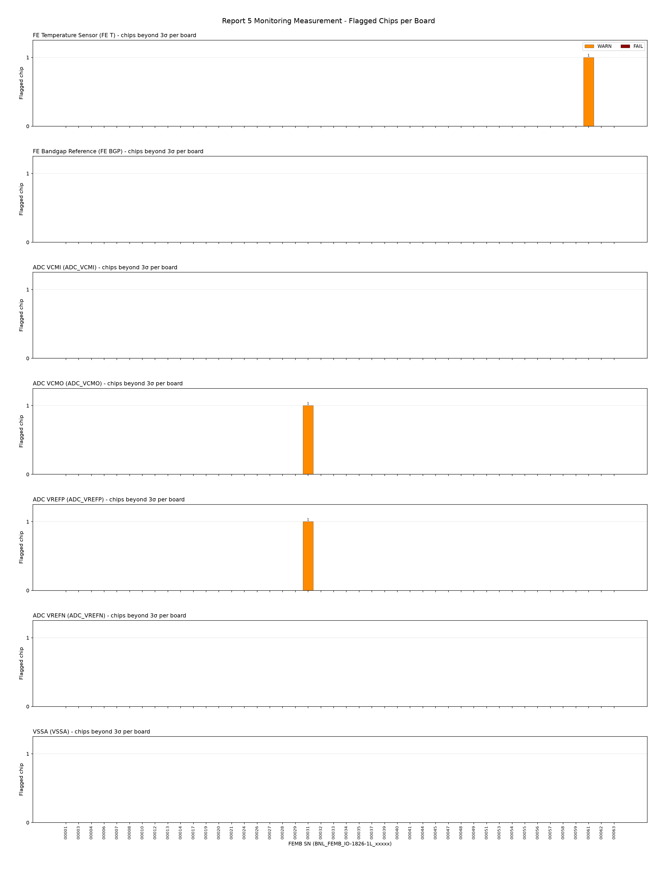
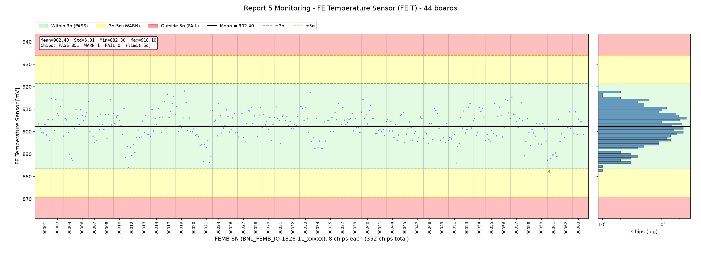
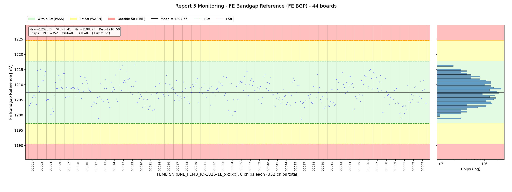
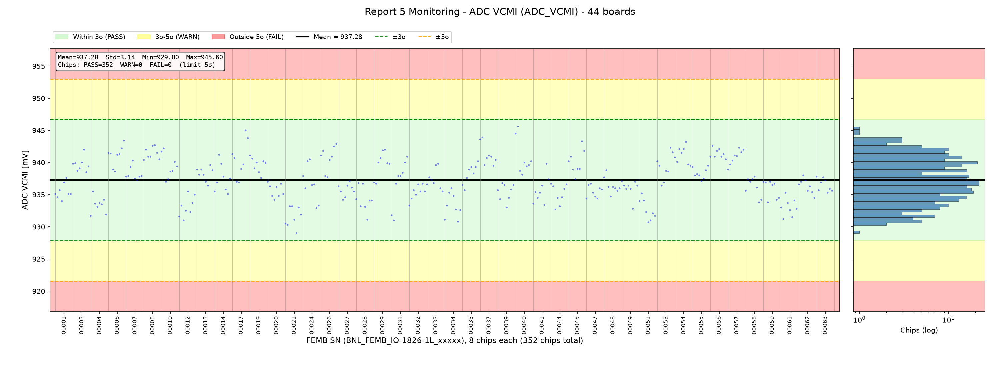
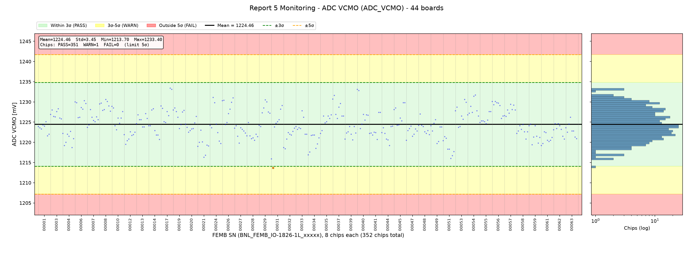
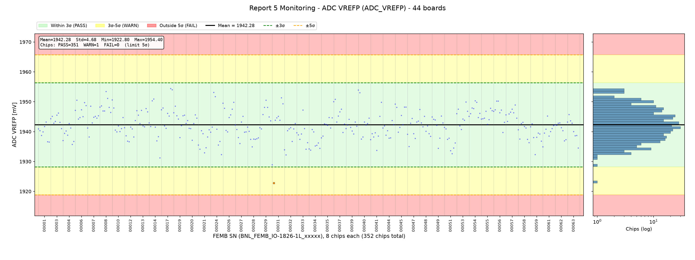
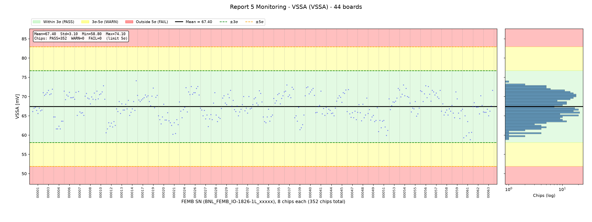

# FEMB QC Parameter Evaluation - Report Section 5: Monitoring Measurement

**Board version:** FEMB-IO 1826-1L  
**Boards used:** 44 (latest passing test per board; excluded: 00046)  
**Chips:** 44 × 8 = 352  
**Test period:** 2026-07-27 23:48 - 2026-10-15 17:19  
**Configuration:** monitoring path through the FEMB monitor ADC, 200 mV baseline, 14 mV/fC (Mon_200mVBL_14_0mVfC)  
**Generated:** 2026-10-16 16:37  
**Script:** `eval_5_monitoring.py`

## 1. Scope

Part 05 of the checkout report reads the internal monitoring points of the 8 ASIC pairs on the FEMB (LArASIC + ColdADC, `ASIC #` 0–7) through the board monitor ADC, in mV. Each parameter has one value per chip, i.e. 8 values per board; every chip is judged against the pooled distribution of all chips of all boards.

| Parameter | Description |
|---|---|
| `FE T` – FE Temperature Sensor | LArASIC on-chip temperature sensor output, mV (depends on ambient temperature) |
| `FE BGP` – FE Bandgap Reference | LArASIC bandgap reference voltage, mV |
| `ADC_VCMI` – ADC VCMI | ColdADC input common-mode voltage, mV |
| `ADC_VCMO` – ADC VCMO | ColdADC output common-mode voltage, mV |
| `ADC_VREFP` – ADC VREFP | ColdADC positive reference voltage, mV |
| `ADC_VREFN` – ADC VREFN | ColdADC negative reference voltage, mV |
| `VSSA` – VSSA | ColdADC analog ground (VSSA) as seen by the monitor, mV |

## 2. Judgement Method

For each parameter the mean and σ are computed over all 352 chips pooled together; each chip is graded by |x − mean| / σ. A board takes the worst level among its chips.

Per-ASIC monitoring parameters use **5σ as the limit**: a chip beyond 5σ fails (same as the channel-level noise / pulse parameters; board-level power and LDO parameters keep the wider 7σ limit).

| Level | Deviation | Plot background |
|---|---|---|
| PASS | ≤ 3σ | green |
| WARN | 3σ – 5σ | yellow |
| FAIL | > 5σ | red |

For a Gaussian distribution, about 0.27 % of chips (≈ 1 of 352) are expected beyond 3σ by chance, so isolated WARN chips are normal.

## 3. Summary

| Parameter | Mean | Std | Min | Max | PASS | WARN | FAIL | Boards with ≥1 FAIL |
|---|---|---|---|---|---|---|---|---|
| `FE T` | 902.40 | 6.31 | 882.30 | 918.10 | 351 | 1 | 0 | – |
| `FE BGP` | 1207.55 | 3.41 | 1198.70 | 1216.50 | 352 | 0 | 0 | – |
| `ADC_VCMI` | 937.28 | 3.14 | 929.00 | 945.60 | 352 | 0 | 0 | – |
| `ADC_VCMO` | 1224.46 | 3.45 | 1213.70 | 1233.40 | 351 | 1 | 0 | – |
| `ADC_VREFP` | 1942.28 | 4.68 | 1922.80 | 1954.40 | 351 | 1 | 0 | – |
| `ADC_VREFN` | 501.51 | 2.98 | 494.50 | 507.80 | 352 | 0 | 0 | – |
| `VSSA` | 67.40 | 3.10 | 58.80 | 74.10 | 352 | 0 | 0 | – |

### Criteria (limits, mV)

| Parameter | −5σ (FAIL) | −3σ | Mean | +3σ | +5σ (FAIL) |
|---|---|---|---|---|---|
| `FE T` | 870.86 | 883.48 | 902.40 | 921.32 | 933.94 |
| `FE BGP` | 1190.53 | 1197.34 | 1207.55 | 1217.77 | 1224.58 |
| `ADC_VCMI` | 921.58 | 927.86 | 937.28 | 946.70 | 952.98 |
| `ADC_VCMO` | 1207.20 | 1214.10 | 1224.46 | 1234.81 | 1241.71 |
| `ADC_VREFP` | 1918.86 | 1928.23 | 1942.28 | 1956.34 | 1965.71 |
| `ADC_VREFN` | 486.59 | 492.56 | 501.51 | 510.46 | 516.42 |
| `VSSA` | 51.89 | 58.09 | 67.40 | 76.71 | 82.92 |

### Flagged chips per board

## 4. Parameters

### 4.1 FE Temperature Sensor (`FE T`)

Mean = 902.40, σ = 6.31, range [882.30, 918.10] mV. Spread of per-board means: σ = 4.61; spread of per-chip means across boards: σ = 0.90.

1 chip(s) beyond 3σ:

| FEMB SN | Chip | Value | Deviation | Level |
|---|---|---|---|---|
| BNL_FEMB_IO-1826-1L_00061 | 1 | 882.30 | 3.2σ | WARN |

### 4.2 FE Bandgap Reference (`FE BGP`)

Mean = 1207.55, σ = 3.41, range [1198.70, 1216.50] mV. Spread of per-board means: σ = 2.54; spread of per-chip means across boards: σ = 0.31.

All chips within 3σ.

### 4.3 ADC VCMI (`ADC_VCMI`)

Mean = 937.28, σ = 3.14, range [929.00, 945.60] mV. Spread of per-board means: σ = 2.72; spread of per-chip means across boards: σ = 0.20.

All chips within 3σ.

### 4.4 ADC VCMO (`ADC_VCMO`)

Mean = 1224.46, σ = 3.45, range [1213.70, 1233.40] mV. Spread of per-board means: σ = 2.82; spread of per-chip means across boards: σ = 0.20.

1 chip(s) beyond 3σ:

| FEMB SN | Chip | Value | Deviation | Level |
|---|---|---|---|---|
| BNL_FEMB_IO-1826-1L_00031 | 1 | 1213.70 | 3.1σ | WARN |

### 4.5 ADC VREFP (`ADC_VREFP`)

Mean = 1942.28, σ = 4.68, range [1922.80, 1954.40] mV. Spread of per-board means: σ = 3.12; spread of per-chip means across boards: σ = 0.26.

1 chip(s) beyond 3σ:

| FEMB SN | Chip | Value | Deviation | Level |
|---|---|---|---|---|
| BNL_FEMB_IO-1826-1L_00031 | 1 | 1922.80 | 4.2σ | WARN |

### 4.6 ADC VREFN (`ADC_VREFN`)

Mean = 501.51, σ = 2.98, range [494.50, 507.80] mV. Spread of per-board means: σ = 2.67; spread of per-chip means across boards: σ = 0.25.

All chips within 3σ.

### 4.7 VSSA (`VSSA`)

Mean = 67.40, σ = 3.10, range [58.80, 74.10] mV. Spread of per-board means: σ = 2.71; spread of per-chip means across boards: σ = 0.31.

All chips within 3σ.

## 5. Observations

- **FE T**: no chip beyond 5σ.
- **FE BGP**: no chip beyond 5σ.
- **ADC_VCMI**: no chip beyond 5σ.
- **ADC_VCMO**: no chip beyond 5σ.
- **ADC_VREFP**: no chip beyond 5σ.
- **ADC_VREFN**: no chip beyond 5σ.
- **VSSA**: no chip beyond 5σ.
- `FE T` is a temperature-sensor voltage: board-to-board shifts can come from the room / board temperature at test time rather than from the chip, so a whole-board offset on `FE T` alone is not by itself a chip defect.

## Appendix A: Per-Board Judgement

Each cell: number of chips WARN / FAIL, and worst deviation.

| FEMB SN | Test time | `FE T` | `FE BGP` | `ADC_VCMI` | `ADC_VCMO` | `ADC_VREFP` | `ADC_VREFN` | `VSSA` | Worst |
|---|---|---|---|---|---|---|---|---|---|
| BNL_FEMB_IO-1826-1L_00001 | 2026-07-28 15:21 | 0/0 (1.0σ) | 0/0 (1.3σ) | 0/0 (1.0σ) | 0/0 (0.8σ) | 0/0 (1.2σ) | 0/0 (1.3σ) | 0/0 (0.6σ) | PASS |
| BNL_FEMB_IO-1826-1L_00003 | 2026-07-28 15:21 | 0/0 (2.0σ) | 0/0 (2.2σ) | 0/0 (1.5σ) | 0/0 (1.1σ) | 0/0 (0.8σ) | 0/0 (1.4σ) | 0/0 (1.4σ) | PASS |
| BNL_FEMB_IO-1826-1L_00004 | 2026-08-03 22:20 | 0/0 (2.4σ) | 0/0 (2.2σ) | 0/0 (1.8σ) | 0/0 (1.7σ) | 0/0 (1.4σ) | 0/0 (1.9σ) | 0/0 (1.9σ) | PASS |
| BNL_FEMB_IO-1826-1L_00006 | 2026-07-28 20:07 | 0/0 (1.2σ) | 0/0 (1.8σ) | 0/0 (1.9σ) | 0/0 (1.7σ) | 0/0 (1.8σ) | 0/0 (1.4σ) | 0/0 (1.3σ) | PASS |
| BNL_FEMB_IO-1826-1L_00007 | 2026-09-11 18:46 | 0/0 (1.8σ) | 0/0 (1.8σ) | 0/0 (1.0σ) | 0/0 (1.1σ) | 0/0 (1.3σ) | 0/0 (1.0σ) | 0/0 (1.3σ) | PASS |
| BNL_FEMB_IO-1826-1L_00008 | 2026-07-28 20:24 | 0/0 (1.9σ) | 0/0 (1.5σ) | 0/0 (1.7σ) | 0/0 (1.8σ) | 0/0 (2.4σ) | 0/0 (1.5σ) | 0/0 (1.1σ) | PASS |
| BNL_FEMB_IO-1826-1L_00010 | 2026-07-28 00:58 | 0/0 (1.3σ) | 0/0 (1.4σ) | 0/0 (1.6σ) | 0/0 (1.3σ) | 0/0 (1.8σ) | 0/0 (1.6σ) | 0/0 (1.7σ) | PASS |
| BNL_FEMB_IO-1826-1L_00012 | 2026-07-29 22:28 | 0/0 (2.9σ) | 0/0 (2.5σ) | 0/0 (2.0σ) | 0/0 (1.4σ) | 0/0 (1.2σ) | 0/0 (1.9σ) | 0/0 (2.2σ) | PASS |
| BNL_FEMB_IO-1826-1L_00013 | 2026-07-28 14:53 | 0/0 (0.8σ) | 0/0 (1.2σ) | 0/0 (0.7σ) | 0/0 (0.8σ) | 0/0 (1.2σ) | 0/0 (0.7σ) | 0/0 (0.6σ) | PASS |
| BNL_FEMB_IO-1826-1L_00014 | 2026-07-28 20:07 | 0/0 (1.3σ) | 0/0 (1.7σ) | 0/0 (1.2σ) | 0/0 (1.1σ) | 0/0 (2.4σ) | 0/0 (1.0σ) | 0/0 (2.2σ) | PASS |
| BNL_FEMB_IO-1826-1L_00017 | 2026-09-11 19:03 | 0/0 (2.3σ) | 0/0 (2.5σ) | 0/0 (2.5σ) | 0/0 (2.6σ) | 0/0 (2.6σ) | 0/0 (1.7σ) | 0/0 (1.0σ) | PASS |
| BNL_FEMB_IO-1826-1L_00019 | 2026-07-28 15:07 | 0/0 (2.5σ) | 0/0 (2.6σ) | 0/0 (1.2σ) | 0/0 (1.2σ) | 0/0 (1.3σ) | 0/0 (1.2σ) | 0/0 (1.5σ) | PASS |
| BNL_FEMB_IO-1826-1L_00020 | 2026-09-11 19:03 | 0/0 (0.7σ) | 0/0 (1.5σ) | 0/0 (1.0σ) | 0/0 (0.6σ) | 0/0 (1.1σ) | 0/0 (1.6σ) | 0/0 (1.5σ) | PASS |
| BNL_FEMB_IO-1826-1L_00021 | 2026-07-29 22:36 | 0/0 (2.6σ) | 0/0 (1.8σ) | 0/0 (2.6σ) | 0/0 (2.4σ) | 0/0 (2.0σ) | 0/0 (2.1σ) | 0/0 (2.3σ) | PASS |
| BNL_FEMB_IO-1826-1L_00024 | 2026-09-11 19:03 | 0/0 (1.6σ) | 0/0 (0.9σ) | 0/0 (1.4σ) | 0/0 (1.9σ) | 0/0 (2.3σ) | 0/0 (1.0σ) | 0/0 (1.6σ) | PASS |
| BNL_FEMB_IO-1826-1L_00026 | 2026-07-28 15:21 | 0/0 (1.2σ) | 0/0 (1.6σ) | 0/0 (1.8σ) | 0/0 (1.9σ) | 0/0 (1.6σ) | 0/0 (2.0σ) | 0/0 (1.7σ) | PASS |
| BNL_FEMB_IO-1826-1L_00027 | 2026-09-11 18:46 | 0/0 (1.1σ) | 0/0 (1.1σ) | 0/0 (1.0σ) | 0/0 (1.3σ) | 0/0 (1.3σ) | 0/0 (1.3σ) | 0/0 (1.7σ) | PASS |
| BNL_FEMB_IO-1826-1L_00028 | 2026-07-28 00:03 | 0/0 (1.3σ) | 0/0 (1.1σ) | 0/0 (2.0σ) | 0/0 (1.1σ) | 0/0 (1.6σ) | 0/0 (1.0σ) | 0/0 (1.3σ) | PASS |
| BNL_FEMB_IO-1826-1L_00029 | 2026-07-28 19:55 | 0/0 (1.0σ) | 0/0 (1.3σ) | 0/0 (1.5σ) | 0/0 (1.8σ) | 0/0 (1.8σ) | 0/0 (1.4σ) | 0/0 (1.4σ) | PASS |
| BNL_FEMB_IO-1826-1L_00031 | 2026-07-28 00:58 | 0/0 (1.4σ) | 0/0 (0.8σ) | 0/0 (2.0σ) | 1/0 (3.1σ) | 1/0 (4.2σ) | 0/0 (1.3σ) | 0/0 (0.8σ) | WARN |
| BNL_FEMB_IO-1826-1L_00032 | 2026-07-28 15:36 | 0/0 (0.7σ) | 0/0 (1.2σ) | 0/0 (1.3σ) | 0/0 (1.8σ) | 0/0 (2.2σ) | 0/0 (0.9σ) | 0/0 (0.8σ) | PASS |
| BNL_FEMB_IO-1826-1L_00033 | 2026-09-17 22:09 | 0/0 (2.4σ) | 0/0 (1.5σ) | 0/0 (0.8σ) | 0/0 (1.0σ) | 0/0 (1.7σ) | 0/0 (1.4σ) | 0/0 (1.3σ) | PASS |
| BNL_FEMB_IO-1826-1L_00034 | 2026-09-17 22:09 | 0/0 (1.6σ) | 0/0 (2.2σ) | 0/0 (2.1σ) | 0/0 (2.2σ) | 0/0 (1.8σ) | 0/0 (1.7σ) | 0/0 (1.4σ) | PASS |
| BNL_FEMB_IO-1826-1L_00035 | 2026-09-11 18:46 | 0/0 (1.0σ) | 0/0 (1.5σ) | 0/0 (0.9σ) | 0/0 (0.7σ) | 0/0 (0.9σ) | 0/0 (0.9σ) | 0/0 (1.1σ) | PASS |
| BNL_FEMB_IO-1826-1L_00037 | 2026-07-28 00:03 | 0/0 (1.6σ) | 0/0 (2.0σ) | 0/0 (2.1σ) | 0/0 (2.1σ) | 0/0 (1.8σ) | 0/0 (1.7σ) | 0/0 (1.8σ) | PASS |
| BNL_FEMB_IO-1826-1L_00039 | 2026-07-28 20:41 | 0/0 (0.9σ) | 0/0 (1.1σ) | 0/0 (1.4σ) | 0/0 (1.1σ) | 0/0 (0.7σ) | 0/0 (1.7σ) | 0/0 (1.9σ) | PASS |
| BNL_FEMB_IO-1826-1L_00040 | 2026-07-28 20:41 | 0/0 (1.9σ) | 0/0 (1.7σ) | 0/0 (2.6σ) | 0/0 (2.5σ) | 0/0 (2.5σ) | 0/0 (2.1σ) | 0/0 (1.6σ) | PASS |
| BNL_FEMB_IO-1826-1L_00041 | 2026-07-28 20:24 | 0/0 (0.7σ) | 0/0 (1.4σ) | 0/0 (1.2σ) | 0/0 (1.1σ) | 0/0 (1.8σ) | 0/0 (0.8σ) | 0/0 (1.3σ) | PASS |
| BNL_FEMB_IO-1826-1L_00044 | 2026-07-28 15:07 | 0/0 (1.0σ) | 0/0 (1.3σ) | 0/0 (1.5σ) | 0/0 (1.5σ) | 0/0 (1.0σ) | 0/0 (1.5σ) | 0/0 (0.8σ) | PASS |
| BNL_FEMB_IO-1826-1L_00045 | 2026-07-28 14:53 | 0/0 (1.2σ) | 0/0 (1.4σ) | 0/0 (1.9σ) | 0/0 (1.5σ) | 0/0 (1.5σ) | 0/0 (1.5σ) | 0/0 (1.4σ) | PASS |
| BNL_FEMB_IO-1826-1L_00047 | 2026-07-27 23:48 | 0/0 (1.1σ) | 0/0 (2.6σ) | 0/0 (0.9σ) | 0/0 (1.1σ) | 0/0 (1.6σ) | 0/0 (1.2σ) | 0/0 (1.4σ) | PASS |
| BNL_FEMB_IO-1826-1L_00048 | 2026-07-28 14:53 | 0/0 (1.2σ) | 0/0 (1.7σ) | 0/0 (0.8σ) | 0/0 (0.7σ) | 0/0 (1.1σ) | 0/0 (1.6σ) | 0/0 (1.2σ) | PASS |
| BNL_FEMB_IO-1826-1L_00049 | 2026-07-28 19:55 | 0/0 (1.1σ) | 0/0 (1.6σ) | 0/0 (1.4σ) | 0/0 (1.4σ) | 0/0 (1.7σ) | 0/0 (1.5σ) | 0/0 (1.3σ) | PASS |
| BNL_FEMB_IO-1826-1L_00051 | 2026-10-15 17:19 | 0/0 (2.6σ) | 0/0 (1.4σ) | 0/0 (2.1σ) | 0/0 (2.5σ) | 0/0 (2.1σ) | 0/0 (1.9σ) | 0/0 (2.4σ) | PASS |
| BNL_FEMB_IO-1826-1L_00053 | 2026-07-28 15:36 | 0/0 (1.6σ) | 0/0 (1.9σ) | 0/0 (1.6σ) | 0/0 (1.8σ) | 0/0 (1.6σ) | 0/0 (2.0σ) | 0/0 (1.5σ) | PASS |
| BNL_FEMB_IO-1826-1L_00054 | 2026-07-28 00:58 | 0/0 (1.3σ) | 0/0 (1.5σ) | 0/0 (1.9σ) | 0/0 (2.1σ) | 0/0 (1.7σ) | 0/0 (1.7σ) | 0/0 (1.8σ) | PASS |
| BNL_FEMB_IO-1826-1L_00055 | 2026-07-28 00:58 | 0/0 (1.6σ) | 0/0 (1.6σ) | 0/0 (0.7σ) | 0/0 (0.9σ) | 0/0 (1.2σ) | 0/0 (0.4σ) | 0/0 (0.8σ) | PASS |
| BNL_FEMB_IO-1826-1L_00056 | 2026-07-28 20:24 | 0/0 (1.9σ) | 0/0 (2.2σ) | 0/0 (1.7σ) | 0/0 (1.6σ) | 0/0 (1.7σ) | 0/0 (1.7σ) | 0/0 (1.7σ) | PASS |
| BNL_FEMB_IO-1826-1L_00057 | 2026-07-28 15:07 | 0/0 (2.1σ) | 0/0 (1.9σ) | 0/0 (1.6σ) | 0/0 (1.4σ) | 0/0 (1.4σ) | 0/0 (1.5σ) | 0/0 (1.4σ) | PASS |
| BNL_FEMB_IO-1826-1L_00058 | 2026-09-17 22:09 | 0/0 (2.1σ) | 0/0 (2.0σ) | 0/0 (1.1σ) | 0/0 (1.1σ) | 0/0 (1.3σ) | 0/0 (0.8σ) | 0/0 (0.7σ) | PASS |
| BNL_FEMB_IO-1826-1L_00059 | 2026-08-03 18:53 | 0/0 (1.3σ) | 0/0 (1.1σ) | 0/0 (1.1σ) | 0/0 (1.5σ) | 0/0 (2.1σ) | 0/0 (1.2σ) | 0/0 (1.2σ) | PASS |
| BNL_FEMB_IO-1826-1L_00061 | 2026-10-09 17:53 | 1/0 (3.2σ) | 0/0 (2.5σ) | 0/0 (1.9σ) | 0/0 (1.5σ) | 0/0 (1.6σ) | 0/0 (2.3σ) | 0/0 (2.8σ) | WARN |
| BNL_FEMB_IO-1826-1L_00062 | 2026-07-27 23:48 | 0/0 (1.1σ) | 0/0 (1.0σ) | 0/0 (0.9σ) | 0/0 (1.1σ) | 0/0 (1.1σ) | 0/0 (1.0σ) | 0/0 (0.9σ) | PASS |
| BNL_FEMB_IO-1826-1L_00063 | 2026-07-28 19:55 | 0/0 (1.0σ) | 0/0 (1.1σ) | 0/0 (0.6σ) | 0/0 (1.0σ) | 0/0 (1.7σ) | 0/0 (0.5σ) | 0/0 (1.4σ) | PASS |

## Appendix B: Output Files

- `output/criteria_5.csv` – mean, σ and 3σ/5σ limits per parameter
- `output/judgement_5_chips.csv` – every chip beyond 3σ (board, chip, value, deviation, level)
- `output/judgement_5_boards.csv` – per-board counts and worst level
- `output/plot_5_*.png` – distribution plots and per-board summary
